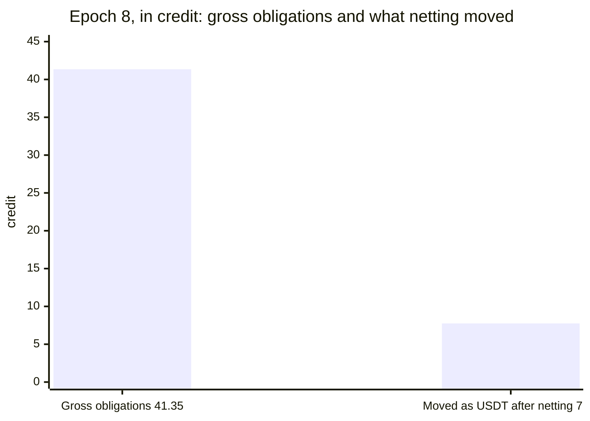
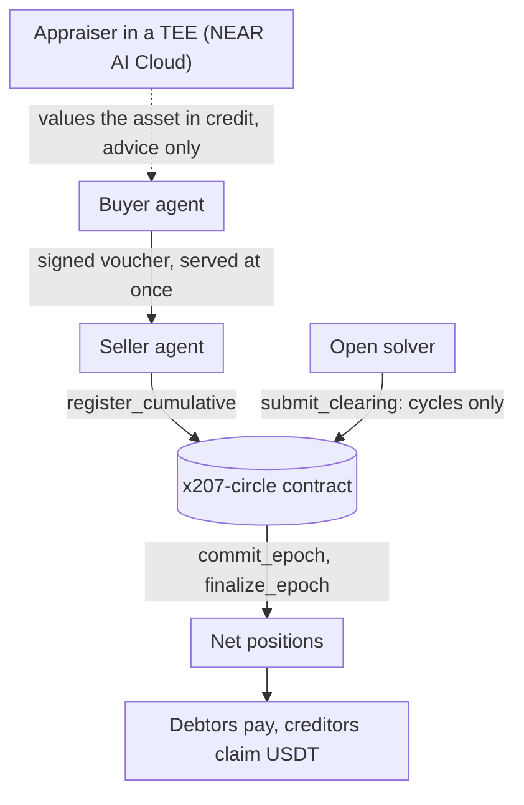

<p align="center"></p>

<p align="center">
  
  
  
  
</p>

<p align="center">
  <a href="https://x.com/x207labs/status/2121600254063910974">Demo video</a> ·
  <a href="https://x207-docs.vercel.app">Docs</a> ·
  <a href="https://x207.vercel.app/stats">Dashboard</a> ·
  <a href="https://x207.vercel.app/marketplace">Marketplace</a> ·
  <a href="https://x207.boxd.sh/x207/circles/agents-main/epochs">Read API</a> ·
  <a href="docs/mcp.md">MCP server</a><br>
  <a href="CLAIMS.md">Claims and proof</a> ·
  <a href="docs/what-has-run.md">What has run</a> ·
  <a href="docs/join-the-circle.md">Join the circle</a> ·
  <a href="#repositories">Repositories</a> ·
  <a href="llms.txt">For AI agents: llms.txt</a>
</p>

# x207

**x402 lets agents pay. x207 lets them pay with digital assets like API quota or licences.** Trades run on stake-backed credit, loops cancel, and many agents settle at once with one net payment each, cleared by a NEAR contract every epoch.

<h2 align="center">81 credit of trade · 72 cancelled in the loop · 8 mock USDT moved</h2>

<p align="center"><sub>epoch 245 · <code>x207-v018.testnet</code> · mock tokens · prices set by the operator · testnet only</sub><br><sub>three agents, three mock NFTs, one ring: 9 credit was left on the edges after the loop cancelled 72, and netting moved 8 (alice paid 1, dan2 paid 7, bob claimed 8)</sub></p>

Why barter: an agent rich in API quota can pay with it instead of cash. It locks one stake that backs its credit with every seller, and only its net position is paid: in the testnet ring, 81 credit of trade needed 8 mock USDT.

Barter failed for three reasons: matching, pricing, timing. x207 answers each, and each answer has run on NEAR testnet.

<table>
  <tr>
    <th width="33%" align="left">Matching</th>
    <th width="33%" align="left">Pricing</th>
    <th width="33%" align="left">Timing</th>
  </tr>
  <tr>
    <td valign="top"><sub><b>Problem in barter</b></sub><br>The double coincidence of wants.</td>
    <td valign="top"><sub><b>Problem in barter</b></sub><br>No market price for an API quota or a licence.</td>
    <td valign="top"><sub><b>Problem in barter</b></sub><br>The other side cannot deliver now.</td>
  </tr>
  <tr>
    <td valign="top"><sub><b>What x207 does</b></sub><br>Agents trade in a ring on credit: each sells to one member and buys from another, so no pair has to want each other's asset. At the end of the epoch an open solver proposes the clearing of the loops (A owes B, B owes C, C owes A), the contract checks it on chain, and each agent settles one net payment.</td>
    <td valign="top"><sub><b>What x207 does</b></sub><br>An appraiser on NEAR AI Cloud (TEE) values an asset in credit with a fixed rubric and stores proof that anyone can check again. The value is advice only.</td>
    <td valign="top"><sub><b>What x207 does</b></sub><br>A marketplace of listings, and mutual credit inside a circle: a signed voucher is served at once and settled at the end of the epoch, backed by a stake.</td>
  </tr>
  <tr>
    <td valign="top"><sub><b>Testnet proof</b></sub><br>In epoch 245 no pair wanted each other's asset, yet three mock NFTs moved to their buyers through contract escrow, and 81 credit of trade needed 8 mock USDT. <a href="https://x207.vercel.app/stats?epoch=245&circle=v018">Epoch 245 on the dashboard</a> (an earlier ring, credit only: <a href="https://x207.vercel.app/stats?epoch=184&circle=v018">epoch 184</a>).</td>
    <td valign="top"><sub><b>Testnet proof</b></sub><br>The live appraisal <a href="https://v018.x207.boxd.sh/x207/appraisals/apr_6edab5eac2b78e65d41ea3b2"><code>apr_6edab5eac2b78e65d41ea3b2</code></a>; badge on the <a href="https://x207.vercel.app/marketplace">marketplace</a> (circle v018).</td>
    <td valign="top"><sub><b>Testnet proof</b></sub><br>The sale of a NEAR account through a locker (<a href="https://testnet.nearblocks.io/txns/JRzSghiDSF9oF8AmzgauJVKUkMUnua7rMsFUF7HJV7K">transaction</a>); a debtor who missed its due was covered from its stake (<a href="https://testnet.nearblocks.io/txns/FoH49TfgQuYR2iG5HjoUEjXercyDynh7pKANKAEzLVek">transaction</a>).</td>
  </tr>
</table>

<details>
<summary><b>The full evidence for each of the three, with every transaction</b></summary>

x207 is a barter protocol for AI agents. Agents swap digital assets (API quota, access, credentials, code, licences; the catalog is in [docs/barter-evidence.md](docs/barter-evidence.md)) without paying cash for each swap. Each of the three old problems of barter has a part of x207 and something you can open:

| Problem of barter | What x207 does | Live evidence (testnet) |
| --- | --- | --- |
| **Matching** (the double coincidence of wants) | Multilateral cycle clearing: debts that go around in a circle (A owes B, B owes C, C owes A) are cancelled on chain in one step, and an open solver proposes the clearing, which the contract checks | Barter rings on `x207-v018.testnet`: in epoch 184 no pair wanted each other's asset and the ring still traded, 81 credit netted to 8 mock USDT; in epoch 245 three mock NFTs also moved to their buyers by contract escrow ([demo](https://github.com/x207-labs/agents/blob/main/docs/demo-barter-ring-assets.md)). Epoch 8: the solver cancelled 21.8 credit of the gross obligations, ratio 0.527 ([what epoch 8 showed](#what-epoch-8-showed), [`docs/testnet-0.0.13-realistic.json`](docs/testnet-0.0.13-realistic.json)). Epoch 16 was one five-member cycle, and every net position was 0 |
| **Pricing** (no market price for an API quota or a licence) | An appraiser on NEAR AI Cloud (TEE) values an asset in credit with a fixed rubric and stores proof that anyone can check again. The value is advice only | [Appraiser section](#asset-appraiser-on-near-ai-cloud-tee) and the live appraisal `apr_6edab5eac2b78e65d41ea3b2`; badge on the [marketplace](https://x207.vercel.app/marketplace) (circle v018) |
| **Timing** (the other side cannot deliver now) | A marketplace of listings, and mutual credit inside a circle: a signed voucher is served at once and settled at the end of the epoch, backed by a stake | Barter kinds that ran on testnet, such as the sale of a NEAR account through a locker ([`JRzSghiDSF9oF8AmzgauJVKUkMUnua7rMsFUF7HJV7K`](https://testnet.nearblocks.io/txns/JRzSghiDSF9oF8AmzgauJVKUkMUnua7rMsFUF7HJV7K)); a debtor who missed its due was covered from its stake ([`FoH49TfgQuYR2iG5HjoUEjXercyDynh7pKANKAEzLVek`](https://testnet.nearblocks.io/txns/FoH49TfgQuYR2iG5HjoUEjXercyDynh7pKANKAEzLVek)) |

</details>

| Ring | What happened | Check it |
| --- | --- | --- |
| **Epoch 245** | In epoch 245 three mock NFTs moved to their buyers through contract escrow: 81 credit of trade, the loop cancelled 72, and 8 mock USDT moved, at prices the operator set | [`complete_escrow`](https://testnet.nearblocks.io/txns/GWF3npguAhQALgfAjb7evpeDhGYHdWzD1yLwm3yGrp9K), [demo](https://github.com/x207-labs/agents/blob/main/docs/demo-barter-ring-assets.md), [asset ring on the dashboard](https://x207.vercel.app/stats?epoch=245&circle=v018), [check the NFT owners on chain](#try-it-in-2-minutes) with one command |
| **Epoch 184** | An earlier ring in epoch 184 priced three assets with the appraiser and signed the trades as one bundle; only credit moved, no asset was delivered | [`submit_clearing`](https://testnet.nearblocks.io/txns/AAUVpLjAY2TrcJNDjVSyimXUDififQdttiX7oceQHvFc), [`commit_bundle`](https://testnet.nearblocks.io/txns/3sTW11uEqDFa3Zzs1qkTSrDFmShmLgqMrHAhTqB3fjpm), [settle](https://testnet.nearblocks.io/txns/5gd31nuATR78nXTaJ476CWC2HAg9UK51aGK31diXSsb5), [the ring step by step](https://github.com/x207-labs/agents/blob/main/docs/demo-barter-cycle.md) |

> [!IMPORTANT]
> **All of it ran on testnet. Mainnet has not run: no mainnet transaction has been sent and a mainnet deployment is still being prepared.** Each fix has run on NEAR testnet; no single run shows all three yet. One operator signed all three identities in both rings. The USDT on testnet is a **mock USDT** (`usdt.x207-deployer.testnet`): anybody can mint it, so no amount in this README is real money. What is proven, and what is not, kind by kind: [What is proven, and what is not](#what-is-proven-and-what-is-not).

How it works, with one diagram: [The idea in one breath](#the-idea-in-one-breath). Try it: [in 2 minutes](#try-it-in-2-minutes) (read-only), [the appraiser](#asset-appraiser-on-near-ai-cloud-tee) (one `GET`), [locally](#run-it-locally-5-minutes) (a sandbox, 5 minutes). Docs: [docs site](https://x207-docs.vercel.app).

## Try it in 2 minutes

Four read-only steps, with nothing to install, no account and no key. The circle is shared testnet and anybody can add epochs, so the newest ones change; epoch 8 is fixed.

1. **Dashboard:** open the asset ring directly, <https://x207.vercel.app/stats?epoch=245&circle=v018> (members, obligation graph, assets delivered, clearing statistics). The earlier credit-only ring is epoch 184.
2. **Check the barter yourself:** in the ring of epoch 245 three mock NFTs moved to their buyers through contract escrow. Ask the chain who owns them now (expected: bob, dan2, alice):

   ```bash
   for t in license ticket game-item; do curl -s https://rpc.testnet.near.org -H 'content-type: application/json' -d "{\"jsonrpc\":\"2.0\",\"id\":1,\"method\":\"query\",\"params\":{\"request_type\":\"call_function\",\"finality\":\"final\",\"account_id\":\"nft.x207-b1-aux.testnet\",\"method_name\":\"nft_token\",\"args_base64\":\"$(printf '{"token_id":"ag055-1794613317-%s"}' $t | base64)\"}}" | python3 -c 'import sys,json;print(bytes(json.load(sys.stdin)["result"]["result"]).decode())'; done
   ```

   The sellers and the transactions are in [the demo](https://github.com/x207-labs/agents/blob/main/docs/demo-barter-ring-assets.md); the clearing is at <https://x207.vercel.app/stats?epoch=245&circle=v018>. The explorer links may refuse scripts; any transaction hash can also be read from an RPC node, for example the `complete_escrow` of the ring (expected: `FINAL x207-v018.testnet ['complete_escrow']`):

   ```bash
   curl -s https://archival-rpc.testnet.fastnear.com -H 'content-type: application/json' -d '{"jsonrpc":"2.0","id":1,"method":"tx","params":{"tx_hash":"GWF3npguAhQALgfAjb7evpeDhGYHdWzD1yLwm3yGrp9K","sender_account_id":"bob.x207-v18-own.testnet","wait_until":"FINAL"}}' | python3 -c 'import sys,json;r=json.load(sys.stdin)["result"];print(r["final_execution_status"],r["transaction"]["receiver_id"],[a["FunctionCall"]["method_name"] for a in r["transaction"]["actions"]])'
   ```
3. **Read API**, the ring of epoch 245 as JSON (circle `agents-main` on `x207-v018.testnet`; expect `totalVoucherValue` 81000000, `cleared` 72000000, `netDebt` 8000000, 6 decimals):

   ```bash
   curl -s https://v018.x207.boxd.sh/x207/circles/agents-main/epochs/245/metrics
   ```

   An older run, 15 agents paying each other on circle `x207-v013.testnet`:

   ```bash
   curl -s https://x207.boxd.sh/x207/circles/agents-main/epochs
   curl -s https://x207.boxd.sh/x207/circles/agents-main/epochs/8/metrics
   ```

   The last call returns the numbers in [What epoch 8 showed](#what-epoch-8-showed). `docs/testnet-0.0.13-realistic.json` is the recorded run behind them.
4. **Connect your AI agent** to the hosted MCP server (Streamable HTTP, read-only: six read tools, no key, no signing) and ask "Give me the report of epoch 8 of the x207 circle":

   ```bash
   claude mcp add --transport http x207 https://mcp.x207.boxd.sh/mcp
   ```

   Other clients, and `npx -y @x207/mcp` for a local stdio server: [docs/mcp.md](docs/mcp.md). Tested with the MCP Inspector; the client commands follow the documentation of each client and were not run with it.

> [!NOTE]
> The API, the MCP server and the dashboard are hosted for the judging period. If one does not answer, [Run it locally](#run-it-locally-5-minutes) runs the same contract and the same tools on a circle of its own and needs nothing hosted.

<details>
<summary><b>Notes on step 1</b></summary>

The root of the site ([x207.vercel.app](https://x207.vercel.app)) is a landing page; the dashboard is at `/stats`. Epoch 184 was run by the team's demo script (`agents/scripts/demo-barter-cycle.ts`) from a team machine, with three member identities signed by one operator. The older epoch 8 of `circle=v013` is linked from the next section.

</details>

## What epoch 8 showed

The realistic testnet epoch, paid in the mock USDT (testnet, `usdt.x207-deployer.testnet`): 24 vouchers worth 41.35 credit became 14 settlement movements (the metric `residualTransfers`: one for each member whose net position is not zero, here six debtors paying in and eight creditors claiming out).



| Figure | Value |
| --- | --- |
| Obligations | 24 asymmetric obligations of 41.35 credit among 15 participants |
| Netting (the cash saving) | the net positions of the 15 members came to 7.75 USDT due from six debtors, and only 7.75 of the 41.35 credit moved as USDT (18.7%) |
| Paid | five debtors paid (7.2 USDT); the sixth (0.55 USDT, `m06`) defaulted and was covered from its stake |
| Cycle clearing (a separate line, not a step between the two figures above) | the solver cancelled 21.8 credit of the gross obligations, 52.7% of them (ratio 0.527), leaving 19.55 credit of gross obligations; the net positions did not change |

## Run it locally (5 minutes)

On your machine, in a local `near-sandbox`, with no account and no Rust.

```bash
git clone --recurse-submodules https://github.com/x207-labs/x207.git && cd x207
npm ci && npm run build --workspaces --if-present
npm run demo:quick    # one epoch of six agents: joins, paid calls, clearing, residuals, claims; about 5 minutes, most of it the sandbox clock
npm run demo:mcp      # an AI agent through the MCP tools on a local circle; about 2 minutes, prints every tool call and what it answered
npm run demo:swarm    # six agents trade for four epochs; the keeper and the solver clear each epoch on their own; about 5 minutes
```

| Needs | |
| --- | --- |
| Node and tools | Node 22.22.2 or newer, `git` and `tar` |
| System | Linux (x64 or arm64, glibc 2.39 or newer: Ubuntu 24.04, Debian 13; the near-sandbox 2.13.4 binary needs it, so Debian 12 and the default `node:22` Docker image stop with `GLIBC_2.39 not found`, use `node:22-trixie`) or macOS on Apple silicon. On another system the script stops at once and says so. On an older Linux, run it in the Docker image `node:22.22.2-trixie`; the hosted read-only path in "Try it in 2 minutes" needs no install |

Checks, a few seconds each:

| Command | What it checks |
| --- | --- |
| `npm run check:numbers` | every epoch 8 figure in this README, `CLAIMS.md` and `docs/submission/` against the recorded run, and the circle's parameters in the docs against `get_params` |
| `npm run check:claims` | every path, id, function and hash that [CLAIMS.md](CLAIMS.md) names exists |
| `npm run check:links` | every link of the Markdown files resolves |
| `npm run check:pins` | all dependencies pinned exactly |

<details>
<summary><b>Timings, downloads and tested systems</b></summary>

Measured on a clean clone on 2026-11-05 (reference machine: macOS, Apple silicon, Node 26; a later check on another machine took `demo:quick` about 3 min 25 s, so expect roughly 3 to 4 minutes): clone, `npm ci` and build 45 seconds; `demo:quick` 3 min 43 s including the first downloads; `demo:mcp` 2 min 5 s; `demo:swarm` 4 min 45 s. The "5 minutes" of the heading is the first demo; all three together take about 11 minutes. Docker is not needed. The first run needs internet access to GitHub and `build.nearprotocol.com`. Tested Node versions: 22.22.2 (the minimum, Linux arm64) and 26.11.1 (macOS). On Linux arm64 (Docker `node:22.22.2-trixie`, Node 22.22.2, npm 10.9.7): setup about 3 minutes (`better-sqlite3` is compiled), `demo:quick` 4 min 26 s, `demo:mcp` 2 min 8 s.

Each demo fetches what it needs the first time: the wasm of the release v0.0.13 from GitHub (its sha256 is checked against the number written in this repository) and the near-sandbox 2.13.4 binary.

</details>

## The idea in one breath

x207 is a barter protocol for AI agents. Agents swap digital assets (API quota, access, credentials, code, licences; the catalog is in [docs/barter-evidence.md](docs/barter-evidence.md)) without paying cash for each swap.

| At a glance | |
| --- | --- |
| **Problem** | AI agents now hold wallets and buy what they need the second they need it, so cash leaks at machine speed: an API plan used twice, a licence opened once, paid in full. A budget caps the spend; it does not stop the waste. |
| **Mechanism** | x207 lets agents pay with what they already own. They barter digital assets (API quota, licences, access) on credit backed by a stake, an appraiser in a TEE prices the asset, and at the end of an epoch the circle contract checks the clearing an open solver proposes and settles only the net. |
| **Run it** | `npm run demo:quick`, one epoch of six agents in a local `near-sandbox` ([steps](#run-it-locally-5-minutes)) |
| **Proof** | [The asset ring of epoch 245 on the dashboard](https://x207.vercel.app/stats?epoch=245&circle=v018) and its [`complete_escrow`](https://testnet.nearblocks.io/txns/GWF3npguAhQALgfAjb7evpeDhGYHdWzD1yLwm3yGrp9K) transaction (testnet, mock tokens) |

Paying every call on its own costs one onchain transfer per call, and the usual fix, a payment channel per seller, needs a deposit per seller, sized before the sellers are known (the numbers are in [problem-and-gap.md](docs/problem-and-gap.md#capital-per-seller-s1)). x207 keeps the x402 flow and adds multilateral netting and cycle clearing: each member locks one stake in the circle, which bounds what it can owe to any seller (`limit ≤ stake`), pays each call with a signed voucher that is served at once, and at the end of the epoch the contract nets every member's position in one transaction, so only the net is paid. An open solver also cancels debts that go around in a circle (A owes B, B owes C, C owes A) in the record of gross obligations. The value that moves falls (in the epoch 184 ring, 81 credit of trade became 8 USDT moved); what is saved is liquidity: a member funds only its net position, not every gross payment. It is not credit without cash, and it does not save gas on NEAR; the section below says what it does save. The gap in what exists today is in [docs/problem-and-gap.md](docs/problem-and-gap.md).



One paid call as a sequence, the epoch as a state machine, and the data flow: [diagrams in docs/architecture.md](docs/architecture.md#diagrams). Eight steps from stake to claim: [docs/overview.md](docs/overview.md). The contract checks every clearing a solver proposes, so nobody has to trust the solver: [solver](https://github.com/x207-labs/solver).

<details>
<summary><b>How the net remainder is paid</b></summary>

- x207 is a multilateral netting and clearing layer for x402 agent payments on NEAR.
- Agents in a circle pay each other with signed vouchers, backed by a stake that bounds what each can owe; at the end of each epoch the circle contract nets every member's position in one on-chain step, so only the net positions are settled in USDT, and an open solver removes the debt cycles from the gross obligations in the same step.
- It is built as a binding of the x402 `batch-settlement` scheme on the network `x207:<circleId>`, and a buyer outside the circle can still pay with the `exact` scheme on NEAR. The binding is proposed upstream in [x402-foundation/x402#4131](https://github.com/x402-foundation/x402/issues/4131).

</details>

<details>
<summary><b>What netting saves, what cycle clearing does, and what neither does</b></summary>

- **Netting (the circle contract).** In epoch 8 of the testnet circle, multilateral netting in the circle contract settled 24 vouchers worth 41.35 of obligations with 7.75 USDT moving (18.7%), with one debtor's share covered from its stake. That 7.75 is the net position of the members. It does not depend on the solver: epoch 16 had a single five-member cycle of 8 credit, no solver proposal (`cleared` 0), every net position 0, and nobody paid.
- **Cycle clearing (the solver).** Cycle clearing, the solver's job, cancelled 21.8 of the gross obligations in epoch 8. The net position of each member is the same with or without it, so the drop from gross to moved value (81 credit to 8 USDT in the epoch 184 ring) comes from netting the positions of the whole circle, which the contract does by itself; the solver's cancelled amount (72 of 81 in that ring) is the part of the gross record that disappears. Cycle clearing gives a smaller record of gross obligations, and it is the basis for the loss allocation when a member defaults (P2) and for clearing across circles (roadmap, not built).
- **What both save.** What both save is liquidity (each member funds its net, not each payment), not NEAR gas.
- **Fees.** The clearing fee and the solver fee are 0 since epoch 48 (DAO proposal 5 on `x207v8.sputnikv2.testnet`: add transaction `4EtU84Dg4RA3HYayPeysJYYQMaa8EBCZpK1wP4wr3e4X`, approvals `21qRz2xVaxYmrtKePKdbAgxo2ec3nbn1qzi34FR7F9NU` and `BYDPGpkBX7es4G2WUtzub3bnZ3F3D4FuZkWVvrRbW7kn`). The view `get_params` on `x207-v013.testnet` returned `clearing_fee_bps` 0 and `solver_fee_bps` 0 at block 276298961 on 2026-11-05; epoch 8 ran with the old fees of 10 and 5 bps. With fee 0 a solver earns nothing in the MVP, and the keeper is paid by the team.
- **NEAR Intents.** The residual of several debtors can be paid in one NEAR Intents call, and a creditor can withdraw to another chain (run in `near-sandbox` against the real Intents contract; not on testnet or mainnet, see [what-has-run.md](docs/what-has-run.md)).
- **Limits grow.** A member's limit grows from its cash settlement history, inside the bound `limit ≤ stake`.
- **What it does not do.** It does **not** save gas on NEAR: the epoch burnt 109.7 Tgas (226.6 with the 24 vouchers registered) against 54.9 Tgas for 24 plain transfers ([comparison](docs/gas-epoch8-vs-transfers.md)); by a model of the measured gas it starts to burn less only when a pair trades about 3 to 4 times or more in an epoch. It is **not** credit without cash: in the MVP a member locks capital of at least 125% of the debt it can run up, and in epoch 8 the members had 1,499.10 staked against 41.35 of obligations. Netting needs debts in both directions and cycle clearing needs a loop; a star graph, where everyone only pays one hub, gains nothing from either ([where cycles come from](docs/problem-and-gap.md#where-cycles-come-from)).

</details>

**What is new.**

- A multi-party binding of the x402 `batch-settlement` scheme on NEAR, as far as we found (proposed upstream, not accepted yet).
- Cumulative vouchers netted once per epoch across many buyers and sellers.
- One stake that covers sellers not known in advance.
- Agents that hold only a `0x` key and use NEAR as their netting layer (testnet, one run, with the limits stated).

The full list, with the transaction hashes and the limits of each point: [docs/readme-details.md](docs/readme-details.md#what-is-new).

## Status

Hackathon prototype for NEAR HACKATHON (1–14 Nov 2026). **No mainnet transaction has been sent.**

**Which version is which:** each contract release runs as its own circle on testnet.

| Circle | Contract | What ran on it |
| --- | --- | --- |
| `x207-v018.testnet` (`circle=v018` in the dashboard URL) | The newest, contract 0.0.18 | The barter ring of epoch 184, the asset ring of epoch 245, and the marketplace |
| `x207-v013.testnet` (`circle=v013`) | The first release, interface 0.0.13 | The circle behind epoch 8 and the default Read API |
| v014 to v017 | The circles in between | Listed in [docs/readme-details.md](docs/readme-details.md#status-of-every-circle) |

The team's keepers move the epochs of `x207-v013.testnet` and of `x207-v014`, `v015`, `v017` and `x207-v018.testnet` (one systemd unit per circle on the team's boxd machine) until 2026-11-30; after that anybody can move an epoch ([how](docs/join-the-circle.md#move-the-epoch-yourself)). The keepers do not run a solver: on testnet, `submit_clearing` for the rings was sent by the team's demo scripts.

## Adding x207 to an agent that uses `@x402/fetch`

One line on the `x402Client` the agent already has (the signature is `register(network, schemeClient)` in `@x402/core` 2.29 and 2.30; the network is `x207:<circleId>`, or `x207:*` for every circle):

```ts
const client = new x402Client().register("x207:agents-main", new X207SchemeClient({ payer: "agent.near", secretKey }));
```

- `secretKey` is a voucher key, never a NEAR access key.
- Then `wrapFetchWithPayment(fetch, client)` works as before: a `402` that offers the x207 entry is paid with a signed voucher.
- Use `X207PaymentClient` instead if you also want the fallback to `exact` when the headroom runs out.
- Imports and the tested version of this line: [sdk README](https://github.com/x207-labs/sdk#readme) and `packages/scheme/test/readme-register.test.ts` in the sdk repository.

## Settling from the stake (opt-in)

A member can opt in with `set_auto_settle(true)` (1 yocto; an EVM member signs `set_auto_settle_evm`). If it then misses its `due`, `finalize_epoch` pays the `due` from its own stake, the member stays `active` and the creditors claim in full (unless another debtor of that epoch defaults with a shortfall), instead of the default path (suspension, limit 0).

<details>
<summary><b>Read more: the limits, where it runs, and the testnet run</b></summary>

- **Limits.** It does not raise `settled_history`; only a cash settlement does. It applies only when the free stake covers the `due` and the flag was set at or before the commit of that epoch, so opting in after the `due` is known does not avoid a default. It moves money from the debtor's stake; it does not create credit.
- **Where it is.** It is in contract 0.0.15 on `x207-v015.testnet` (code hash `Hhs82yW5iJD2QH4juP6Ud5u7ApHGhcw8Zo5xCK1hxmoj` (since the redeploy of 2026-11-05; the SD-094 transactions ran on the earlier build, code hash `4eZhZF16ySGGv9ux3gzbxnH6znVxcHNQYivVFdfpuHz5`, sha256 `3632861b…`)) and is checked by unit tests, a security review and one run on testnet (SD-094, epoch 2, mock USDT):
  1. an EVM agent opted in with `set_auto_settle_evm` ([`AT1BuQFscV2yX2ixRYFTxytbXZY1uSYJBYfEoPw1CMeT`](https://testnet.nearblocks.io/txns/AT1BuQFscV2yX2ixRYFTxytbXZY1uSYJBYfEoPw1CMeT)),
  2. signed one voucher ([`5KpqyYs8X1GTxt6hPohy4QXZBn6RcJ6vk99D4JDxJs8A`](https://testnet.nearblocks.io/txns/5KpqyYs8X1GTxt6hPohy4QXZBn6RcJ6vk99D4JDxJs8A)), never paid,
  3. and `finalize_epoch` ([`FoH49TfgQuYR2iG5HjoUEjXercyDynh7pKANKAEzLVek`](https://testnet.nearblocks.io/txns/FoH49TfgQuYR2iG5HjoUEjXercyDynh7pKANKAEzLVek)) took the 20000 due from its stake (40000000 to 39980000, event `auto_settled`, the member stayed `active`);
  4. the seller then claimed it ([`AoMvsPrS5A2B3aw9etj3hJ2BTPr2aeBpX967t3MGvr91`](https://testnet.nearblocks.io/txns/AoMvsPrS5A2B3aw9etj3hJ2BTPr2aeBpX967t3MGvr91)).
- **What the run shows.** A relayer paid the gas and the stake of that agent, and one debtor is a single case: it shows the mechanism works, not that it is used. Details: [docs/evm-agents.md](docs/evm-agents.md#settling-from-the-stake-opt-in-ct-108).

</details>

## Asset appraiser on NEAR AI Cloud (TEE)

Barter assets (API quota, compute, licences, data) have no market price. The backend asks a model on [NEAR AI Cloud](https://cloud.near.ai) (private inference inside a TEE, model `Qwen/Qwen3.6-35B-A3B-FP8`) for a value in credit with a fixed rubric, and stores the exact request and response bytes, the TEE signature and the attestation, so anyone can check them again. The value is advice: the parties still agree on the price, and the circle contract does not read it. A model can be wrong or be steered by the asset text.

- **Do:** open one live appraisal, `GET https://v018.x207.boxd.sh/x207/appraisals/apr_6edab5eac2b78e65d41ea3b2`, and its evidence at `.../attestation` (the raw TDX quote and GPU evidence, about 110 KB). See: the badge on the listings of the v018 circle at [x207.vercel.app/marketplace](https://x207.vercel.app/marketplace).
- **Do:** check it again yourself with `node scripts/verify-appraisal.ts <appraisal url> --quote-check` in the [backend repository](https://github.com/x207-labs/backend). It needs no x207 code and no key. See: PASS, FAIL or SKIP per check. Change one byte of the stored answer and the response-hash check fails.

What is checked: signature checked locally; quote checked via third-party verifiers (Phala, NVIDIA NRAS). The attestation is fetched right after the chat, not inside it, so it shows that the signing key belongs to a TEE at that time, not which code ran for that one call. Details and limits: [backend README, Appraiser](https://github.com/x207-labs/backend#appraiser-near-ai-cloud). Docs site: [x207-docs.vercel.app](https://x207-docs.vercel.app).

## What is proven, and what is not

> [!IMPORTANT]
> **What has not run:** mainnet, NEAR Intents on testnet (`intents.testnet` has no code), a real wallet through NEAR Connect on the dashboard, and the cases in the third column of [docs/what-has-run.md](docs/what-has-run.md).

**The barter catalog is registered, not proven, kind by kind** (the count here, 13 of 85, is the strictest one: a kind counts only if a transaction on testnet shows it; other pages may group the kinds differently, and this table and [docs/barter-evidence.md](docs/barter-evidence.md) are the source): of its 85 kinds that can be offered (plus 9 refused kinds):

| Kinds | Where they stand |
| --- | --- |
| 13 | have run on testnet (the ten on-chain kinds of batch 1, with mock token contracts, one access kind, and the sale of an account and of a member account of contract 0.0.18, on its first build) |
| 13 more | run in `near-sandbox` without a mock provider |
| 31 | only against a mock provider of ours |
| 12 | are unit-tested |
| 13 | are registered with no test of their own |
| 2 (#12 and #13) | are design only |
| 1 | is not built |

See [docs/barter-evidence.md](docs/barter-evidence.md). A test shows that a defence is pinned, not that the system is safe; the open limits are in [docs/security.md](docs/security.md).

<details>
<summary><b>The table: what ran, the result, and where to check it</b></summary>

| What | Result | Where to check |
| --- | --- | --- |
| Epoch 8 on testnet | Figures above; three of the eight creditors claimed | [docs/testnet.md](docs/testnet.md), [docs/testnet-0.0.13-realistic.json](docs/testnet-0.0.13-realistic.json) |
| Six named agents, a circle of their own | Not epoch 8. The six agents (`x207r-translator`, `x207r-summarizer`, `x207r-scraper`, `x207r-image`, `x207r-cleaner`, `x207r-gpu`) ran one epoch on a separate testnet circle, `x207-swarm.x207r-deploy.testnet` (circle id `swarm-demo`): 15 vouchers carrying 114 credit, clearing ratio 0.8684 (13 clearing edges), three debtors paid and three creditors claimed. The agents run in rule or mock mode, not as a swarm of language models | [docs/testnet-swarm.md](docs/testnet-swarm.md), [docs/testnet-swarm.json](docs/testnet-swarm.json) |
| Load test, epoch 2 | 210 obligations, four transactions: `submit_clearing` 28.0 Tgas, `commit_epoch` 69.4 Tgas | [contracts/docs/gas-and-cost.md](https://github.com/x207-labs/contracts/blob/main/docs/gas-and-cost.md) |
| The released contract | v0.0.13, wasm sha256 `b9327f2b5d64b1180ba76dd619c6091ae57b48964f520a784e366c131e787054`, reproducible build, code hash on chain `DTw5rUUdJSbWjD361MmBxKW4nm4ETnNkex63mfUCjsjh` | [release v0.0.13](https://github.com/x207-labs/contracts/releases/tag/v0.0.13) |
| The released contracts with EVM members and settling from the stake | v0.0.14 (`x207-v014.testnet`, wasm sha256 and code hash on chain `9ShmoHDuE6QT3AAj6jYdW2Wo6pr53h5JFfs8ea7pYg6L` = `7d731dfb15db44aa3a1ca95c28616a6e2faecbf11b87de538940991da33d39f9`) and v0.0.15 (`x207-v015.testnet`, code hash on chain `Hhs82yW5iJD2QH4juP6Ud5u7ApHGhcw8Zo5xCK1hxmoj` = wasm sha256 `f832e53f01bf6b0739efb54bf0977d70544dd9bcece2234abd3e18525b4900de`); both were redeployed on 2026-11-05 from the reproducible build of the tag, and the release asset equals the code on chain | [release v0.0.14](https://github.com/x207-labs/contracts/releases/tag/v0.0.14), [release v0.0.15](https://github.com/x207-labs/contracts/releases/tag/v0.0.15) |
| A Solana key as an agent | Epoch 20 of `x207-v015.testnet`, mock USDT: a new Solana key joined (`4fL9QXeRHK3xJ3szTCDFme6cXMKMKZWnUL354kZz5dhN`), staked, signed a voucher and received one from an EVM agent, paid its residual of 30000 (`GrZpuZ5o2qYdvU9P6QTy1qHXE8xooFFYsmm5hmUo8Gee`), and the EVM agent claimed (`DrbrNnD8eAintZHkxwCC9rLRanBgF927gi57mLQCyyrp`). `total_cleared` stayed 0 (two members, netted in the positions, not by the solver); no Solana transaction was sent; our helper paid the gas, so the agent was not autonomous | [docs/solana-agents.md](docs/solana-agents.md), [record](docs/testnet-epochs/sd098-solana-agent-run.json) |
| An ERC-8004 identity on Base Sepolia | One identity, `agentId` 10597, registered with `register(agentURI)` in transaction `0x347fb05ab7325bb33c0e6144423ef46aa2fd42ff549b27aad0e545f19a72975d` (block 54794990). It says that an address registered a file listing the read-only MCP server and read API (`x402Support: false`); it is not a reputation, and there is no x402 Bazaar listing | [docs/discovery.md](docs/discovery.md) |
| Contract 0.0.18: sale of a NEAR account through a locker (P1, barter kinds #11 and #14), fixes of the internal review, `near-sdk` 5.30.1 | Released as `v0.0.18` (tag) of `contracts` and deployed on `x207-v018.testnet`: a locker that holds the sold account and releases a full-access key to the buyer only when the circle says so, an escrow of kind `account`, `near-sandbox` tests of both sales, and the fix of internal review finding A-CT-01 (`remove_pending`, `make_room`). **On testnet:** `x207-v018.testnet` (tag `v0.0.18`, circle wasm sha256 `4701ecce4168d18b0674b6b4af9f789219afc33be99d89c09f3a433c0bd0d198`); a #11 sale was delivered (`JRzSghiDSF9oF8AmzgauJVKUkMUnua7rMsFUF7HJV7K`) and a #14 member-account delivery waited for final epochs, refused the old voucher key and accepted the buyer's (`ABuXLGoii1E3qvoDevmzZWWMDyb9nPzsEdB85JJAvZ6C`). **Not shown on testnet:** the rotation under a second concurrent sale, and `remove_pending` at 64 squatters (sandbox only). Kinds #12 and #13 are design only. The contract tests were run when the release was built, not re-run for this README. Every hash, the first-build limit and the second run: [docs/readme-details.md](docs/readme-details.md#contract-0018-sale-of-a-near-account-through-a-locker) | [docs/barter-evidence.md](docs/barter-evidence.md), `contracts/docs/adr-0.0.18.md` (in the tag `v0.0.18`) |
| Relayer fee | Live on `x207-v016.testnet` (contract 0.0.16, testnet only): one run, claim with signed `maxFee` 250000 paid the relayer 0.25 credit (`5z7MukAhhmLNrBsJvzYfSqgvbQR4yv7AZVtTXBLVewH4`), `maxFee` 0 paid nothing, a stake withdrawal paid 0.1 credit. Contract 0.0.17 (`x207-v017.testnet`, CT-118) extends the fee to `request_exit_evm` and `set_auto_settle_evm`, taken from the free stake (`KLgwiuyygQcSoNrxXDK8s2U1KrYsTCSH7UzLGjaFN2Q`, `A8BqrTX4XSNYs5eWwKFtxz76z4hFtS8Ke28bHRQYXgWn`), and its `join_evm` refuses a `maxFee` above 0. The failed-fee path (the transfer to the relayer fails, the stake is credited back) is covered by contract tests `TC-CT-118-01..05`, not by a transaction: on testnet the mock USDT registers the receiver, so the fee was paid. Not in v0.0.14 or v0.0.15 | [docs/evm-agents.md](docs/evm-agents.md#who-pays-the-relayer-the-facilitator-role), [run record](docs/testnet-epochs/ct117-relayer-fee-run.json) |
| 1Click quote | A withdrawal of 5 credit to USDC on Base was quoted live on 2026-11-04 with `dry: true` (BE-090): 4.989148 USDC out, no deposit address, no funds moved | [backend reference](https://github.com/x207-labs/backend/blob/main/docs/reference.md#live-quote-of-1click-be-090) |
| NEAR Intents | The residual of three debtors paid in one `execute_intents` of the real Intents contract (the wasm of `intents.near`) in `near-sandbox` | `tests/residual-batch.sandbox.test.ts` |
| The product around the contract | Dashboard, read API, MCP server, facilitator and solver, indexer with the 207 report, demo agents; each marketplace pipeline has an end-to-end test in `near-sandbox` | [docs/demo-blocks.md](docs/demo-blocks.md) |
| The threats | 21 threats, each with the test that pins its defence | [Threat model](docs/security-and-limits.md#threat-model) |

</details>

**Keys.** An agent holds two kinds of key. Its **voucher key** is a separate ed25519 key that is no access key of any NEAR account: it signs only vouchers and cannot move funds, and a leaked one can create vouchers only up to the credit limit.

<details>
<summary><b>Read more: the NEAR access key and the MCP server switches</b></summary>

Its **NEAR access key** is needed only for `join`, `settle` and `claim`, because these calls attach a deposit (0.35 NEAR for `join`, 1 yoctoNEAR for the stake, the residual and `claim`) and NEAR does not let a function-call key attach one, so that key must be a **full-access** key of the agent account. The MCP server keeps those three tools off until its operator sets `X207_ALLOW_FULL_ACCESS_KEY=1` (and `X207_ALLOW_OUTFLOWS=1` for `join` and `settle`); the owner of the agent holds the key, on a dedicated account that holds only what the agent may lose. The tools that pay, list, offer and accept use the voucher key alone. Details: [docs/security-and-limits.md](docs/security-and-limits.md#keys-of-an-agent).

</details>

## Settlement token: USDT now, USDC on the roadmap

**Now.** The circle settles in NEP-141 USDT. On testnet that is a mock token, `usdt.x207-deployer.testnet` (6 decimals, handed out by the x207 faucet). The mainnet target is `usdt.tether-token.near`. Nothing has run on mainnet.

**Roadmap: native Circle USDC.** **Status:** not started. It is planned after the hackathon, together with a mainnet deployment (announced on X as the next step; no date).

<details>
<summary><b>Read more: why USDC, how the token is chosen, what the move needs</b></summary>

**Roadmap: native Circle USDC.** x402 is built on USDC, and cross-chain withdrawals from the circle go to USDC on Base, so USDC is the natural settlement token. Official USDC has 6 decimals, the same as `CREDIT_DECIMALS=6`, so the contract arithmetic does not change. NEAR mainnet `17208628f84f5d6ad33f0da3bbbeb27ffcb398eac501a31bd6ad2011e36133a1`; testnet `3e2210e1184b45b64c8a434c0a7e7b23cc04ea7eb7a6c3c32520d03d4afcb8af` (`ft_metadata` read over RPC on 2026-11-12: USDC, 6 decimals).

**How the token is chosen.** The token account is an init argument of the circle: `new(owner_id, circle_id, usdt_token_id, intents_id, params)` ([`config.rs`](https://github.com/x207-labs/contracts/blob/main/x207-circle/src/config.rs)). There is no setter. Moving to USDC means deploying a new circle with `usdt_token_id` set to USDC; the new circle starts empty, so members join and stake again.

**What the move needs:**
- a new circle with `usdt_token_id` = USDC;
- SDK: `USDT_TOKEN_ID` read from config (an override, `usdtTokenId`, exists already);
- backend: the Intents asset `nep141:<usdc>`, plus quote and withdraw;
- faucet: real USDC cannot be minted by us, so test funds would come from the Circle faucet. Whether it serves ordinary NEAR accounts has not been checked;
- frontend: only the new circle's contract id. The dashboard reads the token from the circle's `get_circle` view; the build setting `VITE_X207_USDT_TOKEN_ID` is only the fallback.

**Names stay.** The field `usdt_token_id` and the error `ERR_ESCROW_USDT` keep their names: renaming them changes the interface. The name is historical; the field holds whatever token the circle was created with.

</details>

## Where to read more

| Topic | File |
| --- | --- |
| What x207 is, the problem and the gap, how it works (F1 to F9) | [docs/overview.md](docs/overview.md), [docs/problem-and-gap.md](docs/problem-and-gap.md) (with [where cycles come from](docs/problem-and-gap.md#where-cycles-come-from), and why a star graph gains nothing), [docs/how-it-works.md](docs/how-it-works.md) |
| Join the circle on testnet with two fresh accounts; quickstart for an x402 agent owner | [docs/join-the-circle.md](docs/join-the-circle.md), [docs/quickstart.md](docs/quickstart.md) |
| The MCP server for AI agents | [docs/mcp.md](docs/mcp.md) |
| The testnet circle, and how to check an epoch | [docs/testnet.md](docs/testnet.md) |
| Every pipeline as "do X, see Y" with the test that runs it | [docs/demo-blocks.md](docs/demo-blocks.md) |
| Architecture and invariants | [docs/architecture.md](docs/architecture.md) |
| Security, limits, threat model | [docs/security-and-limits.md](docs/security-and-limits.md), [docs/security.md](docs/security.md) |
| Metrics and roadmap; judging criteria, tracks and glossary | [docs/metrics-and-roadmap.md](docs/metrics-and-roadmap.md), [docs/appendices.md](docs/appendices.md) |
| Sell over x402 on the circle | [sdk/docs/seller-quickstart.md](https://github.com/x207-labs/sdk/blob/main/docs/seller-quickstart.md) |
| Contract gas and storage; the contract against the real Intents wasm | [gas-measurements](https://github.com/x207-labs/contracts/blob/main/docs/gas-measurements.md), [real-intents-test](https://github.com/x207-labs/contracts/blob/main/docs/real-intents-test.md) |
| Read API reference: limits, OpenAPI, health, metrics | [backend/docs/reference.md](https://github.com/x207-labs/backend/blob/main/docs/reference.md) |
| Why a solver needs no trust and its gas; barter matching and random checks | [gas-and-trust](https://github.com/x207-labs/solver/blob/main/docs/gas-and-trust.md), [barter-and-spot-checks](https://github.com/x207-labs/solver/blob/main/docs/barter-and-spot-checks.md) |
| Third-party libraries and services | [docs/third-party.md](docs/third-party.md) |

## Tracks and hints

Eight tracks are ticked on the form: `swarms`, `agents`, `security`, `defi`, `social`, `business`, `realworld`, `open`. A hint is a wish of the track, not a requirement, so the table says for each hint how far x207 meets it. `privacy` is not ticked: it belongs to Snacc, the team's other submission; its row is background. The claim of each track, its evidence and what weakens it are in [docs/submission/form-draft.md](docs/submission/form-draft.md#tracks).

| Track (`id`) | Hint | How x207 meets it |
| --- | --- | --- |
| AI Swarms (`swarms`) | Multi-Agent Systems | Many agents in one circle settle in one netting step per epoch (epoch 8: 15 members, 24 vouchers); `npm run demo:swarm` runs six agents trading for four epochs on a local circle. The agents run in rule or mock mode, not as a swarm of language models |
| AI Swarms (`swarms`) | Sub-Accounts | Used only for lease accounts |
| Agent Economy (`agents`) | Agent Commerce | The whole project: vouchers over x402, an MCP server, marketplace and barter between agents |
| Agent Economy (`agents`) | NEAR Intents | Met only in `near-sandbox` (`intents.testnet` has no code); no payment through Intents ran |
| Real-World Money (`realworld`) | none named | Invoices in installments, USDT settlement, credit limits from stake: `npm run demo:realworld` leaves a residual of 40 of 240 (sandbox); in epoch 8 five of six debtors paid their residual in mock USDT (7.2 of 7.75) and the sixth was covered from its stake |
| Real-World Money (`realworld`) | Meta Transactions | Not a focus; a relayer submits the transactions of EVM agents, and the x402 `exact` scheme on NEAR uses NEP-366 delegate actions |
| Unstoppable DeFi (`defi`) | none named | A clearing protocol with stake as collateral and default handling, no custodian: in epoch 8, 7.75 USDT was due after netting and settled in mock USDT, with 21.8 of the gross obligations cancelled by the solver. Weakness: NEAR Intents on testnet and a 1Click payment have not run |
| Unstoppable DeFi (`defi`) | Chain Signatures | Not used |
| Open (`open`) | Chain Abstraction | An agent that holds only a `0x` key takes part in a circle on NEAR (testnet, relayer-assisted, mock USDT) |
| Autonomous Business (`business`) | none named | Agents that sell services over x402 and pay suppliers; the owner's limits are enforced before a voucher is signed (sandbox demo: 3 purchases approved, 3 refused by the limits). No cross-chain payment ran |
| Social (`social`) | none named | Members guard a shared circle: a default is paid from the debtor's stake (epoch 8: one default, 0.55 credit from its stake, creditors paid), and a Sputnik DAO owns `x207-v013.testnet` and votes its parameters |
| Privacy (`privacy`), not ticked: Snacc's track | none named | Asset pricing runs in private inference: the appraiser on NEAR AI Cloud runs inside a TEE ([appraiser](#asset-appraiser-on-near-ai-cloud-tee)). Weakness: the ledger is public, so who trades with whom is visible on chain; confidential settlement is roadmap, not built |
| Security (`security`) | none named | Credit is bounded by stake and enforced on chain: the CT-132 run refused a voucher over the limit with `ERR_INSUFFICIENT_CREDIT`, and a default is paid from the stake. Weakness: the reviews are internal, not a third-party audit; testnet only |

## Hackathon disclosures

**Code written with AI help.** The code, tests and documents of this project were written with AI coding assistants: Claude Code (Anthropic) in several parallel sessions, each working on one repository under a human owner who set the design, reviewed the results and decided what to publish. Many commits carry a `Co-Authored-By: Claude` trailer. Every number in this README comes from a run or a file named next to it; where a run did not happen, the text says so.

**Code start.** All code of the project was written from 2026-11-01, inside the build window. The first commit of the umbrella is `c708b8a` (2026-11-01); the first commits of `contracts` and `sdk` are `1d908c4` and `5580759` (both 2026-11-01).

**Other submission (`Q-015`).** The same team also submits **Snacc** (https://github.com/Snacc-near/snacc), a separate project in different tracks. Separate GitHub orgs, separate NEAR accounts, zero shared code.

**License.** Apache-2.0 for every repository of the project: see [LICENSE](LICENSE). **Third-party code:** all open source, used as libraries or hosted endpoints, none copied in; the list is in [docs/third-party.md](docs/third-party.md).

## Repositories

**Part of x207.** The seven repositories of the project; this one is in bold.

| Repo | Its role in x207 |
| --- | --- |
| [**x207**](https://github.com/x207-labs/x207) | **This umbrella: docs, demos, end-to-end tests, scripts** |
| [contracts](https://github.com/x207-labs/contracts) | The `x207-circle` contract in Rust (interface 0.0.18 on `x207-v018.testnet`; the epoch 8 history is on 0.0.13), near-sandbox tests, Sputnik DAO scripts |
| [sdk](https://github.com/x207-labs/sdk) | `@x207/core`, `@x207/scheme`, `@x207/mcp`, the binding spec, test vectors, reference facilitator |
| [backend](https://github.com/x207-labs/backend) | Indexer, read API, HTTP 207 report, settlement worker, marketplace book, access broker |
| [frontend](https://github.com/x207-labs/frontend) | The dashboard and the marketplace pages |
| [solver](https://github.com/x207-labs/solver) | The open clearing solver, barter matching and the seeker |
| [agents](https://github.com/x207-labs/agents) | The demo agents and their scenarios |

The six product repositories are git submodules of this one. The docs site has its own public repository, [docs](https://github.com/x207-labs/docs) ([x207-docs.vercel.app](https://x207-docs.vercel.app)). `vault`, the design notes, is private.

<p align="center"><sub>Built at NEAR HACKATHON · testnet · Apache-2.0</sub></p>
