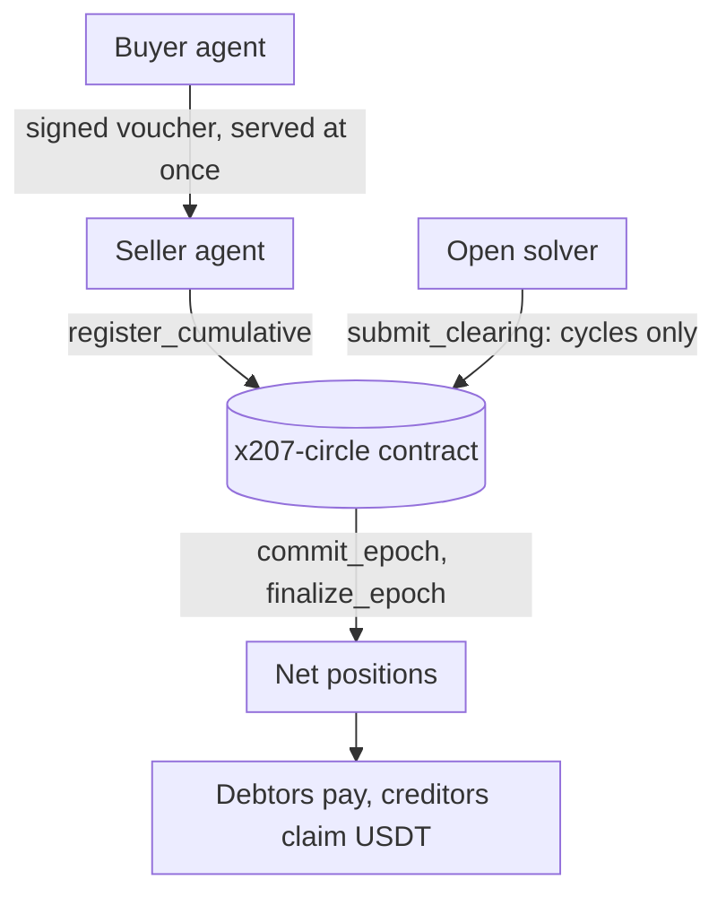
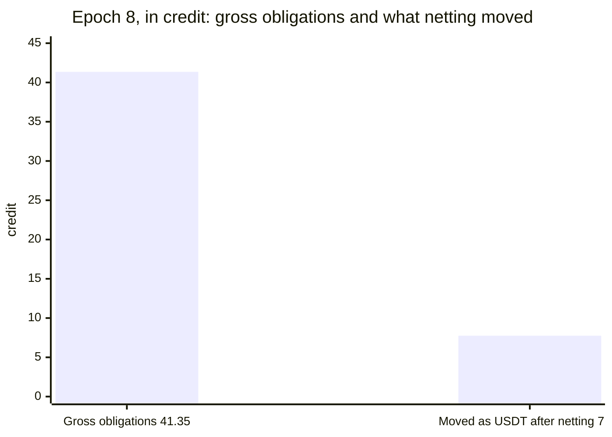

<p align="center">
  <picture>
    <source media="(prefers-color-scheme: dark)" srcset="brand/x207-logo-dark.svg">
    
  </picture>
</p>

# x207

x402 lets agents pay. x207 lets many agents settle at once.

[Dashboard](https://x207.vercel.app/stats) · [Read API](https://x207.boxd.sh/x207/circles/agents-main/epochs) · [MCP server](https://mcp.x207.boxd.sh/mcp) · [Claims and proof](CLAIMS.md) · [What has run](docs/what-has-run.md) · [Join the circle](docs/join-the-circle.md)

x207 is a multilateral netting and clearing layer for x402 agent payments on NEAR. Agents in a circle pay each other with signed vouchers, backed by a stake that bounds what each can owe; at the end of each epoch the circle contract nets every member's position in one on-chain step, so only the net positions are settled in USDT, and an open solver removes the debt cycles from the gross obligations in the same step. It is built as a binding of the x402 `batch-settlement` scheme on the network `x207:<circleId>`, and a buyer outside the circle can still pay with the `exact` scheme on NEAR. The binding is proposed upstream in [x402-foundation/x402#4131](https://github.com/x402-foundation/x402/issues/4131).

**What is new.** (1) A multi-party binding of the x402 `batch-settlement` scheme on NEAR, as far as we found (the proposal is [x402-foundation/x402#4131](https://github.com/x402-foundation/x402/issues/4131); nobody has accepted it yet). (2) Cumulative vouchers that are netted once per epoch across many buyers and sellers. (3) One stake covers sellers that are not known in advance, where a channel per seller needs a deposit for each ([the comparison, spike S1](docs/problem-and-gap.md#capital-per-seller-s1); with an exact forecast a channel locks less). (4) An agent on Base only holds a `0x` key; NEAR is its netting layer. On `x207-v014.testnet` an EVM agent with a new key (not a public test key) joined with `join_evm` ([`E5dQ4Wn4TZyFUXheKvS1CS7whUaLHJ8sXp8hZ2zQJN3c`](https://testnet.nearblocks.io/txns/E5dQ4Wn4TZyFUXheKvS1CS7whUaLHJ8sXp8hZ2zQJN3c)), signed an EIP-712 voucher, was netted in epoch 2 and claimed to its own account with `claim_evm` ([`ERoUbiz3U2MgCkWR8YDuhzria7j8RvwYE8NCvvpziQMm`](https://testnet.nearblocks.io/txns/ERoUbiz3U2MgCkWR8YDuhzria7j8RvwYE8NCvvpziQMm)). The agent's `0x` key then spent its own payout through its NEAR eth-implicit account (NEP-518, `rlp_execute`: [`J59PWbv4MHUz2o7DPJcNk1fUZGrnZc8xy7N39VTXwx6m`](https://testnet.nearblocks.io/txns/J59PWbv4MHUz2o7DPJcNk1fUZGrnZc8xy7N39VTXwx6m)); any NEAR account can submit that transaction and pay the gas, only the `0x` key can authorize it. The limits: a relayer still paid the join deposit and the gas, funded the stake and registered the vouchers (the full circle flow through `rlp_execute` is not tested); the token is a mock USDT; settling from the stake ran once on testnet in contract 0.0.15: an EVM agent that never paid its residual had 20000 taken from its stake by `finalize_epoch` and stayed active (`FoH49TfgQuYR2iG5HjoUEjXercyDynh7pKANKAEzLVek`) (CT-108, [below](#settling-from-the-stake-opt-in)), and the funding route from other chains is mainnet and not tested. The relayer plays the role that the [x402 `exact` scheme on NEAR](https://github.com/x402-foundation/x402/blob/main/specs/schemes/exact/scheme_exact_near.md) gives to the facilitator (it sponsors the gas and the 1 yoctoNEAR deposit); a fee for it is live on `x207-v016.testnet` (contract 0.0.16, testnet only, one run) and does not exist in `x207-v014.testnet` or `x207-v015.testnet` ([who pays the relayer](docs/evm-agents.md#who-pays-the-relayer-the-facilitator-role)). All hashes: [docs/evm-agents.md](docs/evm-agents.md).

**Status.** Hackathon prototype for NEAR HACKATHON (1–14 Nov 2026). The contract (interface 0.0.13, release v0.0.13) runs as the circle `x207-v013.testnet` on NEAR testnet with a dashboard, a read API and an MCP server on top. Two newer circles run the later releases: `x207-v014.testnet` (v0.0.14, EVM members) and `x207-v015.testnet` (v0.0.15, settling from the stake); the dashboard picks the circle with `?circle=v013`, `?circle=v014` or `?circle=v015`, and each has its own read API. Two later releases run on testnet without a dashboard option yet: `x207-v016.testnet` (v0.0.16, a relayer fee on `claim_evm` and `withdraw_stake_evm`; no hosted read API) and `x207-v017.testnet` (v0.0.17, tag `v0.0.17`, wasm sha256 `cbb8a9108f975ba8fca86dc6f6d470e3e377b91309fce56b2ec18a77ff4a4b97`, the fee also on `request_exit_evm` and `set_auto_settle_evm`; its read API is [v017.x207.boxd.sh](https://v017.x207.boxd.sh/x207/circles/agents-main/epochs), BE-103). The integration tests run in a local `near-sandbox`, and the end-to-end sandbox workflow of this repository passed on GitHub on 2026-11-08 for the commit `5567e5b`, all five shards ([run 42467676597](https://github.com/x207-labs/x207/actions/runs/42467676597)). **No mainnet transaction has been sent.** **The team's keeper moves the epochs of `x207-v013.testnet` until 2026-11-18.** A worker run by the team (`scripts/keeper.mjs`, on a boxd machine) calls `close_epoch`, `commit_epoch` and `finalize_epoch` after each cutoff, so the dashboard can show an epoch that has just passed its cutoff or is waiting in a window. After 2026-11-18 the worker is stopped; the contract has no paid keeper, and anybody can move the epoch: see [how to move an epoch yourself](docs/join-the-circle.md#move-the-epoch-yourself). The USDT on testnet is a **mock USDT** (testnet, `usdt.x207-deployer.testnet`): anybody can mint it, so no amount in this README is real money.

## The idea in one breath

Paying every call on its own costs one onchain transfer per call, and the usual fix, a payment channel per seller, needs a deposit per seller, sized before the sellers are known (the numbers are in [problem-and-gap.md](docs/problem-and-gap.md#capital-per-seller-s1)). x207 keeps the x402 flow and adds multilateral netting and cycle clearing: each member locks one stake in the circle, which bounds what it can owe to any seller (`limit ≤ stake`), pays each call with a signed voucher that is served at once, and at the end of the epoch the contract nets every member's position in one transaction, so only the net is paid. An open solver also cancels debts that go around in a circle (A owes B, B owes C, C owes A) in the record of gross obligations; in the MVP that does not change what anyone pays. It is not credit without cash, and it does not save gas on NEAR; the section below says what it does save. The gap in what exists today is in [docs/problem-and-gap.md](docs/problem-and-gap.md).

**What netting saves, what cycle clearing does, and what neither does.** In epoch 8 of the testnet circle, multilateral netting in the circle contract settled 24 vouchers worth 41.35 of obligations with 7.75 USDT moving (18.7%), with one debtor's share covered from its stake. That 7.75 is the net position of the members. It does not depend on the solver: epoch 16 had a single five-member cycle of 8 credit, no solver proposal (`cleared` 0), every net position 0, and nobody paid. Cycle clearing, the solver's job, cancelled 21.8 of the gross obligations in epoch 8. In the MVP it does not change who pays what, because net positions do not change when a cycle is removed. It gives a smaller record of gross obligations, and it is the basis for the loss allocation when a member defaults (P2) and for clearing across circles (roadmap, not built). The clearing fee and the solver fee are 0 since epoch 48 (DAO proposal 5 on `x207v8.sputnikv2.testnet`: add transaction `4EtU84Dg4RA3HYayPeysJYYQMaa8EBCZpK1wP4wr3e4X`, approvals `21qRz2xVaxYmrtKePKdbAgxo2ec3nbn1qzi34FR7F9NU` and `BYDPGpkBX7es4G2WUtzub3bnZ3F3D4FuZkWVvrRbW7kn`). The view `get_params` on `x207-v013.testnet` returned `clearing_fee_bps` 0 and `solver_fee_bps` 0 at block 276298961 on 2026-11-05; epoch 8 ran with the old fees of 10 and 5 bps. With fee 0 a solver earns nothing in the MVP, and the keeper is paid by the team. The residual of several debtors can be paid in one NEAR Intents call, and a creditor can withdraw to another chain (run in `near-sandbox` against the real Intents contract; not on testnet or mainnet, see [what-has-run.md](docs/what-has-run.md)). A member's limit grows from its cash settlement history, inside the bound `limit ≤ stake`. It does **not** save gas on NEAR: the epoch burnt 109.7 Tgas (226.6 with the 24 vouchers registered) against 54.9 Tgas for 24 plain transfers ([comparison](docs/gas-epoch8-vs-transfers.md)); by a model of the measured gas it starts to burn less only when a pair trades about 3 to 4 times or more in an epoch. It is **not** credit without cash: in the MVP a member locks capital of at least 125% of the debt it can run up, and in epoch 8 the members had 1,499.10 staked against 41.35 of obligations. Netting needs debts in both directions and cycle clearing needs a loop; a star graph, where everyone only pays one hub, gains nothing from either ([where cycles come from](docs/problem-and-gap.md#where-cycles-come-from)).



One paid call as a sequence, the epoch as a state machine, and the data flow: [diagrams in docs/architecture.md](docs/architecture.md#diagrams). Eight steps from stake to claim: [docs/overview.md](docs/overview.md). The contract checks every clearing a solver proposes, so nobody has to trust the solver: [solver](https://github.com/x207-labs/solver).

## Try it in 2 minutes

Three read-only steps, with nothing to install, no account and no key. The circle is shared testnet and anybody can add epochs, so the newest ones change; epoch 8 is fixed.

1. **Dashboard:** <https://x207.vercel.app/stats> (the root of the site is a landing page; the dashboard is at `/stats`) showed, as of 2026-11-04, epoch 8: members, obligation graph, clearing statistics, risk. Epoch 8 was run by the team's demo script from a team machine.
2. **Read API** (the same data as JSON, circle `agents-main` on `x207-v013.testnet`):

   ```bash
   curl -s https://x207.boxd.sh/x207/circles/agents-main/epochs
   curl -s https://x207.boxd.sh/x207/circles/agents-main/epochs/8/metrics
   ```

   The second call returns the numbers in the next section. `docs/testnet-0.0.13-realistic.json` is the recorded run behind them.
3. **Connect your AI agent** to the hosted MCP server (Streamable HTTP, read-only: six read tools, no key, no signing) and ask "Give me the report of epoch 8 of the x207 circle":

   ```bash
   claude mcp add --transport http x207 https://mcp.x207.boxd.sh/mcp
   ```

   Other clients, and `npx -y @x207/mcp` for a local stdio server: [docs/mcp.md](docs/mcp.md). Tested with the MCP Inspector; the client commands follow the documentation of each client and were not run with it.

The API, the MCP server and the dashboard are hosted for the judging period. If one does not answer, [Run it locally](#run-it-locally-5-minutes) runs the same contract and the same tools on a circle of its own and needs nothing hosted.

## What epoch 8 showed

The realistic testnet epoch, paid in the mock USDT (testnet, `usdt.x207-deployer.testnet`): 24 vouchers worth 41.35 credit became 14 settlement movements (the metric `residualTransfers`: one for each member whose net position is not zero, here six debtors paying in and eight creditors claiming out).



| Figure | Value |
| --- | --- |
| Obligations | 24 asymmetric obligations of 41.35 credit among 15 participants |
| Netting (the cash saving) | the net positions of the 15 members came to 7.75 USDT due from six debtors, and only 7.75 of the 41.35 credit moved as USDT (18.7%) |
| Paid | five debtors paid (7.2 USDT); the sixth (0.55 USDT, `m06`) defaulted and was covered from its stake |
| Cycle clearing (a separate line, not a step between the two figures above) | the solver cancelled 21.8 credit of the gross obligations, 52.7% of them (ratio 0.527), leaving 19.55 credit of gross obligations; the net positions did not change |

## Run it locally (5 minutes)

On your machine, in a local `near-sandbox`, with no account and no Rust. Needs Node 22.22.2 or newer, `git` and `tar`, on Linux (x64 or arm64, glibc 2.39 or newer: Ubuntu 24.04, Debian 13; the near-sandbox 2.13.4 binary needs it, so Debian 12 and the default `node:22` Docker image stop with `GLIBC_2.39 not found`, use `node:22-trixie`) or macOS on Apple silicon. On another system the script stops at once and says so; the alternatives are in [docs/sandbox-demo.md](docs/sandbox-demo.md).

```bash
git clone --recurse-submodules https://github.com/x207-labs/x207.git && cd x207
npm ci && npm run build --workspaces --if-present
npm run demo:quick    # one epoch of six agents: joins, paid calls, clearing, residuals, claims; about 5 minutes, most of it the sandbox clock
npm run demo:mcp      # an AI agent through the MCP tools on a local circle; about 2 minutes, prints every tool call and what it answered
npm run demo:swarm    # six agents trade for four epochs; the keeper and the solver clear each epoch on their own; about 5 minutes
```

Measured on a clean clone on 2026-11-05 (macOS, Apple silicon, Node 26): clone, `npm ci` and build 45 seconds; `demo:quick` 3 min 43 s including the first downloads; `demo:mcp` 2 min 5 s; `demo:swarm` 4 min 45 s. The "5 minutes" of the heading is the first demo; all three together take about 11 minutes. Docker is not needed. The first run needs internet access to GitHub and `build.nearprotocol.com`. Tested Node versions: 22.22.2 (the minimum, Linux arm64) and 26.11.1 (macOS). On Linux arm64 (Docker `node:22.22.2-trixie`, Node 22.22.2, npm 10.9.7): setup about 3 minutes (`better-sqlite3` is compiled), `demo:quick` 4 min 26 s, `demo:mcp` 2 min 8 s.

Each demo fetches what it needs the first time: the wasm of the release v0.0.13 from GitHub (its sha256 is checked against the number written in this repository) and the near-sandbox 2.13.4 binary.

Checks, a few seconds each: `npm run check:numbers` (every epoch 8 figure in this README, `CLAIMS.md` and `docs/submission/` against the recorded run, and the circle's parameters in the docs against `get_params`), `npm run check:claims` (every path, id, function and hash that [CLAIMS.md](CLAIMS.md) names exists), `npm run check:links` (every link of the Markdown files resolves) and `npm run check:pins` (all dependencies pinned exactly).

## Adding x207 to an agent that uses `@x402/fetch`

One line on the `x402Client` the agent already has (the signature is `register(network, schemeClient)` in `@x402/core` 2.29 and 2.30; the network is `x207:<circleId>`, or `x207:*` for every circle):

```ts
const client = new x402Client().register("x207:agents-main", new X207SchemeClient({ payer: "agent.near", secretKey }));
```

`secretKey` is a voucher key, never a NEAR access key. Then `wrapFetchWithPayment(fetch, client)` works as before: a `402` that offers the x207 entry is paid with a signed voucher. Use `X207PaymentClient` instead if you also want the fallback to `exact` when the headroom runs out. Imports and the tested version of this line: [sdk README](https://github.com/x207-labs/sdk#readme) and `packages/scheme/test/readme-register.test.ts` in the sdk repository.

## Settling from the stake (opt-in)

A member can opt in with `set_auto_settle(true)` (1 yocto; an EVM member signs `set_auto_settle_evm`). If it then misses its `due`, `finalize_epoch` pays the `due` from its own stake, the member stays `active` and the creditors claim in full (unless another debtor of that epoch defaults with a shortfall), instead of the default path (suspension, limit 0). It does not raise `settled_history`; only a cash settlement does. It applies only when the free stake covers the `due` and the flag was set at or before the commit of that epoch, so opting in after the `due` is known does not avoid a default. It moves money from the debtor's stake; it does not create credit. It is in contract 0.0.15 on `x207-v015.testnet` (code hash `Hhs82yW5iJD2QH4juP6Ud5u7ApHGhcw8Zo5xCK1hxmoj` (since the redeploy of 2026-11-05; the SD-094 transactions ran on the earlier build, code hash `4eZhZF16ySGGv9ux3gzbxnH6znVxcHNQYivVFdfpuHz5`, sha256 `3632861b…`)) and is checked by unit tests, a security review and one run on testnet (SD-094, epoch 2, mock USDT): an EVM agent opted in with `set_auto_settle_evm` ([`AT1BuQFscV2yX2ixRYFTxytbXZY1uSYJBYfEoPw1CMeT`](https://testnet.nearblocks.io/txns/AT1BuQFscV2yX2ixRYFTxytbXZY1uSYJBYfEoPw1CMeT)), signed one voucher ([`5KpqyYs8X1GTxt6hPohy4QXZBn6RcJ6vk99D4JDxJs8A`](https://testnet.nearblocks.io/txns/5KpqyYs8X1GTxt6hPohy4QXZBn6RcJ6vk99D4JDxJs8A)), never paid, and `finalize_epoch` ([`FoH49TfgQuYR2iG5HjoUEjXercyDynh7pKANKAEzLVek`](https://testnet.nearblocks.io/txns/FoH49TfgQuYR2iG5HjoUEjXercyDynh7pKANKAEzLVek)) took the 20000 due from its stake (40000000 to 39980000, event `auto_settled`, the member stayed `active`); the seller then claimed it ([`AoMvsPrS5A2B3aw9etj3hJ2BTPr2aeBpX967t3MGvr91`](https://testnet.nearblocks.io/txns/AoMvsPrS5A2B3aw9etj3hJ2BTPr2aeBpX967t3MGvr91)). A relayer paid the gas and the stake of that agent, and one debtor is a single case: it shows the mechanism works, not that it is used. Details: [docs/evm-agents.md](docs/evm-agents.md#settling-from-the-stake-opt-in-ct-108).

## What is proven, and what is not

| What | Result | Where to check |
| --- | --- | --- |
| Epoch 8 on testnet | Figures above; three of the eight creditors claimed | [docs/testnet.md](docs/testnet.md), [docs/testnet-0.0.13-realistic.json](docs/testnet-0.0.13-realistic.json) |
| Six named agents, a circle of their own (UM-124) | Not epoch 8. The six agents (`x207r-translator`, `x207r-summarizer`, `x207r-scraper`, `x207r-image`, `x207r-cleaner`, `x207r-gpu`) ran one epoch on a separate testnet circle, `x207-swarm.x207r-deploy.testnet` (circle id `swarm-demo`): 15 vouchers carrying 114 credit, clearing ratio 0.8684 (13 clearing edges), three debtors paid and three creditors claimed. The agents run in rule or mock mode, not as a swarm of language models | [docs/testnet-swarm.md](docs/testnet-swarm.md), [docs/testnet-swarm.json](docs/testnet-swarm.json) |
| Load test, epoch 2 | 210 obligations, four transactions: `submit_clearing` 28.0 Tgas, `commit_epoch` 69.4 Tgas | [contracts/docs/gas-and-cost.md](https://github.com/x207-labs/contracts/blob/main/docs/gas-and-cost.md) |
| The released contract | v0.0.13, wasm sha256 `b9327f2b5d64b1180ba76dd619c6091ae57b48964f520a784e366c131e787054`, reproducible build, code hash on chain `DTw5rUUdJSbWjD361MmBxKW4nm4ETnNkex63mfUCjsjh` | [release v0.0.13](https://github.com/x207-labs/contracts/releases/tag/v0.0.13) |
| The released contracts with EVM members and settling from the stake | v0.0.14 (`x207-v014.testnet`, wasm sha256 and code hash on chain `9ShmoHDuE6QT3AAj6jYdW2Wo6pr53h5JFfs8ea7pYg6L` = `7d731dfb15db44aa3a1ca95c28616a6e2faecbf11b87de538940991da33d39f9`) and v0.0.15 (`x207-v015.testnet`, code hash on chain `Hhs82yW5iJD2QH4juP6Ud5u7ApHGhcw8Zo5xCK1hxmoj` = wasm sha256 `f832e53f01bf6b0739efb54bf0977d70544dd9bcece2234abd3e18525b4900de`); both were redeployed on 2026-11-05 from the reproducible build of the tag, and the release asset equals the code on chain | [release v0.0.14](https://github.com/x207-labs/contracts/releases/tag/v0.0.14), [release v0.0.15](https://github.com/x207-labs/contracts/releases/tag/v0.0.15) |
| A Solana key as an agent (SD-098) | Epoch 20 of `x207-v015.testnet`, mock USDT: a new Solana key joined (`4fL9QXeRHK3xJ3szTCDFme6cXMKMKZWnUL354kZz5dhN`), staked, signed a voucher and received one from an EVM agent, paid its residual of 30000 (`GrZpuZ5o2qYdvU9P6QTy1qHXE8xooFFYsmm5hmUo8Gee`), and the EVM agent claimed (`DrbrNnD8eAintZHkxwCC9rLRanBgF927gi57mLQCyyrp`). `total_cleared` stayed 0 (two members, netted in the positions, not by the solver); no Solana transaction was sent; our helper paid the gas, so the agent was not autonomous | [docs/solana-agents.md](docs/solana-agents.md), [record](docs/testnet-epochs/sd098-solana-agent-run.json) |
| An ERC-8004 identity on Base Sepolia | One identity, `agentId` 10597, registered with `register(agentURI)` in transaction `0x347fb05ab7325bb33c0e6144423ef46aa2fd42ff549b27aad0e545f19a72975d` (block 54794990). It says that an address registered a file listing the read-only MCP server and read API (`x402Support: false`); it is not a reputation, and there is no x402 Bazaar listing | [docs/discovery.md](docs/discovery.md) |
| Contract 0.0.18: sale of a NEAR account through a locker (P1, barter kinds #11 and #14), fixes of the audit, `near-sdk` 5.30.1 | Built and tested on the branch `p1-0.0.18` of `contracts`: a locker contract that holds the sold account and releases a full-access key to the buyer only when the circle says so (`ed04e15`), an escrow of kind `account` in the circle (`6ad63e9`), and `near-sandbox` tests of a sale (#11) and of the sale of a member account that waits for the epochs to be final and rotates the voucher key (#14) (`b5e531e`). Fix of audit finding A-CT-01 (joins that never stake could hold all 64 slots): `remove_pending` and `make_room`, with a garbage-collection delay of 7 days that the owner can set between 1 hour and 30 days; a squatted slot still costs the 0.35 NEAR join deposit, so the attack is delayed, not made impossible. `near-sdk` 5.30.1 and `near-workspaces` 0.24.0 (CT-122). `wee_alloc` stays: it is the default allocator of `near-sdk`, there is no supported switch, and its advisory (RUSTSEC-2022-0054) is an "unmaintained" notice, not a vulnerability. A limit on the escrow (CT-129): it lasts at most `max_escrow_ttl` (default 72 hours, the owner can set 1 hour to 30 days; longer grants are refused with `ERR_ESCROW_TTL_TOO_LONG`), but the seller still cannot take the account back before the expiry. Contract tests as logged by the contracts session (not re-run for this README): the full suite 732 passed and 0 failed on contracts `1f30269`, among them 9 sandbox tests of the account escrow and 4 of `remove_pending` (one with 64 squatters). **On testnet:** `x207-v018.testnet` (owner `x207-v18-own.testnet`, tag `v0.0.18`), circle wasm sha256 `4701ecce4168d18b0674b6b4af9f789219afc33be99d89c09f3a433c0bd0d198` built twice byte-identical from contracts `f551f51`, locker wasm sha256 `6d2ebdf437471a666bf9073637e012c04189cab08921e606ddbfec0bd9524e71`. One run: a #11 sale was delivered (`JRzSghiDSF9oF8AmzgauJVKUkMUnua7rMsFUF7HJV7K`); a #14 delivery in the same epoch was refused with `ERR_ESCROW_EPOCH_WAIT`; after the epochs were final the member account was delivered (`ABuXLGoii1E3qvoDevmzZWWMDyb9nPzsEdB85JJAvZ6C`), the old voucher key was refused (`ERR_BAD_SIGNATURE`), the buyer's key was accepted, and epoch 6 finalised (`HUzhsowabszAxxLaDvRmfRCaQEbNiTQF7ucKdLHt1f4v`). **Limit of that run:** it ran on the first build of 0.0.18 (sha256 `e64d4ec7…`). The circle was then redeployed with `max_escrow_ttl` (transaction `Bx2qeVrB9z8WTH2FXnHvxp5DztEpmuJRGPaQ3SwgzTXu`, state unchanged). On that final build a smoke test ran (a 24 hour grant locked, an 80 hour grant refused and the locker gave the key back), and then a second run: #11 completed (`13AHbm6AwKEXHCovdTXGtjbSLz9xmvSmifsebMMKJ6gR`), #14 completed after the earlier epochs were final (`9vRmaYFbc56y2vSiuFM7PayogVSZH8jbSJvXbkgYzEjj`, epoch 13 finalised `CJMhQgomNP2UCTGE6MA42nWWpCbtr4AigCLHhyNuNbk6`), and a stranger called `cancel_expired_account_escrow` on an expired grant (`5mUqbeo34pxBFCFqTC732Hnrrv9zWACXd9EuYfWXbSqH`): the seller's return key came back and the escrow became `cancelled` (two `commit_epoch` calls in that run failed with `ERR_WRONG_PHASE`, wrong phase, and the run went on). The rotation of the member's voucher key (#14) was then shown on the final build too (CT-131, one member, `dan3`): after `complete_account_escrow` (`B8xB2VgzZpM6TrYMX1FsW87iHpsEJLM7cVdnM4fb1MEJ`) a voucher signed with the old key was refused with `ERR_BAD_SIGNATURE` (`GgTrNXWYBnmMwUswwzZPFL8kAT9vt6gZ43JjkPTAGk7n`), a voucher signed with the buyer's key was accepted (`HPstpxebammykdkm3ChGzqXVoEdLv5q6ccrXTY9U8Ks4`), and epoch 23 finalised (`FrwZJqFjTfe35pwM55fKXL5LroYFKuQtjPHZz6HTyqro`); one `commit_epoch` call of that run failed with `ERR_WRONG_PHASE` and the run went on. **Still not shown on testnet:** the rotation under a second concurrent sale; the garbage collection on node 2.14.0; `remove_pending` at 64 squatters (sandbox only). Kinds #12 and #13 have a design in the ADR and no test of their own | [docs/barter-evidence.md](docs/barter-evidence.md), `contracts/docs/adr-0.0.18.md` (on the branch) |
| Relayer fee | Live on `x207-v016.testnet` (contract 0.0.16, testnet only): one run, claim with signed `maxFee` 250000 paid the relayer 0.25 credit (`5z7MukAhhmLNrBsJvzYfSqgvbQR4yv7AZVtTXBLVewH4`), `maxFee` 0 paid nothing, a stake withdrawal paid 0.1 credit. Contract 0.0.17 (`x207-v017.testnet`, CT-118) extends the fee to `request_exit_evm` and `set_auto_settle_evm`, taken from the free stake (`KLgwiuyygQcSoNrxXDK8s2U1KrYsTCSH7UzLGjaFN2Q`, `A8BqrTX4XSNYs5eWwKFtxz76z4hFtS8Ke28bHRQYXgWn`), and its `join_evm` refuses a `maxFee` above 0. The failed-fee path (the transfer to the relayer fails, the stake is credited back) is covered by contract tests `TC-CT-118-01..05`, not by a transaction: on testnet the mock USDT registers the receiver, so the fee was paid. Not in v0.0.14 or v0.0.15 | [docs/evm-agents.md](docs/evm-agents.md#who-pays-the-relayer-the-facilitator-role), [run record](docs/testnet-epochs/ct117-relayer-fee-run.json) |
| 1Click quote | A withdrawal of 5 credit to USDC on Base was quoted live on 2026-11-04 with `dry: true` (BE-090): 4.989148 USDC out, no deposit address, no funds moved | [backend reference](https://github.com/x207-labs/backend/blob/main/docs/reference.md#live-quote-of-1click-be-090) |
| NEAR Intents | The residual of three debtors paid in one `execute_intents` of the real Intents contract (the wasm of `intents.near`) in `near-sandbox` | `tests/residual-batch.sandbox.test.ts` |
| The product around the contract | Dashboard, read API, MCP server, facilitator and solver, indexer with the 207 report, demo agents; each marketplace pipeline has an end-to-end test in `near-sandbox` | [docs/demo-blocks.md](docs/demo-blocks.md) |
| The threats | 21 threats, each with the test that pins its defence | [Threat model](docs/security-and-limits.md#threat-model) |

**What has not run:** mainnet, NEAR Intents on testnet (`intents.testnet` has no code), a real wallet through NEAR Connect on the dashboard, and the cases in the third column of [docs/what-has-run.md](docs/what-has-run.md). **The barter catalog is registered, not proven, kind by kind:** of its 85 kinds that can be offered (plus 9 refused kinds), 13 have run on testnet (the ten on-chain kinds of batch 1, with mock token contracts, one access kind, and the sale of an account and of a member account of contract 0.0.18, on its first build), 13 more run in `near-sandbox` without a mock provider, 31 only against a mock provider of ours, 12 are unit-tested, 13 are registered with no test of their own, 2 (#12 and #13) are design only and 1 is not built; see [docs/barter-evidence.md](docs/barter-evidence.md). A test shows that a defence is pinned, not that the system is safe; the open limits are in [docs/security.md](docs/security.md).

**Keys.** An agent holds two kinds of key. Its **voucher key** is a separate ed25519 key that is no access key of any NEAR account: it signs only vouchers and cannot move funds, and a leaked one can create vouchers only up to the credit limit. Its **NEAR access key** is needed only for `join`, `settle` and `claim`, because these calls attach a deposit (0.35 NEAR for `join`, 1 yoctoNEAR for the stake, the residual and `claim`) and NEAR does not let a function-call key attach one, so that key must be a **full-access** key of the agent account. The MCP server keeps those three tools off until its operator sets `X207_ALLOW_FULL_ACCESS_KEY=1` (and `X207_ALLOW_OUTFLOWS=1` for `join` and `settle`); the owner of the agent holds the key, on a dedicated account that holds only what the agent may lose. The tools that pay, list, offer and accept use the voucher key alone. Details: [docs/security-and-limits.md](docs/security-and-limits.md#keys-of-an-agent).

## Settlement token: USDT now, USDC on the roadmap

**Now.** The circle settles in NEP-141 USDT. On testnet that is a mock token, `usdt.x207-deployer.testnet` (6 decimals, handed out by the x207 faucet). The mainnet target is `usdt.tether-token.near`. Nothing has run on mainnet.

**Roadmap: native Circle USDC.** x402 is built on USDC, and cross-chain withdrawals from the circle go to USDC on Base, so USDC is the natural settlement token. Official USDC has 6 decimals, the same as `CREDIT_DECIMALS=6`, so the contract arithmetic does not change. NEAR mainnet `17208628f84f5d6ad33f0da3bbbeb27ffcb398eac501a31bd6ad2011e36133a1`; testnet `3e2210e1184b45b64c8a434c0a7e7b23cc04ea7eb7a6c3c32520d03d4afcb8af` (`ft_metadata` read over RPC on 2026-11-12: USDC, 6 decimals).

**How the token is chosen.** The token account is an init argument of the circle: `new(owner_id, circle_id, usdt_token_id, intents_id, params)` ([`config.rs`](https://github.com/x207-labs/contracts/blob/main/x207-circle/src/config.rs)). There is no setter. Moving to USDC means deploying a new circle with `usdt_token_id` set to USDC; the new circle starts empty, so members join and stake again.

**What the move needs:**
- a new circle with `usdt_token_id` = USDC;
- SDK: `USDT_TOKEN_ID` read from config (an override, `usdtTokenId`, exists already);
- backend: the Intents asset `nep141:<usdc>`, plus quote and withdraw;
- faucet: real USDC cannot be minted by us, so test funds would come from the Circle faucet. Whether it serves ordinary NEAR accounts has not been checked;
- frontend: only the new circle's contract id. The dashboard reads the token from the circle's `get_circle` view; the build setting `VITE_X207_USDT_TOKEN_ID` is only the fallback.

**Names stay.** The field `usdt_token_id` and the error `ERR_ESCROW_USDT` keep their names: renaming them changes the interface. The name is historical; the field holds whatever token the circle was created with.

**Status:** not started. It is planned after the hackathon.

## Where to read more

| Topic | File |
| --- | --- |
| What x207 is, the problem and the gap, how it works (F1 to F9) | [docs/overview.md](docs/overview.md), [docs/problem-and-gap.md](docs/problem-and-gap.md) (with [where cycles come from](docs/problem-and-gap.md#where-cycles-come-from), and why a star graph gains nothing), [docs/how-it-works.md](docs/how-it-works.md) |
| Join the circle on testnet with two fresh accounts; quickstart for an x402 agent owner | [docs/join-the-circle.md](docs/join-the-circle.md), [docs/quickstart.md](docs/quickstart.md) |
| The MCP server for AI agents | [docs/mcp.md](docs/mcp.md) |
| The testnet circle, and how to check an epoch | [docs/testnet.md](docs/testnet.md) |
| Every pipeline as "do X, see Y" with the test that runs it | [docs/demo-blocks.md](docs/demo-blocks.md) |
| Architecture and invariants | [docs/architecture.md](docs/architecture.md) |
| Security, limits, threat model | [docs/security-and-limits.md](docs/security-and-limits.md), [docs/security.md](docs/security.md) |
| Metrics and roadmap; judging criteria, tracks and glossary | [docs/metrics-and-roadmap.md](docs/metrics-and-roadmap.md), [docs/appendices.md](docs/appendices.md) |
| Sell over x402 on the circle | [sdk/docs/seller-quickstart.md](https://github.com/x207-labs/sdk/blob/main/docs/seller-quickstart.md) |
| Contract gas and storage; the contract against the real Intents wasm | [gas-measurements](https://github.com/x207-labs/contracts/blob/main/docs/gas-measurements.md), [real-intents-test](https://github.com/x207-labs/contracts/blob/main/docs/real-intents-test.md) |
| Read API reference: limits, OpenAPI, health, metrics | [backend/docs/reference.md](https://github.com/x207-labs/backend/blob/main/docs/reference.md) |
| Why a solver needs no trust and its gas; barter matching and random checks | [gas-and-trust](https://github.com/x207-labs/solver/blob/main/docs/gas-and-trust.md), [barter-and-spot-checks](https://github.com/x207-labs/solver/blob/main/docs/barter-and-spot-checks.md) |
| Third-party libraries and services | [docs/third-party.md](docs/third-party.md) |

## Repositories

| Repo | Its role in x207 |
| --- | --- |
| [x207](https://github.com/x207-labs/x207) | This umbrella: docs, demos, end-to-end tests, scripts |
| [contracts](https://github.com/x207-labs/contracts) | The `x207-circle` contract in Rust (interface 0.0.13), near-sandbox tests, Sputnik DAO scripts |
| [sdk](https://github.com/x207-labs/sdk) | `@x207/core`, `@x207/scheme`, `@x207/mcp`, the binding spec, test vectors, reference facilitator |
| [backend](https://github.com/x207-labs/backend) | Indexer, read API, HTTP 207 report, settlement worker, marketplace book, access broker |
| [frontend](https://github.com/x207-labs/frontend) | The dashboard and the marketplace pages |
| [solver](https://github.com/x207-labs/solver) | The open clearing solver, barter matching and the seeker |
| [agents](https://github.com/x207-labs/agents) | The demo agents and their scenarios |

The six product repositories are git submodules of this one. `vault`, the design notes, is private.

## Tracks and hints

Seven tracks are ticked on the form; `swarms` is the main one. A hint is a wish of the track, not a requirement, so the table says for each hint how far x207 meets it. The claim of each track, its evidence and what weakens it are in [docs/submission/form-draft.md](docs/submission/form-draft.md#tracks).

| Track (`id`) | Hint | How x207 meets it |
| --- | --- | --- |
| AI Swarms (`swarms`), main | Multi-Agent Systems | Many agents in one circle settle in one netting step per epoch (epoch 8: 15 members, 24 vouchers); the agents run in rule or mock mode, not as a swarm of language models |
| AI Swarms (`swarms`) | Sub-Accounts | Used only for lease accounts |
| Agent Economy (`agents`) | Agent Commerce | The whole project: vouchers over x402, an MCP server, marketplace and barter between agents |
| Agent Economy (`agents`) | NEAR Intents | Met only in `near-sandbox` (`intents.testnet` has no code); no payment through Intents ran |
| Real-World Money (`realworld`) | Meta Transactions | Not a focus; a relayer submits the transactions of EVM agents, and the x402 `exact` scheme on NEAR uses NEP-366 delegate actions |
| Unstoppable DeFi (`defi`) | Chain Signatures | Not used |
| Open (`open`) | Chain Abstraction | An agent that holds only a `0x` key takes part in a circle on NEAR (testnet, relayer-assisted, mock USDT) |
| Autonomous Business (`business`), Social (`social`) | none named | See the form draft |

## Hackathon disclosures

**Code written with AI help.** The code, tests and documents of this project were written with AI coding assistants: Claude Code (Anthropic) in several parallel sessions, each working on one repository under a human owner who set the design, reviewed the results and decided what to publish. Many commits carry a `Co-Authored-By: Claude` trailer. Every number in this README comes from a run or a file named next to it; where a run did not happen, the text says so.

**Code start.** All code of the project was written from 2026-11-01, inside the build window. The first commit of the umbrella is `c708b8a` (2026-11-01); the first commits of `contracts` and `sdk` are `1d908c4` and `5580759` (both 2026-11-01).

**License.** Apache-2.0 for every repository of the project: see [LICENSE](LICENSE). **Third-party code:** all open source, used as libraries or hosted endpoints, none copied in; the list is in [docs/third-party.md](docs/third-party.md).
