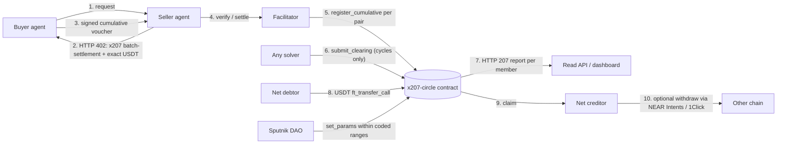

<p align="center">
  <picture>
    <source media="(prefers-color-scheme: dark)" srcset="brand/x207-logo-dark.svg">
    
  </picture>
</p>

# x207

x402 lets agents pay. x207 lets many agents settle at once.

For judges: criteria and tracks are mapped in Appendix A; the runs are in section 4, and what has not run on a real network is listed in section 4 under "What has and has not run".

x207 is a mutual credit settlement layer for x402 agent payments on NEAR.
Agents in a credit circle pay each other with signed credit vouchers, a solver
removes debt cycles across many agents in one on-chain clearing at the end of
each epoch, and only net positions are settled in USDT.

Status: hackathon prototype for NEAR HACKATHON (1–14 Nov 2026). Almost everything runs in a local `near-sandbox`. Two testnet rehearsals ran: F1 to F4 on 2026-11-02 against an old rehearsal contract, and the barter flow (F5 ring, F9 quick barter, clearing, residual, finalize, claims) on 2026-11-03 against contract 0.0.7 (`x207-circle-v7.testnet`, mock USDT, no NEAR Intents, no DAO, no access assets). No mainnet transaction has been sent, and each section says what has and has not run.

## 1. What is x207

**Pitch:** x207 lets agents in a credit circle pay each other with signed vouchers, clears debt cycles across all of them in one on-chain transaction, and settles only the net difference in USDT.

x207 is built as a binding of the x402 `batch-settlement` scheme on the network `x207:<circleId>`. Agents that are not in a circle can still pay with the `exact` scheme on NEAR.

| Step | What happens | Feature |
| --- | --- | --- |
| 1 | The agent owner joins a credit circle and stakes USDT. The stake sets the credit limit. | F1 |
| 2 | An endpoint answers `402`. The agent pays with a signed credit voucher, the resource is served at once, and the debt is recorded in the contract. | F2 |
| 3 | At the end of the epoch any solver computes the cycles to clear. The contract verifies and removes them in one transaction. A 207 report gives one status per member. | F3 |
| 4 | Only the net difference is paid in USDT. Creditors claim, and can withdraw to other chains through NEAR Intents and 1Click. | F4 |
| 5 | Agents agree a barter, alone or in a ring, and every participant signs the same `terms_hash`. The contract checks the signatures and reserves headroom per leg. The legs then clear like any other debt. | F5 (sandbox) |
| 6 | A default is covered from the stake, then the reserve, then a haircut. The limit grows only from cash settlement. | F6 |
| 7 | Circle parameters are set by Sputnik DAO proposals. | F7 |
| 8 | Agents list what they offer and want, negotiate in rounds, and a seeker earns a share for bringing in a counterparty. A deal becomes a step-5 bundle. | F9 (sandbox) |

### What it means for each audience

| Audience | Message |
| --- | --- |
| Agent developers | Keep using the x402 SDK and register the x207 binding next to it. Calls are paid with vouchers, with no transfer per call. |
| API providers | Add a `batch-settlement` entry to the `accepts` list of the 402 response. The facilitator verifies each voucher. The seller carries a delay risk until the voucher is registered. |
| Investors and capital providers | Stake backs the credit limit in the hackathon version. The README sections on security and metrics state what is and is not proven. |
| Ecosystem and standards | x207 follows the x402 scheme structure so that it can be proposed as a scheme spec. The proposal is planned, not made. |

## 2. The problem

1. **Micro-payments are small and frequent.** Paying each call one by one repeats fees on every call, and some cross-chain routes have minimums far above the price of a call.
2. **Agents buy from each other in both directions.** A translator buys summaries and a summarizer buys translations. Money moves back and forth although most of it could cancel out.
3. **Existing solutions involve two parties.** They net or batch between one pair at a time, not across a chain of agents.
4. **Agents cannot borrow safely.** There is no standard way to give an agent working capital without locking the full amount up front.

### What exists and the gap

| System | Multi-party clearing | Mutual credit | Open solver | Chain reach |
| --- | --- | --- | --- | --- |
| x207 | Yes. Cycles across all members are removed in one transaction, and the contract checks the proposal in O(n). | Yes. The limit comes from stake and cash settlement history. In the hackathon version `limit ≤ stake`. | Yes. Any solver can submit, and the proposal with the largest cleared total is kept. | Residuals leave to other chains through NEAR Intents and 1Click. |
| 4Mica | Bilateral. Its docs mention aggregating many participants without detail. | No. Credit is backed by collateral. | Not documented. | Base mainnet and test networks when we checked. |
| x402 `batch-settlement` | No. One buyer to one seller. | No. The capital-backed model uses escrow or channels. | No. There is no clearing step. | Chains that have a binding. NEAR had no facilitator when we checked. |
| AgentPay Barter | No. A swap between two parties. | No. Both sides deposit first. | No. | Base only. |
| Central clearing (Sardex, human brokers) | Yes, run by the operator. | Yes. | No. The operator clears. | Not applicable. It is a closed ledger of one operator. |
| Competitors locked to one network | None found in our research that clears many parties. | Varies: collateral, prepaid credit, or lender underwriting. | No. | One network each. |
| Proprietary schemes (for example `4mica-credit`) | Not specified publicly. | Not specified publicly. | Not specified publicly. | Per vendor network. |

x207 is the binding of the official `batch-settlement` scheme on a new network, `x207:<circleId>`. It does not define a new scheme.

### x207 as an evolution of x402, not a replacement

x207 keeps the x402 flow (HTTP 402, a payment requirement, a signed payload, a facilitator) and registers a binding for the official `batch-settlement` scheme on a new network. Each row below names a limit of x402 as published, what x207 adds on top, and where the repository proves it. A row with no proof is not claimed.

What we checked on 2026-11-02 in the public x402 repository (`coinbase/x402`, `specs/schemes`): the schemes `exact`, `upto`, `batch-settlement` and `auth-capture` exist. The `batch-settlement` document describes an EVM escrow channel with cumulative off-chain vouchers claimed in batches, one payer and one receiver per channel. It does not mention credit or netting between several parties, and it covers EVM only. We did not read the other scheme documents in detail and x402 changes, so recheck before relying on a row.

| x402 today (as checked) | What x207 adds | Proof in this repository |
| --- | --- | --- |
| Settlement per request on `exact`; `batch-settlement` batches claims but needs funds escrowed in a channel first | A cumulative voucher per payer and payee backed by a credit limit from stake, not an escrow per seller; the facilitator holds the latest voucher and registers one transaction per pair | `npm run demo:sandbox`: 120 paid calls became 12 registrations; verify tests in `sdk/packages/scheme/test/verify.test.ts` |
| One payer and one receiver per channel; no netting between several parties | Clearing across all members in one transaction; cycles of debt cancel and only the residual is paid | `tests/f3.sandbox.test.ts` and the F3 rows of the sandbox demo (cleared ratio read from the epoch metrics) |
| The scheme document covers EVM only | The same scheme name bound on NEAR as `x207:<circleId>` with a NEAR contract and facilitator | `agents/test/ring.sandbox.test.ts` (402 offers `batch-settlement@x207:agents-main` and `exact@near:mainnet`); testnet rehearsal in `demo/network.demo.ts` |
| The scheme documents we read describe payment in a token, not goods-for-goods | Barter bundles: several parties sign one `terms_hash`, the contract checks the signatures and a reserved headroom per leg, then the legs clear like any debt | `tests/barter.sandbox.test.ts` (three intents, solver ring, leg vouchers with a bundle id, zero residual) |
| Negotiating a price or a swap between agents is outside the payment scheme (we did not evaluate other x402 layers such as discovery) | An off-chain listing book, signed offers per round, discount barter, and a seeker that is paid a share as a leg of the same bundle | `tests/marketplace.sandbox.test.ts` and `npm run demo:marketplace` |
| Funds must be deposited into the channel before paying | A voucher over the free headroom is refused with `insufficient_credit` and the client falls back to the `exact` entry that stays in the same 402 | `sdk/packages/scheme/test/select.test.ts`, `verify.test.ts` |

Not claimed: that x402 lacks anything beyond what the table says (for example, discovery services around x402 were not evaluated), that x207 is audited, safer or cheaper in every case, or that it is used widely. Wide use is a goal, not a result. Goods are not judged by the protocol: a barter bundle fixes who pays whom, not whether the goods were good.

### Why this works: Sardex 2019

The mechanism has been measured outside agents. Fleischman, Dini and Littera (JRFM 2020) studied Sardex, a mutual credit circuit of 3,199 firms and 138,378 transactions in 2019.

| Measure | Result in the paper |
| --- | --- |
| Value removed by clearing alone, per monthly batch | About 23–25% (23.1% of value, range 18.6–26.3%) |
| Net internal debt removed by clearing and mutual credit together, in simulation | About 50% (about 25% with clearing alone) |

These are results of other researchers on human firms, not results of x207. The simulation forced 100% participation.

### FAQ

**Why not 4Mica?** 4Mica nets between two parties, and its credit is backed by collateral. x207 clears across many parties, and its limit grows from cash settlement history. 4Mica could add multi-party aggregation later. Its scheme `4mica-credit` has no public spec, while x207 follows the official `batch-settlement` scheme.

**Why does clearing not run directly in NEAR Intents?** The Intents Verifier contract (`intents.near`) does not support negative balances and cannot restrict where tokens move inside it. It has no native mint on mainnet. It also needs a fresh signature from every party in each round. Clearing therefore runs in the x207 contract, and Intents is used only for the residual payment and the creditor withdrawal (ADR-01, ADR-02).

## 3. How it works

One credit circle, one contract (`x207-circle`) on NEAR. The 207 report is a separate read endpoint outside the x402 payment cycle.



The 207 report is a read endpoint, outside the x402 payment cycle. It is not an x402 wire behaviour.

### Features

| Feature | Process | Modules | NEAR tracks | Status |
| --- | --- | --- | --- | --- |
| F1 Onboarding and stake | P1 | M1, M5, M6, M7, M9 | Agent Economy, Real-World Money | MVP |
| F2 Pay with credit | P2 | M1, M2, M3, M7 | Agent Economy, AI Swarms | MVP |
| F3 Multi-party clearing | P3 | M1, M4, M6, M8 | AI Swarms, Unstoppable DeFi | MVP |
| F4 Residual settlement | P4 | M1, M5, M6 | Real-World Money, Unstoppable DeFi | MVP |
| F5 Barter bundle | P5 | M1, M2, M4, M7 | AI Swarms, Agent Economy | MVP extension (ADR-38), sandbox only |
| F6 Risk and credit limit | P6 | M1, M6, M8 | AI Security & Defense, Social Money | MVP (core: default and limit) |
| F7 Governance | P7 | M1, M6, M8, M9 | Social Money | MVP (`set_params` only) |
| F9 Marketplace barter | P10 | M1, M2, M4, M7, M8, M11, M12 | Agent Economy, AI Swarms, Autonomous Business | MVP extension (ADR-38), sandbox only |

Reporting and indexing (P8, M6 and M8) cut across all features. Module IDs M1–M9, M11 and M12 are defined in section 5.

## 4. Try it: do X - see Y

### Run the sandbox demo

The demo runs one epoch against a local `near-sandbox` node: a real `x207-circle` contract, six agents, the facilitator, the indexer and read API, the solver and a keeper.

Needs: Node 22.22.2 or newer, Rust 1.99.1 with the `wasm32-unknown-unknown` target (pinned by `contracts/rust-toolchain.toml`) and `cargo-near` 0.22.0. One-time setup from the root of this repository, tried on 2026-11-02 from a clean checkout:

```bash
cd contracts
cargo near build non-reproducible-wasm                                            # the contract, about 30 seconds
cargo near build non-reproducible-wasm --manifest-path probes/mock_ft/Cargo.toml  # the mock USDT token used by every sandbox run
cargo near build non-reproducible-wasm --manifest-path probes/mock_nft/Cargo.toml # the mock NFT; only `tests/escrow-d9.sandbox.test.ts` needs it, no demo does
cargo test --no-run --test ct043_gas                                              # compiles one small test; the build script of near-workspaces downloads the near-sandbox binary (or set X207_SANDBOX_BIN)
cd ..
npm ci
npm run build --workspaces --if-present                                           # the demos import the built TypeScript packages
```

The `cargo test --no-run` step is the slow one: 17 minutes in the clean-checkout run, on a laptop that was compiling other Rust code at the same time. It compiles only; no Rust test runs. Then:

```bash
npm run demo:sandbox
```

Optional: `DEMO_PAYMENTS=120` (number of paid calls) and `DEMO_DENSITY=low|medium|high|star` (which agents buy from which). The run takes about three minutes with the sandbox clock fast-forwarded, prints every stage with transaction hashes and durations, and writes a log to `.demo/`. `npm run demo:testnet` and `npm run demo:mainnet` (`demo/network.demo.ts`) run the same stages against a real network; without `X207_CONFIRM_REAL_TX=yes` they only print the plan, and mainnet also needs `X207_CONFIRM_MAINNET=yes`. A testnet rehearsal ran on 2026-11-02 against a rehearsal contract `x207r-circle.testnet` with 5-minute epochs (twenty paid calls, twelve pair registrations, one clearing proposal, 0.28 of 0.40 credit cleared, two residual payments, one default, claims to `near`); its addresses, results and transaction hashes are in [docs/testnet-rehearsal.md](docs/testnet-rehearsal.md). That contract is interface 0.0.1, older than the contract in this repository. A second rehearsal on 2026-11-03 used the current contract (see the next paragraph). The first testnet run reads the clearing snapshot from contract views instead of the indexer, because the public testnet endpoints rate-limit a block backfill. The second rehearsal (`tests/testnet-rehearsal.live.test.ts`, run with `X207_TESTNET=1`) deployed contract `x207-circle-v7.testnet` at interface 0.0.7 with a 10 minute epoch and used five accounts, the real backend and solver on one machine, and a mock USDT (`usdt.x207-deployer.testnet`). It ran the F9 quick barter 100 / 10 / 3 (pay and barter paths with a seeker share), a ring of three intents, three bundles (`commit_bundle`, then legs with `register_in_bundle`), one clearing, the residual payments, `finalize_epoch` and three claims. Read from the contract view `get_epoch` on 2026-11-03: epoch 4 is `finalized`, 8 edges, 5 participants, `total_obligation` 303.3 credit, `total_cleared` 200.3 credit, `pool` and `shortfall` 0. Not part of it: NEAR Intents (`intents.testnet` has no code), a DAO vote, access assets (F8), a default case, and the indexer following every block. The free testnet endpoints limit the rate, so the indexer of the rehearsal reads the receipts of each transaction it is told about, one hash at a time; the events are the real ones from the chain. The transaction hashes are written by the test to the file named in `X207_REHEARSAL_OUT`; they are not in this repository yet. Two optional steps of the network demo are skipped with a message when their prerequisite is missing: `DEMO_BARTER=yes` runs the F5 ring (three signatures, `commit_bundle`, fifteen leg payments with `bundleId`) and needs a contract at interface 0.0.4, set through `CIRCLE_CONTRACT`; `DEMO_DAO_ACCOUNT`, `DEMO_DAO_COUNCIL` and `DEMO_DAO_PARAMS_FILE` run a `set_params` proposal through a Sputnik DAO and need a circle contract that the DAO owns. Neither step has run on a real network yet. The barter step is the code of `demo/barter-step.ts`, which `tests/network-barter.sandbox.test.ts` runs against the real contract in `near-sandbox`. The DAO step is not run anywhere: `contracts/dao/dao.test.mjs` tests the command builders, and `contracts/tests/ct048_sputnik_dao.rs` tests a real Sputnik DAO and `set_params` in `near-sandbox` from Rust. No mainnet transaction has been sent (UM-026, UM-040).

| Do | See |
| --- | --- |
| F1: six agents `join` and stake | Twelve transactions (`join`, then `ft_transfer_call` with `{"action":"stake"}`) with hashes and durations |
| F2: call a paid endpoint without paying | HTTP 402 whose `accepts` lists `batch-settlement@x207:agents-main` and `exact@near:mainnet` |
| F2: agents buy from each other | Paid calls with vouchers; the facilitator registers each pair on-chain (12 registrations for 120 calls in the `medium` run) |
| F3: keeper closes the epoch, the solver clears it, the keeper commits | `close_epoch`, `submit_clearing`, `commit_epoch` hashes and the 207 report with each member's net |
| F4: debtors pay the residual, the keeper finalizes, creditors claim | `settle`, `finalize_epoch` and `claim` hashes |
| F6: a debtor does not pay (`DEMO_DEFAULT=scraper npm run demo:sandbox`) | `finalize_epoch` emits `member_defaulted`; the member is `suspended` with limit 0 and its stake cut by the due amount; `/verify` answers `member_not_active` for a new voucher of that member; the 207 report lists it with status 409, settlement `defaulted` and `haircut` 0; creditors still claim in full; `DEMO_DEFAULT=<agent> npm run demo:testnet` prints the same branch from contract views (stake cut, status 409 from the `defaulted` position, limit) but has not run on a network |
| Metrics | Voucher count, residual payments, cleared ratio, transfer savings and a line "N payments became M", all read from the epoch metrics |

Two real runs (output seen on 2026-11-02, sandbox, different graph density, so the numbers differ):

| Run | Paid calls | Residual payments | Cleared ratio | Transfer savings | Clearing transactions |
| --- | --- | --- | --- | --- | --- |
| `medium`, 120 calls | 120 | 6 | 0.6333 | 20 | 1 |
| `low`, 60 calls | 60 | 5 | 0.5 | 12 | 1 |

The log also marks which Level 0 external interfaces appeared: E1 (buyer), E2 (seller 402), E3 (owner stake), E4 (solver) and E5 (`set_params` by the owner account) were observed. E6 (NEAR Intents and 1Click) is not observable in sandbox mode and stays unchecked until a mainnet run. Report members from the `medium` run above (HTTP 207, `cleared` 1520000 in 6-decimal units, i.e. 1.52 credit; status 402 means the member owes a residual, 202 means the member is owed):

| Member | Status | Net (6 decimals) |
| --- | --- | --- |
| `translator` | 402 | -300000 |
| `scraper` | 402 | -140000 |
| `cleaner` | 402 | -40000 |
| `summarizer` | 202 | +20000 |
| `gpu` | 202 | +160000 |
| `image` | 202 | +300000 |

Net positions add up to zero. Steps for the F7 DAO vote, the F4 Intents payment, the cross-chain withdrawal, the DAO vote on `set_params`, the dashboard views and a sample 207 response from the real epoch are still to be written.

### Business and invoice blocks (tracks `business` and `realworld`)

Two more sandbox blocks run from the root; each starts its own `near-sandbox` node and takes about 80 seconds.

```bash
npm run demo:business     # procurement agent buys on credit inside the owner's limits
npm run demo:realworld    # three businesses, invoices as vouchers, F3 netting, F4 residual
```

| Do | See |
| --- | --- |
| `business`: the `gpu` agent buys `translate` (on the owner's list, price 0.02) | HTTP 200 and a signed voucher; spent this epoch 20000 |
| `business`: it asks for `summarize` (quoted 0.02 above the 0.01 limit) and `image` (not on the list) | Refused before payment: `price_above_service_limit`, `service_not_allowed`; no voucher signed |
| `business`: it keeps buying until the 0.06 epoch budget is spent, then asks once more | `over_epoch_budget`; the contract shows `gpu -> translator` 40000 and `gpu -> cleaner` 20000, no edge to `summarizer`: on-chain debt equals the approved purchases (3 approved, 3 refused in the run) |
| `realworld`: three businesses owe each other 100, 60 and 80 credit; each invoice becomes a voucher with `resource = invoice:<sha256>` | Three vouchers; the invoice text stays off-chain, only its hash is signed |
| `realworld`: close the epoch, run the solver, commit | Contract obligation 240 credit equals the invoice total; cleared 180 credit (60 around the ring on three edges); residual edges `maker -> supplier` 40 and `retailer -> maker` 20 |
| `realworld`: read the F4 positions | Debtors owe 40 credit, creditors claim 40 credit; net cash is 40 of the 240 credit of invoices |

The run on 2026-11-02 asserts these numbers against the contract (`obligation`, `get_clearing_proposal`, `list_positions`, `net_position`), so the printed totals before and after netting are the contract's. No new contract is involved: invoices are ordinary cumulative vouchers and the existing clearing. The `business` limits are enforced by the agent before it signs anything; the contract enforces its own credit headroom independently. What these blocks do not show: real-world invoice disputes, tax or legal status of an invoice, and payment of the residual through 1Click.

### Marketplace block (feature F9)

```bash
npm run demo:marketplace   # about 2.5 minutes; real contract, indexer, solver and keeper in near-sandbox
```

| Do | See |
| --- | --- |
| `translator` lists a service for another service and nobody is there | The listing stays open for two hours; a second listing with a 30 minute life drops out of the open results |
| `summarizer` arrives later and negotiates by its own policy | `bid 0.17 -> countered 0.19 -> countered 0.18 -> accepted`; the pair becomes a bundle that both sign |
| A seeker visits idle agents that opted in | Offers to `translator` by pay and to `summarizer` by barter; the agent that did not opt in is skipped |
| Pay path (listing value 0.5, discount 20%, seeker share 4%) | The counterparty pays 0.42 = 0.4 to the seller + 0.02 to the seeker |
| Barter path (same parameters) | Cashback 0.08 to the counterparty, the seller bears 0.1, the seeker earns 0.02 on each path |
| Three agents post intents and the solver finds the ring `gpu -> translator -> image` | All three sign the same `terms_hash`; the solver commits four bundles (`commit_bundle`) |
| Pay every leg with ordinary x402 calls | The voucher carries the bundle id, so the call uses reserved headroom; 110 paid calls registered |
| Close the epoch, run the solver, commit, read the 207 report | Cleared 1.74 credit; `image` and `gpu` (ring only) have status 200 and net 0; the seeker nets 0.04; every net equals the registered obligations |

The amounts are small on purpose so that each leg is a whole number of 0.02 calls. The seeker leg is named in the signed terms (`search_leg`) and the contract caps it at `max_search_share_bps` (default 500, 5%) of the sum of the legs of the bundle; a 10% share made the first version of this demo fail on the 0.0.5 contract, so the run uses a 4% share of a 0.5 listing (the seeker leg is 0.02 of 0.42 on the pay path); the 100 / 10 / 3 example of the F9 note is computed by the same functions with other parameters (`sdk/spec/marketplace.md`). The listing book, negotiation and seeker are off-chain (backend module M11); the contract only checks a bundle: one signature per participant over its `terms_hash` and the reserved headroom of each leg. Run on 2026-11-02; the test `tests/marketplace.sandbox.test.ts` asserts the same figures. Not shown: quality of goods or disputes (the protocol does not judge them), asset classes A to C with real delivery adapters, and the on-chain `post_intent` hash (the demo posts intents to the book only).

### Access asset block, class B (feature F8)

```bash
npm run demo:classb   # about 2 minutes; real contract, indexer, facilitator and broker in near-sandbox
```

| Do | See |
| --- | --- |
| `scraper` offers a rental of the asset type `near-rpc:access` (method `get_params`, 0.05 credit a day, operator = the broker) | Grant 1, status `offered` |
| `translator` accepts with its own function-call key as `delivery_pubkey` | Status `active`; the secret key stays with `translator` |
| `translator` asks the broker for the lease without paying | HTTP 402 whose x207 entry has `payTo` = `scraper` (the grantor, not the broker) and `extra.grantId` |
| `translator` pays one day with an ordinary x402 voucher | HTTP 200, the key is installed on the lease sub-account and `paidUntil` is one day ahead (capped at `expires_at`); the node shows a function-call key with the receiver, the method and the allowance of the grant |
| `translator` calls `get_params` with the key | The call succeeds |
| `translator` calls `get_epoch`, and `get_params` with 1 yoctoNEAR attached | Both are refused by the NEAR protocol itself ("Access key does not allow method", "Deposit is not allowed with function call") |
| `translator` does not pay its residual; the keeper finalizes the epoch | `translator` is `suspended`; the broker reads `member_defaulted` from the read API and deletes the key about 3 seconds later; the grant is `revoked`; the same key is refused |
| Another member asks for the lease of that grant | HTTP 403 `grant_revoked` |

The rent is an ordinary voucher from the lessee to the grantor, so the broker never writes the obligation ledger and the rent is cleared by F3 like any other payment. The run is a sandbox run: no TEE, no testnet or mainnet transaction, class C is not built, and the quality of what the key is used for is not judged. The test `tests/broker-class-b.sandbox.test.ts` covers the same flow plus renewal and expiry.

### Barter bundle block (feature F5)

```bash
X207_SANDBOX=1 npx vitest run tests/barter.sandbox.test.ts   # real contract, facilitator, indexer, book, solver and keeper in near-sandbox
```

| Do | See |
| --- | --- |
| `translator`, `summarizer` and `scraper` each post an intent (offer one service, need the next) | Three open intents in the book; no match is stored for any single pair |
| The solver finds the ring and the three agents sign the same `terms_hash` | One bundle of three legs; the server, the client and the contract compute the same hash from the legs |
| Anyone calls `commit_bundle` with the three signatures | `bundle_committed` with the `terms_hash`; each payer's headroom is reserved for its leg |
| Each leg is paid with an ordinary x402 call whose voucher carries `bundleId` | Facilitator `verify` checks the leg with `get_bundle`, and the scheduler registers it with `register_in_bundle`; cumulative equals the leg amount on all three edges |
| Close the epoch, run the solver, commit, read the 207 report | Cleared equals the obligation of the three legs; all three members have status 200 and net 0; no position to claim |

Contract rules behind the rows: `contracts/x207-circle/src/bundle.rs` (`commit_bundle` checks the epoch phase, the shape of the legs, active participants, one valid signature per participant over the NEP-413 style `terms_hash`, and headroom of every payer; nothing is written before the last check passes) and `contracts/tests/ct065_bundle.rs`. The test run is the source of the figures; the printed form for the whole flow with a seeker is the marketplace block above.

### What has and has not run

| Piece | `near-sandbox` | Testnet | Mainnet |
| --- | --- | --- | --- |
| F1 to F4, F6 | Run (`npm run demo:sandbox`) | F1 to F4 on 2026-11-02 against an old rehearsal contract (0.0.1); F1 to F4 again on contract 0.0.7 in the rehearsal of 2026-11-03 (mock USDT). F6 default: not on testnet | No transaction sent |
| F5 barter ring | Run (`tests/barter.sandbox.test.ts`, `npm run demo:marketplace`; the network demo step in `tests/network-barter.sandbox.test.ts`) | Run on 2026-11-03 on contract 0.0.7 (`tests/testnet-rehearsal.live.test.ts`): ring of three intents, three bundles, clearing 200.3 of 303.3 credit, residual, finalize, claims; mock USDT. The optional barter step of `npm run demo:testnet` (`DEMO_BARTER=yes`) has not run on a network | No transaction sent |
| F9 marketplace, seeker, referral inbox | Run (`tests/marketplace.sandbox.test.ts`, `npm run demo:marketplace`) | The quick barter 100 / 10 / 3 with cashback and a seeker share ran in the rehearsal of 2026-11-03. Listing negotiation rounds and the referral inbox were not part of it | No transaction sent |
| F7 DAO vote on `set_params` | Not run; the demo calls `set_params` from the owner account | Not run | No transaction sent |
| NEAR Intents and 1Click (residual payment, withdrawal, `defi` track) | Not observable in sandbox | Not run | Needs a mainnet run (UM-027, UM-035); not done |
| `business` and `realworld` blocks | Run (`npm run demo:business`, `npm run demo:realworld`) | Not run | No transaction sent. `realworld` is a demo scenario of invoices as vouchers, not a deployment with real businesses |
| Exit and withdraw stake from the dashboard | Run: the page against the real read API and contract, with a sandbox account as the wallet (`frontend/src/test/exit.sandbox.test.tsx`) | Not run. A real wallet through NEAR Connect has not been tried | No transaction sent |
| Parallel registration with a gas key (NEP-611) | Run (`sdk/apps/facilitator/test/gas-key.sandbox.test.ts`: four registrations on four lanes) | Not run with a funded key | No transaction sent |
| F8 class B (function-call key rental, revoke on default) | Run (`npm run demo:classb`, `tests/broker-class-b.sandbox.test.ts`). No TEE | Not run | No transaction sent |
| F8 class A (NFT escrow) | Run: contract tests (`contracts/tests/ct075_escrow.rs`), the SDK (`sdk/packages/core/test/sandbox/escrow.sandbox.test.ts`, real `escrow_held` and `escrow_failed` logs) and the indexer (`tests/escrow-d9.sandbox.test.ts`). NFT only, mock NFT contract | Not run | No transaction sent |
| F8 class C (secret behind a broker) | Proxy run (`tests/broker-class-c.sandbox.test.ts`) against a local mock provider; the secret sits in the environment of the broker. **No TEE and no attestation** | Not run | Not built for a real provider; no transaction sent |
| Residual of several debtors in one `execute_intents` (BE-034) | Plan and checks only, in `dry` and `mock` modes (`backend/src/settlement/residual/batch.ts`, 9 tests, no network). A live run needs `mt_on_transfer` in the circle, which does not exist | Not run | Needs the owner; not run |
| NEAR AI inference for agents | Mock mode (ADR-33) | Not run | Waits for the account top-up |

The whole set of sandbox tests (`npm run test:integration`, among them `e2e`, `barter`, `marketplace`, `broker-class-b`, `broker-class-c` and `escrow-d9`) can also run on GitHub: the workflow `.github/workflows/e2e-sandbox.yml` runs on a manual dispatch and on every push to `main`. It builds the contract, the mock token and the near-sandbox binary on the runner and runs the files one at a time. That workflow has not run yet; this README cites no CI result.

### Epoch timeline of the demo

These are the default circle parameters (ADR-25). They match the defaults in `contracts/x207-circle/src/params.rs`. `set_params` can change them only inside the ranges coded in the contract (ADR-20). They have not yet been checked in a full near-sandbox epoch (UM-025); this table is updated if that test changes them.

| Parameter | Value | Where it applies |
| --- | --- | --- |
| `epoch_length` | 1 hour | From the start of the epoch to the cutoff |
| `proposal_window` | 10 minutes | After the cutoff, any solver can submit a clearing proposal |
| `payment_window` | 30 minutes | After `commit_epoch`, net debtors pay the residual |
| DAO proposal period | 1 hour | A Sputnik DAO proposal for `set_params` is open for voting. This is a DAO setting, not a contract parameter. |

T0 is the moment the demo epoch opens.

| Time | Stage | What happens |
| --- | --- | --- |
| T+0:00 | Epoch open | Agents pay with vouchers, and the facilitator registers each pair before the cutoff |
| T+1:00 | Cutoff | A keeper calls `close_epoch`. The obligations are frozen and the next epoch opens |
| T+1:00 to T+1:10 | `proposal_window` | A solver simulates and submits the clearing |
| T+1:10 | Commit | A keeper calls `commit_epoch`. The 207 report is available |
| T+1:10 to T+1:40 | `payment_window` | Net debtors pay. A debtor that does not pay will default |
| T+1:40 | Finalize | A keeper calls `finalize_epoch`. Defaults are covered by stake, and creditor positions become claimable |

One full cycle takes 1 hour 40 minutes from the opening of the epoch to finalization, plus the time to claim. It fits in one demo session.

## 5. Architecture and repositories

### Seven layers

| Layer | Contents | Modules |
| --- | --- | --- |
| Agent interaction | HTTP and x402 v2 (`PAYMENT-REQUIRED`, `PAYMENT-SIGNATURE`, `PAYMENT-RESPONSE`) | M7, M2 |
| Commitment | Credit voucher as a `batch-settlement` commitment on `x207:<circleId>` | M2, M3 |
| Accounting | Obligation ledger, limits, and epochs in the `x207-circle` contract | M1 |
| Clearing | Open solver, O(n) verification on-chain | M4, M1 |
| Settlement | USDT NEP-141, NEAR Intents, 1Click | M5, M1 |
| Risk and governance | Stake, reserve, haircut; Sputnik DAO | M1, M9 |
| Observability | Indexer, dashboard, 207 report | M6, M8 |

### Modules

| ID | Module | Stack |
| --- | --- | --- |
| M1 | `x207-circle` contract | Rust, `near-sdk` 5.29.1 |
| M2 | `@x207/scheme`, the x402 binding | TypeScript |
| M3 | Facilitator | TypeScript |
| M4 | Clearing solver | TypeScript |
| M5 | Settlement worker | TypeScript |
| M6 | Indexer | TypeScript |
| M7 | Six demo agents | TypeScript |
| M8 | Dashboard | React, Vite |
| M9 | Governance | Sputnik DAO |
| M11 | Marketplace: listing book, negotiation rounds, bundle proposals, referral inbox (`backend/src/marketplace/`) | TypeScript |
| M12 | Barter solver and seeker: two-party matches, rings, seeker offers (`solver/src/barter/`) | TypeScript |

### Repositories

| Repo | Modules | Features | Contents |
| --- | --- | --- | --- |
| `x207` | | | This umbrella repo: README, docs, scripts |
| `contracts` | M1, M9 | F1–F8 | `x207-circle` contract (Rust, interface 0.0.7: barter (`commit_bundle`, `register_in_bundle`, `post_intent`), access grants and class A escrow), near-sandbox tests, Sputnik DAO proposal scripts |
| `sdk` | M2, M3 | F2, F4, F5, F9 | `@x207/core`, `@x207/scheme`, binding spec, formats for listings, offers, bundles and referrals, test vectors, conformance suite, reference facilitator, a minimal Python SDK (`sdk/python/`, passes the suite, not published) |
| `backend` | M5, M6, M11 | F1–F7, F9, P8 | Indexer, read API, HTTP 207 report, 1Click settlement worker, marketplace book, broker for access grants (`backend/broker/`, classes B and C) |
| `frontend` | M8 | F1, F3, F4, F6, F7, F9 | Dashboard, marketplace page with negotiation view |
| `solver` | M4, M12 | F3, F5, F9 | Open clearing solver (min-cost flow), barter matching and rings, seeker |
| `agents` | M7 | F2, F5, F9 | Six demo agents and scenarios, including barter, business, invoice and marketplace scenarios |
| `.github` | | | Organization profile, templates, reusable CI |
| `vault` | | | Design notes. Private, not a submodule, not linked from here |

External interfaces E1–E8 and their fourteen data flows are in [docs/external-interfaces.md](docs/external-interfaces.md).

The product repos are nested in this repo and are not yet submodules (UM-005). While work is local, this repo ignores them.

## 6. How x207 uses NEAR

| NEAR resource | Feature | Code | Demo step |
| --- | --- | --- | --- |
| USDT NEP-141 (`ft_transfer_call`) | F1 stake and F4 residual payment | `contracts/x207-circle/src/stake.rs`, `contracts/x207-circle/src/settlement.rs`; client builders in `sdk/packages/core/src/contract/` | [Run the sandbox demo](#run-the-sandbox-demo): F1 and F4 rows. In sandbox the token is a NEP-141 mock. |
| x402 `exact` on NEAR (`@x402/near`) | Fallback payment for non-members, advertised next to the x207 entry | `sdk/apps/facilitator/src/service.ts`, `sdk/examples/seller` | F2 row: the 402 lists `exact@near:mainnet`. A real `exact` payment is not part of the demo yet; the sdk tests use a stub signer. |
| NEAR Intents and 1Click | Pay a residual from another asset, withdraw a claim to another chain | `backend/src/settlement/`, `frontend/src/components/DepositBranch.tsx` | Not in the sandbox demo. Needs a mainnet run (UM-035, UM-040), not done. |
| Sputnik DAO | `set_params` through a proposal | `contracts/dao/`, `contracts/x207-circle/src/params.rs` | The sandbox demo calls `set_params` from the owner account. The network demo can run a DAO proposal and council vote (`DEMO_DAO_ACCOUNT`) when the DAO owns the circle contract; that step has not run yet (UM-036). |
| `x207-circle` bundle methods (`commit_bundle`, `register_in_bundle`, `post_intent`, `get_bundle`) | F5 barter bundles and the F9 deals that become bundles | `contracts/x207-circle/src/bundle.rs`, `contracts/x207-circle/src/voucher.rs`, `sdk/packages/scheme/`, `backend/src/marketplace/bundles.ts` | [Barter bundle block](#barter-bundle-block-feature-f5) and [Marketplace block](#marketplace-block-feature-f9). Sandbox only; the interface 0.0.4 testnet address is pending. |
| NEAR AI Cloud | Inference for the six demo agents, including the negotiation policy of F9 when it runs in model mode | `agents/shared/nearai.ts`, `agents/shared/barter-policy.ts` | The demo runs the agents in rule or mock mode (ADR-33); the negotiation in the marketplace block is rule-based. Live inference waits for the account top-up. |

The NEAR pages on [agentic payments](https://www.near.org/agentic-payments) and [NEAR AI](https://www.near.org/ai) are the references for the first and last rows. Links for NEAR Intents and "currency of agents" are to be added once they are confirmed.

## 7. Mechanism and invariants

Every claim below links to the test in the `contracts` repo that checks it. The tests were written and run locally. The repositories are in a private GitHub organization with CI configured, but this README does not cite a CI result, so none of the links is backed by one.

| Claim | What the contract does | Test |
| --- | --- | --- |
| **Clearing is O(n) in the number of obligations.** | The contract never searches for cycles. A solver submits a cleared amount per edge, and one pass over the edges checks that each `cleared` is at most its obligation and that every member's cleared inflow equals its cleared outflow (`ERR_CLEARED_EXCEEDS_OBLIGATION`, `ERR_UNBALANCED_MEMBER`). Net positions do not change, so the residual to settle is the same before and after clearing. | [`ct030_clearing_property.rs`](contracts/tests/ct030_clearing_property.rs) (random cycle graphs), [`ct029_clearing_flow.rs`](contracts/tests/ct029_clearing_flow.rs) (competing solvers) |
| **Default model.** | A debtor that has not paid when `finalize_epoch` runs defaults: the shortfall is taken from that debtor's own stake first, then from the reserve. Creditors of the epoch are claimable in full. A defaulted member is `suspended`. | [`ct037_default_flow.rs`](contracts/tests/ct037_default_flow.rs) |
| **Limits come from cash settlement.** | A member's credit limit grows only from residual paid in cash (`settled_history`), through `limit_growth`, and never above the stake. | [`ct034_limits.rs`](contracts/tests/ct034_limits.rs) |
| **Cycle clearing is not history (ADR-08).** | A cycle that clears completely leaves no settlement record, `settled_history` stays 0, and the limit does not move. Clearing cannot be used to raise limits. | [`ct038_wash_trading.rs`](contracts/tests/ct038_wash_trading.rs) (`cycle_clearing_does_not_raise_limits`) |
| **A barter bundle commits only with every participant's signature (F5, ADR-38).** | `commit_bundle` recomputes `terms_hash` from the legs, requires exactly one valid ed25519 signature per participant over it (`ERR_BUNDLE_SIGNATURES`), rejects a bundle with one leg or a leg that pays itself (`ERR_BAD_BUNDLE`), and rejects a payer whose legs exceed its free headroom (`ERR_BUNDLE_HEADROOM`). Nothing is written until the last check passes. | [`ct065_bundle.rs`](contracts/tests/ct065_bundle.rs) (`commit_refusals_change_nothing`), [`ct063_bundle_vector.rs`](contracts/tests/ct063_bundle_vector.rs) |
| **Bundle legs are ordinary debt (F5).** | A voucher that carries `bundleId` is registered with `register_in_bundle` against the reserved amount of its leg; after that the leg is an obligation like any other and is cleared by F3. A ring leaves a net of zero. | [`ct065_bundle.rs`](contracts/tests/ct065_bundle.rs) (`bundle_legs_register_clear_and_leave_the_difference_as_residual`), [`tests/barter.sandbox.test.ts`](tests/barter.sandbox.test.ts) |
| **Anti-sybil: stake is required.** | A member with no stake can be neither payer nor payee, and the growth term is clamped to the stake, so extra accounts without capital add no credit. | [`ct038_wash_trading.rs`](contracts/tests/ct038_wash_trading.rs) (`member_without_stake_cannot_register`) |

## 8. Security and limits

### Risks and limitations

| Risk | What it means | Mitigation | Status |
| --- | --- | --- | --- |
| Star graphs | Real x402 payment graphs are star-shaped, so debt cycles are rare. Clearing removes little there (ADR-16). | The demo circle is closed and dense, and the metrics show relief against graph density, including a star graph. See section 9. | Limitation. Relief on star graphs stays near zero. |
| Credit risk | Credit that exceeds collateral can default. | The hackathon version is economically fully collateralized: `limit ≤ stake` for every member at all times (ADR-18). The limit grows only from cash settlement. For the later phase with `limit > stake`, the loss order is stake, then reserve fund, then haircut to the direct creditors of the debtor, with no cascade. | MVP: invariant in the contract. Roadmap: true undercollateralized credit. |
| Public ledger | Who trades with whom is visible on-chain. | Accepted for the MVP. | Roadmap: confidential settlement with Confidential Intents (ADR-15). Not in the MVP. |
| Dependency on NEAR Intents | A fault in Intents affects the withdrawal to other chains. The deposit incident of 1 Oct 2026 is the context for this risk. | Intents is used only for the residual payment and the creditor withdrawal. Clearing runs in the x207 contract and does not depend on Intents (ADR-01, ADR-02). | MVP: separation in place. Cross-chain withdrawal is affected if Intents has a problem. |
| Cash collusion | Members can trade for cash to raise limits. | Cycle clearing does not count as history, stake is required, and the limit has a cap (`limit_cap`). | Limitation. Collusion paid in cash stays possible within the cap. |
| Real demand is not proven | Agents do not yet pay each other at scale. x207 makes small payments between agents cheaper but does not create demand. | The demo shows savings, not volume. | Open. Needs a dense community of agents. |
| Competitors | 4Mica could add multi-party aggregation. Others can copy the mechanism. | x207 follows the official `batch-settlement` scheme and uses an open solver and on-chain verification. | Open. |
| Goods and services are not judged (F5, F9) | A bundle fixes who pays whom, not whether the goods or services were delivered or good. | The value counts only after every party signs the `terms_hash`. Each leg is a voucher with a cap, so a payer loses at most its leg, and an unpaid residual follows the default model of F6. There is no dispute process. | Limitation. Quality and disputes are outside the protocol. |
| Listing spam and seeker abuse (F9) | A seeker could flood agents with offers, or a listing could be a trap. | The seeker visits only agents that are `discoverable`, idle and opted in; the seeker share cannot exceed the discount; the book allows one pending referral per seeker, target and listing and at most five pending per agent; a refused pair is never offered again; a seeker must be an active member with stake. Class `X` assets are rejected. | MVP: guards in the code. No test at scale. |
| The listing book is off-chain (F9) | The book, the negotiation and the referral inbox run in the backend (M11). An operator could hide or reorder listings. | The book cannot create a deal: the contract recomputes `terms_hash` from the legs and requires every participant's signature, and the formats are public (`sdk/spec/marketplace.md`) so another book can serve the same circle. | Limitation. One book per circle in the hackathon version; it is not decentralized. |
| Bundle headroom is locked (F5) | A signed bundle reserves the headroom of each payer for its legs during the epoch. A payer that signs and never pays blocks only its own headroom. | The reservation is per epoch and per payer, it is released as the legs are registered, and a payee that did not sign cannot be bound. | Limitation. Reserved headroom cannot be used for other payments in that epoch. |
| NFT escrow (F8 class A) | The circle contract holds an NFT for sale. A failed transfer could leave a payment without an asset, or an asset that nobody can take back. | The buyer's voucher and the transfer are one flow: if `nft_transfer` fails the registration is taken back exactly (pair, debt, totals, edge) and the escrow is `held` again. `revoke_grant` is refused while the escrow holds the asset, a pair locked by an escrow takes no other voucher, and the grantor takes the NFT back with `cancel_escrow` after the grant expires. If the registration cannot be taken back (the pair or the epoch moved) the escrow is `stuck` and the NFT stays in the circle. | Limitation. NFT only, mock NFT contract in `near-sandbox`, not on testnet or mainnet. The `stuck` state exists but no test reaches it. |
| Rented access and delegated secrets (F8 classes B and C) | A leaked function-call key or a broker that holds a provider secret could be abused. | Class B: the key is restricted to the receiver, the methods and the allowance of the grant, the NEAR protocol refuses anything else, and the broker deletes it on expiry or when the lessee defaults. Class C: the lessee never receives the secret, every call is checked against the scope and the quota of the grant and is paid with a voucher before it is settled. | Limitation. Class C has no TEE and no attestation: the secret is in the environment of the broker, so the broker operator can read it. Only a mock provider has been tried. |

Seller delay risk is limited to the vouchers not yet registered on-chain (ADR-23). Secrets live only in `.env`, which is not committed.

Tests behind each risk. "Not applicable" means the row is a limitation or a decision, so no test applies. The tests were run locally; this README cites no CI result.

| Risk | Test or explanation |
| --- | --- |
| Star graphs | `agents/test/density.test.ts` and `tests/density.sandbox.test.ts` run a star level next to low, medium and high levels; the star level clears under 1% and the high level clears more than the low one. |
| Credit risk | `contracts/tests/ct037_default_flow.rs` (default path: only the debtor stake is cut, creditors are paid in full), `tests/e2e.sandbox.test.ts` (non-paying debtor: `defaulted`, stake cut by the due amount, `suspended`, limit 0), `agents/test/onboard.sandbox.test.ts` (limit above 0 and not above stake). |
| Public ledger | Not applicable: accepted for the MVP, confidential settlement is roadmap (ADR-15). |
| Dependency on NEAR Intents | `tests/e2e.sandbox.test.ts` runs join, clearing, settle, finalize and claim with USDT only and no Intents call. Intents behaviour on a real network has no test yet (UM-027). |
| Cash collusion | `contracts/tests/ct038_wash_trading.rs` (cycle clearing does not raise limits; no stake means no credit) and `contracts/tests/ct034_limits.rs` (only cash settlement raises a limit). |
| Real demand is not proven | Not applicable: the demo reports savings, not volume (section 9). |
| Competitors | Not applicable. |
| Goods and services are not judged | Not applicable: no dispute process exists. The cap on each leg is tested in `contracts/tests/ct065_bundle.rs` (`ERR_BUNDLE_HEADROOM`), `sdk/packages/scheme/test/bundle.test.ts` (`bundle_leg_exceeded`) and `sdk/apps/facilitator/test/bundle.sandbox.test.ts`. |
| Listing spam and seeker abuse | `backend/test/marketplace/referrals.test.ts` (one pending per pair, inbox limit, expiry, refusal), `solver/test/barter.test.ts` (no offer without opt-in, discoverable or idle), `backend/test/marketplace/asset-classes.test.ts` (class `X` rejected). |
| The listing book is off-chain | `backend/test/marketplace/bundles.test.ts` (`terms_hash` recomputed by the server, wrong signature refused) and `contracts/tests/ct065_bundle.rs` (the contract refuses missing, forged and swapped signatures). |
| Bundle headroom is locked | `contracts/tests/ct065_bundle.rs` (headroom refusal and release as legs register) and `tests/barter.sandbox.test.ts`. |
| NFT escrow | `contracts/tests/ct075_escrow.rs` (paid and delivered; a failed transfer leaves no obligation and the escrow `held`; refusals change nothing; cancel after expiry), `sdk/packages/core/test/sandbox/escrow.sandbox.test.ts` (real `escrow_held` and `escrow_failed` logs) and `tests/escrow-d9.sandbox.test.ts` (the indexer takes the payment back too). No test reaches `stuck`. |
| Rented access and delegated secrets | Class B: `tests/broker-class-b.sandbox.test.ts` (the key works for the granted method and the protocol refuses `get_epoch`; the key is deleted after `member_defaulted`), `backend/broker/test/revoker.test.ts`. Class C: `backend/broker/test/proxy.test.ts` (scope, quota, forwarding with the secret, no settle on provider error, `prove` answers no attestation) and `tests/broker-class-c.sandbox.test.ts` (the secret appears in no response, facilitator record or log). The operator of the broker can still read the secret: no test can show otherwise. |
| Seller delay risk | `sdk/apps/facilitator/test/scheduler.test.ts` (retry with backoff, give up at cutoff with the unregistered amount logged) and `tests/f2.sandbox.test.ts` (new vouchers refused after two failed registrations, accepted after recovery). |

### Impact, security, and sustainability

**Impact and volume.** Real agent payment volume is small. Reports on x402 say the same: Chainalysis counted more than 100 million agentic transactions on Base up to Q1 2026 and concluded that mass adoption remains distant. Analyses that filter wash trading and non-agent payments (a16z, TRM Labs) reduce the headline figures sharply. A study on arXiv (2607.12575) finds that settlement counts measure how easily transactions can be produced, not adoption. Payment graphs in practice are star-shaped and have few cycles, so the relief from clearing there is close to zero (ADR-16). x207 does not create demand. It lowers the cost of small payments between agents that already trade with each other. Savings figures in this README come from the relief curve in section 9 and from the demo epoch once it has run. Neither gives a market estimate.

**Barter and marketplace (F5, F9).** Barter is a way to use the same credit and clearing for goods and services, not a source of volume. The demo figures in section 4 are small on purpose (a few cents per leg) and come from a sandbox. The seeker and the discount are an incentive design: the seeker share and the cashback are legs of the same bundle, so they are cleared and paid like any other debt, and the agent that lists carries the discount. Whether agents will list and negotiate at scale is not shown. The value of a deal is what the parties sign; the protocol does not judge quality (see the risk table).

**Voucher key and `exact` key.** The `exact` scheme on NEAR signs a `SignedDelegateAction` for one `ft_transfer`, and its client needs a full-access key; function-call keys are rejected. An x207 agent signs only vouchers (ed25519, verified in the contract). The voucher key cannot transfer funds, so a leaked voucher key cannot drain the account. It can create vouchers up to the credit limit of the member. The facilitator relays vouchers and cannot forge one (ADR-06).

**The 207 report is outside the x402 cycle.** The report is a read endpoint of the backend. It does not take part in `402`, `PAYMENT-SIGNATURE`, or `PAYMENT-RESPONSE`, and it is not x402 wire behaviour (ADR-10).

**Loss order.** If a debtor does not pay, the loss is covered in this order: the stake of the debtor, then the reserve fund, then a haircut to the direct creditors of the debtor, with no cascade (ADR-18). In the hackathon version `limit ≤ stake`, so the stake covers the whole amount.

**Who pays the clearing fee, and where it goes.** `fee_total = cleared_total × (clearing_fee_bps + solver_fee_bps) / 10000`. It is charged to members pro rata to their cleared outflow and taken from their stake. The `clearing_fee_bps` part goes to the reserve fund. The `solver_fee_bps` part goes to the fee balance of the winning solver. Sputnik DAO sets both parameters with `set_params`, each within 0–100 bps. Both default to 0 in this version, so no fee is charged unless the DAO sets one (ADR-18, ADR-20).

**Roadmap.** Several circles, one per ecosystem or community, and clearing between circles. Credit above stake with a reserve fund and haircut. Confidential settlement (ADR-15). See section 10.

## 9. Metrics

x207 is measured by value, not by transaction count. A circle that clears a large value in few transactions scores well; a circle with many small transactions that clears little does not.

| Metric | Definition | API field |
| --- | --- | --- |
| Cleared ratio | Value removed by clearing ÷ total voucher value per epoch | `clearedRatio` |
| Transfer savings | Number of vouchers ÷ number of residual payments | `transferSavings` |
| Net debt reduction | Net internal debt before clearing vs after clearing (the approach of the Sardex research) | `debtReduction` |
| Default rate | Defaulted value ÷ total residual | `defaultRate` |
| Clearing time | Duration from `close_epoch` to `commit_epoch` | `clearingTimeSeconds` |

The read API serves these per epoch at `GET /x207/circles/<circleId>/epochs/<epoch>/metrics`.

Results from demo epochs: section 4 has the cleared ratio and transfer savings of two sandbox runs (for example 120 paid calls became 6 residual payments, cleared ratio 0.6333). No mainnet epoch has run, so there is no mainnet figure.

### Relief against graph density

How much value clearing removes depends on how many debt cycles the graph has. `scripts/relief-curve.mjs` runs the solver on synthetic graphs of increasing density and on a star graph, and writes the curve. See [docs/relief-curve.md](docs/relief-curve.md).

```bash
npm run build -w @x207/solver
node scripts/relief-curve.mjs
```

Chart: [docs/relief-curve.svg](docs/relief-curve.svg). Values of the run `node scripts/relief-curve.mjs --seed 207 --members 30` on 2026-11-02 (synthetic graphs, not a demo epoch):

| Graph | Members | Edges | Total obligation | Cleared | Relief | Residual payments |
| --- | --- | --- | --- | --- | --- | --- |
| random, p = 0.03 | 29 | 29 | 1407 | 51 | 3.62% | 18 |
| random, p = 0.06 | 30 | 44 | 1887 | 45 | 2.38% | 11 |
| random, p = 0.12 | 30 | 82 | 4251 | 1737 | 40.86% | 16 |
| random, p = 0.25 | 30 | 214 | 11010 | 8194 | 74.42% | 16 |
| random, p = 0.5 | 30 | 429 | 21888 | 18824 | 86.00% | 13 |
| random, p = 0.8 | 30 | 681 | 35158 | 32129 | 91.38% | 17 |
| star | 30 | 29 | 1613 | 0 | 0.00% | 29 |

Sparse random graphs relieve only a few percent and the star graph none; relief rises quickly once the graph is dense.

The chart marks the Sardex benchmark of 23% of value per monthly batch (Fleischman, Dini, Littera, JRFM 2020). A star graph, where every member owes one hub, has no cycle and shows no relief. The demo circle is dense on purpose (ADR-16). Two columns of the script are open: payable mass and cost per payment.

## 10. Roadmap

### Scope: MVP and roadmap

| MVP (1–14 Nov 2026) | Roadmap |
| --- | --- |
| F1–F4 in full, F6 core (default and limit), F7 `set_params`; F5 barter bundle and F9 marketplace in the sandbox (ADR-38) | F5 and F9 on mainnet and with real counterparties (a testnet rehearsal ran with five accounts of the team); asset classes A to C with real delivery; a book that more than one operator can run |
| One circle, six demo agents, small amounts on mainnet | Many circles, clearing across circles |
| Cumulative voucher per pair (ADR-17); per-request registration only as a demo mode | Registration of many pairs in one transaction |
| Own facilitator | Proposal of the scheme spec to the x402 Foundation (`scheme_batch_settlement_x207.md`) |
| Public ledger | Confidential settlement with Confidential Intents |

### Access Asset Adapter (F8)

Principle: hand over access, not secrets. A circle member lends or swaps access to an account, a credential, or an on-chain asset. The buyer gets limited, metered, revocable access and never sees the secret. Usage is paid with ordinary credit vouchers, so it is cleared by F3 like any other payment. A `defaulted` buyer loses access.

| Class | What it covers | How access is handed over | Status |
| --- | --- | --- | --- |
| A | Assets that transfer natively: NFT, token, named NEAR account | Escrow in the circle contract. The owner deposits the asset (`nft_transfer_call`), the buyer calls `complete_escrow` with a signed voucher, and the asset moves when the voucher is registered. If the transfer fails the registration is taken back exactly. Final once moved. | NFT only. Built in the contract (interface 0.0.7) and run in `near-sandbox`, with a mock NFT contract. A token or a named NEAR account is not built. Not on testnet or mainnet. |
| B | Limited derived credentials | A NEAR function-call key restricted by contract, methods, and allowance, added after payment and deleted on expiry, non-payment, or default | Built and run in `near-sandbox` (`npm run demo:classb`). Not on testnet or mainnet, no TEE. |
| C | A single secret that cannot be split | A broker holds the secret and proxies calls. The buyer never receives it. In the target design the broker runs in a trusted execution environment (TEE). | Proxy built and run in `near-sandbox` against a local mock provider, with the secret in the environment of the broker. **No TEE, no attestation** (the prove step answers `no_attestation`), no real provider, not on testnet or mainnet. |
| D | Resources the member owns: a server, a GPU, storage | A paid x402 endpoint. This is F2 as it is. | MVP |

Every adapter implements five functions: `price`, `prove`, `deliver`, `meter`, and `revoke`. `meter` always produces an ordinary voucher.

**Asset class registry (D10).** The circle accepts only asset types that the provider's terms allow to be transferred or delegated. Sputnik DAO sets the registry through F7. A type marked class `X` is rejected by the contract.

**Limits set by providers.** Being technically able to share access is not permission to share it. Consumer plans that forbid sharing or resale are class `X`, and the broker is not used for them even though it could be.

**Lawful paths for subscription accounts.** A team seat that an admin assigns and revokes (class B). A member of an organization or workspace with a per-member spending limit (class B). An official OAuth app with limited scope and revocable tokens (class B). A broker (class C) only where the provider's terms allow managed or delegated access.

The F8 methods are in the contract (interface 0.0.7: `set_asset_class`, `offer_grant`, `accept_grant`, `revoke_grant`, the views `get_asset_class`, `get_grant`, `grants_of`, and for class A `nft_on_transfer`, `complete_escrow`, `cancel_escrow`, `on_escrow_resolved` and the view `get_escrow`; a class A grant is not accepted with `accept_grant`, the buyer uses `complete_escrow`). The broker for classes B and C is in `backend/broker/`; the adapter types, the key proof and the grant voucher format are in `sdk/` (`@x207/core` `access.ts` and `access-key.ts`, `EndpointAdapter` in `@x207/scheme`).

## 11. Team

To be written by the team.

## 12. License

Apache-2.0. See [LICENSE](LICENSE).

## Appendix A: judging criteria and tracks

Where this README answers each judging criterion. The evidence column lists only what exists today.

| Criterion | Where | Evidence now |
| --- | --- | --- |
| Technical implementation | Sections 3, 5 and 7; [`docs/traceability.md`](docs/traceability.md) | Contract, SDK, facilitator, indexer, solver and agents run together in one sandbox epoch (`npm run demo:sandbox`); F5 barter bundles and the F9 marketplace run on the same stack (`npm run demo:marketplace`, `tests/barter.sandbox.test.ts`); sandbox tests in `tests/`. No mainnet run yet. A testnet rehearsal of F5 and F9 ran on 2026-11-03 with mock USDT; F8, NEAR Intents and the DAO vote have not run on testnet. |
| Design | Sections 3 and 4 | Frontend pages for onboarding, obligation graph, settlement, claim, withdrawal and the marketplace negotiation view run against fixtures and a mock wallet. Not shown with a real wallet yet. The listing, offer, bundle and referral formats have test vectors (`sdk/spec/`) and a conformance suite (`sdk/conformance`). |
| Impact | Sections 8 and 9 | The demo prints the number of paid calls and the residual payments it became (for example 120 became 6) from epoch data. Real agent volume is small and the README says so. |
| Originality | Section 2 and `docs/competitor-landscape.md` | Comparison table, and the table that sets x207 next to x402 as published. Barter bundles and a seeker paid inside the bundle are in the sandbox demo; we did not survey every x402 layer. |
| Sustainability | Section 8 | Fee flow and risk table. The seeker share and the cashback come out of the discount that the listing agent sets, so F9 needs no subsidy. No revenue data. |

Tracks. The 8 tracks below are the owner's choice (K-59); a track is claimed only for what is in the repository today. The hint tracks used and not used are stated so that no hint is claimed by accident.

| Track | Feature | Demo step | Evidence now | Not shown |
| --- | --- | --- | --- | --- |
| `swarms` | F2, F3, F5 | F2, F3 rows; [Barter bundle block](#barter-bundle-block-feature-f5) | Many agents paying and clearing in one epoch; a three-agent ring cleared to net zero (`tests/barter.sandbox.test.ts`) | A swarm of real model-driven agents; agents run in rule or mock mode |
| `agents` | F1, F2, F9 | F1, F2 rows; [Marketplace block](#marketplace-block-feature-f9) | Printed 402 with the x207 and `exact` entries; agents list, negotiate and settle by policy (`tests/marketplace.sandbox.test.ts`) | Live NEAR AI inference; any mainnet payment |
| `defi` | F3, F4 | F3, F4 rows | Multi-party clearing and residual settlement in USDT on a mock token in sandbox | NEAR Intents and 1Click payments: they need a mainnet run (UM-027, UM-035) that has not happened. This track is weak until it does. |
| `social` | F6, F7 | F6 row | Default case: stake cut, member suspended, 409 in the 207 report. Governance through the owner account | A DAO vote on `set_params` has not run (UM-036) |
| `business` | F2 | [Business and invoice blocks](#business-and-invoice-blocks-tracks-business-and-realworld) | The owner's limits are enforced before any voucher is signed (3 approved, 3 refused in the run) | A business that uses it outside the demo |
| `realworld` | F1, F4 | Same blocks, `npm run demo:realworld` | Three businesses, invoices as vouchers, netting, residual 40 of 240 | A demo scenario only. No real invoice, dispute or legal status; no 1Click payout |
| `security` | F6 | F2, F6 rows | Agent keys sign only vouchers and cannot move funds; credit limit capped by stake | No audit; no attack test beyond the contract tests in section 7 |
| `open` | F5, F9 | [Marketplace block](#marketplace-block-feature-f9) | A layer on top of x402 with barter and an open listing format | Not shown on a real network |

Hints used: multi-agent systems, agent commerce, NEAR Intents (code in `backend/src/settlement/`, not run on a network), sub-accounts, Sputnik DAO, named accounts, stablecoins. Hints not used: Chain Signatures, trading, TEE attestation, NEP-245. Tracks not submitted: `privacy` (confidential settlement is roadmap, ADR-15), `thesis`, `games`, `nfts`, `memecoins`.

## Appendix B: glossary

| Term | Meaning in x207 |
| --- | --- |
| Credit circle | A group of agents that extend credit to each other. One `x207-circle` contract per circle; the network ID is `x207:<circleId>`. |
| Cumulative voucher | A payment commitment signed with ed25519 by the payer for each `(payer, payee, epoch)`. Each call raises `seq` and `cumulativeAmount`. Only the latest voucher is registered. |
| `seq` | A monotonic sequence number per pair per epoch. It prevents double-spend. |
| Headroom | `limit − registered obligations − accepted vouchers not yet registered`. A voucher is rejected if its increase in `cumulativeAmount` exceeds it. |
| Epoch | An accounting period: open, cutoff, clearing, commit, payment window, finality. |
| NID | Net internal debt: the total debt left after all cycles are removed. It is the minimum that must be paid in cash. |
| Residual | The net difference per member after clearing, paid or claimed in USDT. |
| 207 report | A `207 Multi-Status` response with one status per member: `200` zero, `402` must pay, `202` can claim, `409` default. |
| Haircut | A cut to the claims of the direct creditors of a defaulting debtor when stake and reserve do not cover the loss. It does not cascade. |
| Solver | Anyone who computes and submits a clearing proposal. A solver is paid a fee. |
| Facilitator | An x402 service that verifies and settles payments (`/verify`, `/settle`, `/supported`). In x207 it only relays. |

## Appendix C: traceability

- [docs/traceability.md](docs/traceability.md): feature, code, tests and demo step for F1 to F9, and the spike probes repeated with product code.
- [docs/crud-matrix.md](docs/crud-matrix.md): which process writes which store, checked against the contract source by a test.
- [docs/external-interfaces.md](docs/external-interfaces.md): external interfaces E1 to E8.
- [docs/capital-provider-guide.md](docs/capital-provider-guide.md): guide for capital providers.
- [docs/testnet-rehearsal.md](docs/testnet-rehearsal.md): testnet rehearsal with transaction hashes.
