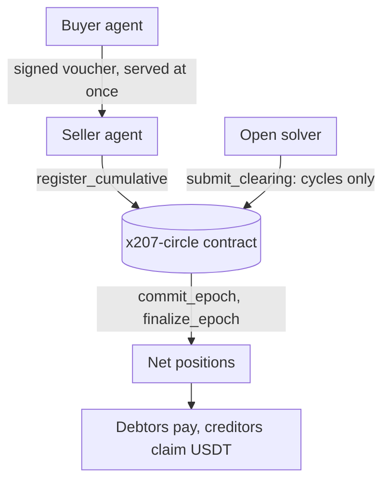
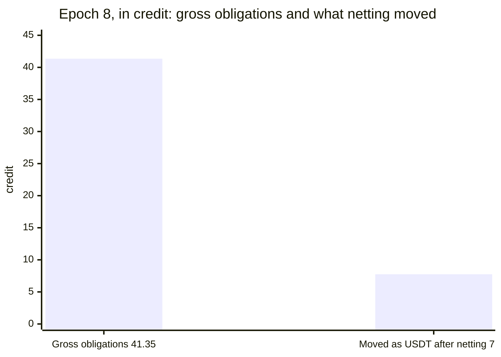

<p align="center">
  <picture>
    <source media="(prefers-color-scheme: dark)" srcset="brand/x207-logo-dark.svg">
    
  </picture>
</p>

# x207

x402 lets agents pay. x207 lets many agents settle at once.

[Dashboard](https://x207-dashboard.vercel.app) · [Read API](https://x207.boxd.sh/x207/circles/agents-main/epochs) · [MCP server](https://mcp.x207.boxd.sh/mcp) · [Claims and proof](CLAIMS.md) · [What has run](docs/what-has-run.md) · [Join the circle](docs/join-the-circle.md)

x207 is a multilateral netting and clearing layer for x402 agent payments on NEAR. Agents in a circle pay each other with signed vouchers, backed by a stake that bounds what each can owe; at the end of each epoch the circle contract nets every member's position in one on-chain step, so only the net positions are settled in USDT, and an open solver removes the debt cycles from the gross obligations in the same step. It is built as a binding of the x402 `batch-settlement` scheme on the network `x207:<circleId>`, and a buyer outside the circle can still pay with the `exact` scheme on NEAR. The binding is proposed upstream in [x402-foundation/x402#4131](https://github.com/x402-foundation/x402/issues/4131).

**What is new.** (1) A multi-party binding of the x402 `batch-settlement` scheme on NEAR, as far as we found (the proposal is [x402-foundation/x402#4131](https://github.com/x402-foundation/x402/issues/4131); nobody has accepted it yet). (2) Cumulative vouchers that are netted once per epoch across many buyers and sellers. (3) One stake covers sellers that are not known in advance, where a channel per seller needs a deposit for each ([the comparison, spike S1](docs/problem-and-gap.md#capital-per-seller-s1); with an exact forecast a channel locks less). (4) An EVM agent that signs with EIP-712 can join a circle: `join_evm` ran on NEAR testnet on the contract `x207-v014.testnet` (transaction [`GD92fvfjRMjmdRfDW3d8PqCft7GzPyiAGX6hLTjJ3E8A`](https://testnet.nearblocks.io/txns/GD92fvfjRMjmdRfDW3d8PqCft7GzPyiAGX6hLTjJ3E8A)). That transaction was signed with the public Hardhat test key #1: a technical proof only, not a demo agent; the official demo follows with a new key (SD-090). **The rest of the EVM flow (vouchers, claim, the demo) is in progress and not deployed**; see [docs/evm-agents.md](docs/evm-agents.md).

**Status.** Hackathon prototype for NEAR HACKATHON (1–14 Nov 2026). The contract (interface 0.0.13, release v0.0.13) runs as the circle `x207-v013.testnet` on NEAR testnet with a dashboard, a read API and an MCP server on top. The integration tests run in a local `near-sandbox`, and the end-to-end sandbox workflow of this repository passed on GitHub on 2026-11-04 for the commit `ced22b0`, all four shards ([run 41899663919](https://github.com/x207-labs/x207/actions/runs/41899663919)). **No mainnet transaction has been sent.** **The team's keeper moves the epochs of `x207-v013.testnet` until 2026-11-18.** A worker run by the team (`scripts/keeper.mjs`, on a boxd machine) calls `close_epoch`, `commit_epoch` and `finalize_epoch` after each cutoff, so the dashboard can show an epoch that has just passed its cutoff or is waiting in a window. After 2026-11-18 the worker is stopped; the contract has no paid keeper, and anybody can move the epoch: see [how to move an epoch yourself](docs/join-the-circle.md#move-the-epoch-yourself). The USDT on testnet is a **mock USDT** (testnet, `usdt.x207-deployer.testnet`): anybody can mint it, so no amount in this README is real money.

## The idea in one breath

Paying every call on its own costs one onchain transfer per call, and the usual fix, a payment channel per seller, needs a deposit per seller, sized before the sellers are known (the numbers are in [problem-and-gap.md](docs/problem-and-gap.md#capital-per-seller-s1)). x207 keeps the x402 flow and adds multilateral netting and cycle clearing: each member locks one stake in the circle, which bounds what it can owe to any seller (`limit ≤ stake`), pays each call with a signed voucher that is served at once, and at the end of the epoch the contract nets every member's position in one transaction, so only the net is paid. An open solver also cancels debts that go around in a circle (A owes B, B owes C, C owes A) in the record of gross obligations; in the MVP that does not change what anyone pays. It is not credit without cash, and it does not save gas on NEAR; the section below says what it does save. The gap in what exists today is in [docs/problem-and-gap.md](docs/problem-and-gap.md).

**What netting saves, what cycle clearing does, and what neither does.** In epoch 8 of the testnet circle, multilateral netting in the circle contract settled 24 vouchers worth 41.35 of obligations with 7.75 USDT moving (18.7%), with one debtor's share covered from its stake. That 7.75 is the net position of the members. It does not depend on the solver: epoch 16 had a single five-member cycle of 8 credit, no solver proposal (`cleared` 0), every net position 0, and nobody paid. Cycle clearing, the solver's job, cancelled 21.8 of the gross obligations in epoch 8. In the MVP it does not change who pays what, because net positions do not change when a cycle is removed. It gives a smaller record of gross obligations, and it is the basis for the loss allocation when a member defaults (P2) and for clearing across circles (roadmap, not built). The clearing fee and the solver fee are 0 since epoch 48 (DAO proposal 5 on `x207v8.sputnikv2.testnet`: add transaction `4EtU84Dg4RA3HYayPeysJYYQMaa8EBCZpK1wP4wr3e4X`, approvals `21qRz2xVaxYmrtKePKdbAgxo2ec3nbn1qzi34FR7F9NU` and `BYDPGpkBX7es4G2WUtzub3bnZ3F3D4FuZkWVvrRbW7kn`). The view `get_params` on `x207-v013.testnet` returned `clearing_fee_bps` 0 and `solver_fee_bps` 0 at block 276298961 on 2026-11-05; epoch 8 ran with the old fees of 10 and 5 bps. With fee 0 a solver earns nothing in the MVP, and the keeper is paid by the team. The residual of several debtors can be paid in one NEAR Intents call, and a creditor can withdraw to another chain (run in `near-sandbox` against the real Intents contract; not on testnet or mainnet, see [what-has-run.md](docs/what-has-run.md)). A member's limit grows from its cash settlement history, inside the bound `limit ≤ stake`. It does **not** save gas on NEAR: the epoch burnt 109.7 Tgas (226.6 with the 24 vouchers registered) against 54.9 Tgas for 24 plain transfers ([comparison](docs/gas-epoch8-vs-transfers.md)); by a model of the measured gas it starts to burn less only when a pair trades about 3 to 4 times or more in an epoch. It is **not** credit without cash: in the MVP a member locks capital of at least 125% of the debt it can run up, and in epoch 8 the members had 1,499.10 staked against 41.35 of obligations. Netting needs debts in both directions and cycle clearing needs a loop; a star graph, where everyone only pays one hub, gains nothing from either ([where cycles come from](docs/problem-and-gap.md#where-cycles-come-from)).



One paid call as a sequence, the epoch as a state machine, and the data flow: [diagrams in docs/architecture.md](docs/architecture.md#diagrams). Eight steps from stake to claim: [docs/overview.md](docs/overview.md). The contract checks every clearing a solver proposes, so nobody has to trust the solver: [solver](https://github.com/x207-labs/solver).

## Try it in 2 minutes

Three read-only steps, with nothing to install, no account and no key. The circle is shared testnet and anybody can add epochs, so the newest ones change; epoch 8 is fixed.

1. **Dashboard:** <https://x207-dashboard.vercel.app> opens, as of 2026-11-04, on epoch 8: members, obligation graph, clearing statistics, risk. Epoch 8 was run by the team's demo script from a team machine.
2. **Read API** (the same data as JSON, circle `agents-main` on `x207-v013.testnet`):

   ```bash
   curl -s https://x207.boxd.sh/x207/circles/agents-main/epochs
   curl -s https://x207.boxd.sh/x207/circles/agents-main/epochs/8/metrics
   ```

   The second call returns the numbers in the next section. `docs/testnet-0.0.13-realistic.json` is the recorded run behind them.
3. **Connect your AI agent** to the hosted MCP server (Streamable HTTP, read-only: six read tools, no key, no signing) and ask "Give me the report of epoch 8 of the x207 circle":

   ```bash
   claude mcp add --transport http x207 https://mcp.x207.boxd.sh/mcp
   ```

   Other clients, and `npx -y @x207/mcp` for a local stdio server: [docs/mcp.md](docs/mcp.md). Tested with the MCP Inspector; the client commands follow the documentation of each client and were not run with it.

The API, the MCP server and the dashboard are hosted for the judging period. If one does not answer, [Run it locally](#run-it-locally-5-minutes) runs the same contract and the same tools on a circle of its own and needs nothing hosted.

## What epoch 8 showed

The realistic testnet epoch, paid in the mock USDT (testnet, `usdt.x207-deployer.testnet`): 24 vouchers worth 41.35 credit became 14 settlement movements (the metric `residualTransfers`: one for each member whose net position is not zero, here six debtors paying in and eight creditors claiming out).



| Figure | Value |
| --- | --- |
| Obligations | 24 asymmetric obligations of 41.35 credit among 15 participants |
| Netting (the cash saving) | the net positions of the 15 members came to 7.75 USDT due from six debtors, and only 7.75 of the 41.35 credit moved as USDT (18.7%) |
| Paid | five debtors paid (7.2 USDT); the sixth (0.55 USDT, `m06`) defaulted and was covered from its stake |
| Cycle clearing (a separate line, not a step between the two figures above) | the solver cancelled 21.8 credit of the gross obligations, 52.7% of them (ratio 0.527), leaving 19.55 credit of gross obligations; the net positions did not change |

## Run it locally (5 minutes)

On your machine, in a local `near-sandbox`, with no account and no Rust. Needs Node 22.22.2 or newer, `git` and `tar`, on Linux (x64 or arm64) or macOS on Apple silicon. On another system the script stops at once and says so; the alternatives are in [docs/sandbox-demo.md](docs/sandbox-demo.md).

```bash
git clone --recurse-submodules https://github.com/x207-labs/x207.git && cd x207
npm ci && npm run build --workspaces --if-present
npm run demo:quick    # one epoch of six agents: joins, paid calls, clearing, residuals, claims; about 5 minutes, most of it the sandbox clock
npm run demo:mcp      # an AI agent through the MCP tools on a local circle; about 2 minutes, prints every tool call and what it answered
npm run demo:swarm    # six agents trade for four epochs; the keeper and the solver clear each epoch on their own; about 5 minutes
```

Each demo fetches what it needs the first time: the wasm of the release v0.0.13 from GitHub (its sha256 is checked against the number written in this repository) and the near-sandbox 2.13.4 binary.

Checks, a few seconds each: `npm run check:numbers` (every epoch 8 figure in this README, `CLAIMS.md` and `docs/submission/` against the recorded run, and the circle's parameters in the docs against `get_params`), `npm run check:claims` (every path, id, function and hash that [CLAIMS.md](CLAIMS.md) names exists), `npm run check:links` (every link of the Markdown files resolves) and `npm run check:pins` (all dependencies pinned exactly).

## What is proven, and what is not

| What | Result | Where to check |
| --- | --- | --- |
| Epoch 8 on testnet | Figures above; three of the eight creditors claimed | [docs/testnet.md](docs/testnet.md), [docs/testnet-0.0.13-realistic.json](docs/testnet-0.0.13-realistic.json) |
| Six named agents, a circle of their own (UM-124) | Not epoch 8. The six agents (`x207r-translator`, `x207r-summarizer`, `x207r-scraper`, `x207r-image`, `x207r-cleaner`, `x207r-gpu`) ran one epoch on a separate testnet circle, `x207-swarm.x207r-deploy.testnet` (circle id `swarm-demo`): 15 vouchers carrying 114 credit, clearing ratio 0.8684 (13 clearing edges), three debtors paid and three creditors claimed. The agents run in rule or mock mode, not as a swarm of language models | [docs/testnet-swarm.md](docs/testnet-swarm.md), [docs/testnet-swarm.json](docs/testnet-swarm.json) |
| Load test, epoch 2 | 210 obligations, four transactions: `submit_clearing` 28.0 Tgas, `commit_epoch` 69.4 Tgas | [contracts/docs/gas-and-cost.md](https://github.com/x207-labs/contracts/blob/main/docs/gas-and-cost.md) |
| The released contract | v0.0.13, wasm sha256 `b9327f2b5d64b1180ba76dd619c6091ae57b48964f520a784e366c131e787054`, reproducible build, code hash on chain `DTw5rUUdJSbWjD361MmBxKW4nm4ETnNkex63mfUCjsjh` | [release v0.0.13](https://github.com/x207-labs/contracts/releases/tag/v0.0.13) |
| 1Click quote | A withdrawal of 5 credit to USDC on Base was quoted live on 2026-11-04 with `dry: true` (BE-090): 4.989148 USDC out, no deposit address, no funds moved | [backend reference](https://github.com/x207-labs/backend/blob/main/docs/reference.md#live-quote-of-1click-be-090) |
| NEAR Intents | The residual of three debtors paid in one `execute_intents` of the real Intents contract (the wasm of `intents.near`) in `near-sandbox` | `tests/residual-batch.sandbox.test.ts` |
| The product around the contract | Dashboard, read API, MCP server, facilitator and solver, indexer with the 207 report, demo agents; each marketplace pipeline has an end-to-end test in `near-sandbox` | [docs/demo-blocks.md](docs/demo-blocks.md) |
| The threats | 21 threats, each with the test that pins its defence | [Threat model](docs/security-and-limits.md#threat-model) |

**What has not run:** mainnet, NEAR Intents on testnet (`intents.testnet` has no code), a real wallet through NEAR Connect on the dashboard, and the cases in the third column of [docs/what-has-run.md](docs/what-has-run.md). A test shows that a defence is pinned, not that the system is safe; the open limits are in [docs/security.md](docs/security.md).

**Keys.** An agent holds two kinds of key. Its **voucher key** is a separate ed25519 key that is no access key of any NEAR account: it signs only vouchers and cannot move funds, and a leaked one can create vouchers only up to the credit limit. Its **NEAR access key** is needed only for `join`, `settle` and `claim`, because these calls attach a deposit (0.35 NEAR for `join`, 1 yoctoNEAR for the stake, the residual and `claim`) and NEAR does not let a function-call key attach one, so that key must be a **full-access** key of the agent account. The MCP server keeps those three tools off until its operator sets `X207_ALLOW_FULL_ACCESS_KEY=1` (and `X207_ALLOW_OUTFLOWS=1` for `join` and `settle`); the owner of the agent holds the key, on a dedicated account that holds only what the agent may lose. The tools that pay, list, offer and accept use the voucher key alone. Details: [docs/security-and-limits.md](docs/security-and-limits.md#keys-of-an-agent).

## Where to read more

| Topic | File |
| --- | --- |
| What x207 is, the problem and the gap, how it works (F1 to F9) | [docs/overview.md](docs/overview.md), [docs/problem-and-gap.md](docs/problem-and-gap.md) (with [where cycles come from](docs/problem-and-gap.md#where-cycles-come-from), and why a star graph gains nothing), [docs/how-it-works.md](docs/how-it-works.md) |
| Join the circle on testnet with two fresh accounts; quickstart for an x402 agent owner | [docs/join-the-circle.md](docs/join-the-circle.md), [docs/quickstart.md](docs/quickstart.md) |
| The MCP server for AI agents | [docs/mcp.md](docs/mcp.md) |
| The testnet circle, and how to check an epoch | [docs/testnet.md](docs/testnet.md) |
| Every pipeline as "do X, see Y" with the test that runs it | [docs/demo-blocks.md](docs/demo-blocks.md) |
| Architecture and invariants | [docs/architecture.md](docs/architecture.md) |
| Security, limits, threat model | [docs/security-and-limits.md](docs/security-and-limits.md), [docs/security.md](docs/security.md) |
| Metrics and roadmap; judging criteria, tracks and glossary | [docs/metrics-and-roadmap.md](docs/metrics-and-roadmap.md), [docs/appendices.md](docs/appendices.md) |
| Sell over x402 on the circle | [sdk/docs/seller-quickstart.md](https://github.com/x207-labs/sdk/blob/main/docs/seller-quickstart.md) |
| Contract gas and storage; the contract against the real Intents wasm | [gas-measurements](https://github.com/x207-labs/contracts/blob/main/docs/gas-measurements.md), [real-intents-test](https://github.com/x207-labs/contracts/blob/main/docs/real-intents-test.md) |
| Read API reference: limits, OpenAPI, health, metrics | [backend/docs/reference.md](https://github.com/x207-labs/backend/blob/main/docs/reference.md) |
| Why a solver needs no trust and its gas; barter matching and random checks | [gas-and-trust](https://github.com/x207-labs/solver/blob/main/docs/gas-and-trust.md), [barter-and-spot-checks](https://github.com/x207-labs/solver/blob/main/docs/barter-and-spot-checks.md) |
| Third-party libraries and services | [docs/third-party.md](docs/third-party.md) |

## Repositories

| Repo | Its role in x207 |
| --- | --- |
| [x207](https://github.com/x207-labs/x207) | This umbrella: docs, demos, end-to-end tests, scripts |
| [contracts](https://github.com/x207-labs/contracts) | The `x207-circle` contract in Rust (interface 0.0.13), near-sandbox tests, Sputnik DAO scripts |
| [sdk](https://github.com/x207-labs/sdk) | `@x207/core`, `@x207/scheme`, `@x207/mcp`, the binding spec, test vectors, reference facilitator |
| [backend](https://github.com/x207-labs/backend) | Indexer, read API, HTTP 207 report, settlement worker, marketplace book, access broker |
| [frontend](https://github.com/x207-labs/frontend) | The dashboard and the marketplace pages |
| [solver](https://github.com/x207-labs/solver) | The open clearing solver, barter matching and the seeker |
| [agents](https://github.com/x207-labs/agents) | The demo agents and their scenarios |

The six product repositories are git submodules of this one. `vault`, the design notes, is private.

## Hackathon disclosures

**Code written with AI help.** The code, tests and documents of this project were written with AI coding assistants: Claude Code (Anthropic) in several parallel sessions, each working on one repository under a human owner who set the design, reviewed the results and decided what to publish. Many commits carry a `Co-Authored-By: Claude` trailer. Every number in this README comes from a run or a file named next to it; where a run did not happen, the text says so.

**Code start.** All code of the project was written from 2026-11-01, inside the build window. The first commit of the umbrella is `c708b8a` (2026-11-01); the first commits of `contracts` and `sdk` are `1d908c4` and `5580759` (both 2026-11-01).

**License.** Apache-2.0 for every repository of the project: see [LICENSE](LICENSE). **Third-party code:** all open source, used as libraries or hosted endpoints, none copied in; the list is in [docs/third-party.md](docs/third-party.md).
