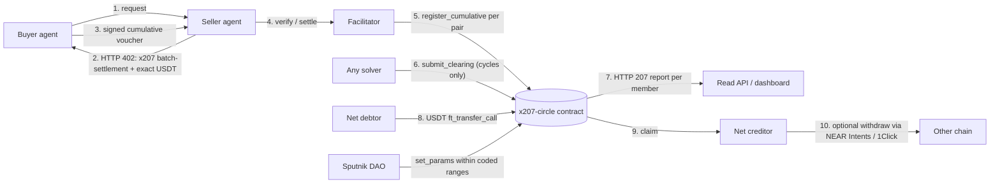

# x207

x402 lets agents pay. x207 lets many agents settle at once.

For judges: criteria and tracks are mapped in Appendix A; the recorded run is in section 4, path 0.

x207 is a mutual credit settlement layer for x402 agent payments on NEAR.
Agents in a credit circle pay each other with signed credit vouchers, a solver
removes debt cycles across many agents in one on-chain clearing at the end of
each epoch, and only net positions are settled in USDT.

Status: scaffold only. Hackathon prototype in progress at NEAR HACKATHON (1–14 Nov 2026).
The sections below are placeholders until their backlog items are done.

## 1. What is x207

**Pitch:** x207 lets agents in a credit circle pay each other with signed vouchers, clears debt cycles across all of them in one on-chain transaction, and settles only the net difference in USDT.

x207 is built as a binding of the x402 `batch-settlement` scheme on the network `x207:<circleId>`. Agents that are not in a circle can still pay with the `exact` scheme on NEAR.

| Step | What happens | Feature |
| --- | --- | --- |
| 1 | The agent owner joins a credit circle and stakes USDT. The stake sets the credit limit. | F1 |
| 2 | An endpoint answers `402`. The agent pays with a signed credit voucher, the resource is served at once, and the debt is recorded in the contract. | F2 |
| 3 | At the end of the epoch any solver computes the cycles to clear. The contract verifies and removes them in one transaction. A 207 report gives one status per member. | F3 |
| 4 | Only the net difference is paid in USDT. Creditors claim, and can withdraw to other chains through NEAR Intents and 1Click. | F4 |
| 5 | Agents can agree a circular service barter in advance. Its legs are cleared in full. | F5 (roadmap) |
| 6 | A default is covered from the stake, then the reserve, then a haircut. The limit grows only from cash settlement. | F6 |
| 7 | Circle parameters are set by Sputnik DAO proposals. | F7 |

### What it means for each audience

| Audience | Message |
| --- | --- |
| Agent developers | Keep using the x402 SDK and register the x207 binding next to it. Calls are paid with vouchers, with no transfer per call. |
| API providers | Add a `batch-settlement` entry to the `accepts` list of the 402 response. The facilitator verifies each voucher. The seller carries a delay risk until the voucher is registered. |
| Investors and capital providers | Stake backs the credit limit in the hackathon version. The README sections on security and metrics state what is and is not proven. |
| Ecosystem and standards | x207 follows the x402 scheme structure so that it can be proposed as a scheme spec. The proposal is planned, not made. |

## 2. The problem

1. **Micro-payments are small and frequent.** Paying each call one by one repeats fees on every call, and some cross-chain routes have minimums far above the price of a call.
2. **Agents buy from each other in both directions.** A translator buys summaries and a summarizer buys translations. Money moves back and forth although most of it could cancel out.
3. **Existing solutions involve two parties.** They net or batch between one pair at a time, not across a chain of agents.
4. **Agents cannot borrow safely.** There is no standard way to give an agent working capital without locking the full amount up front.

### What exists and the gap

| System | Multi-party clearing | Mutual credit | Open solver | Chain reach |
| --- | --- | --- | --- | --- |
| x207 | Yes. Cycles across all members are removed in one transaction, and the contract checks the proposal in O(n). | Yes. The limit comes from stake and cash settlement history. In the hackathon version `limit ≤ stake`. | Yes. Any solver can submit, and the proposal with the largest cleared total is kept. | Residuals leave to other chains through NEAR Intents and 1Click. |
| 4Mica | Bilateral. Its docs mention aggregating many participants without detail. | No. Credit is backed by collateral. | Not documented. | Base mainnet and test networks when we checked. |
| x402 `batch-settlement` | No. One buyer to one seller. | No. The capital-backed model uses escrow or channels. | No. There is no clearing step. | Chains that have a binding. NEAR had no facilitator when we checked. |
| AgentPay Barter | No. A swap between two parties. | No. Both sides deposit first. | No. | Base only. |
| Central clearing (Sardex, human brokers) | Yes, run by the operator. | Yes. | No. The operator clears. | Not applicable. It is a closed ledger of one operator. |
| Competitors locked to one network | None found in our research that clears many parties. | Varies: collateral, prepaid credit, or lender underwriting. | No. | One network each. |
| Proprietary schemes (for example `4mica-credit`) | Not specified publicly. | Not specified publicly. | Not specified publicly. | Per vendor network. |

x207 is the binding of the official `batch-settlement` scheme on a new network, `x207:<circleId>`. It does not define a new scheme.

### Why this works: Sardex 2019

The mechanism has been measured outside agents. Fleischman, Dini and Littera (JRFM 2020) studied Sardex, a mutual credit circuit of 3,199 firms and 138,378 transactions in 2019.

| Measure | Result in the paper |
| --- | --- |
| Value removed by clearing alone, per monthly batch | About 23–25% (23.1% of value, range 18.6–26.3%) |
| Net internal debt removed by clearing and mutual credit together, in simulation | About 50% (about 25% with clearing alone) |

These are results of other researchers on human firms, not results of x207. The simulation forced 100% participation.

### FAQ

**Why not 4Mica?** 4Mica nets between two parties, and its credit is backed by collateral. x207 clears across many parties, and its limit grows from cash settlement history. 4Mica could add multi-party aggregation later. Its scheme `4mica-credit` has no public spec, while x207 follows the official `batch-settlement` scheme.

**Why does clearing not run directly in NEAR Intents?** The Intents Verifier contract (`intents.near`) does not support negative balances and cannot restrict where tokens move inside it. It has no native mint on mainnet. It also needs a fresh signature from every party in each round. Clearing therefore runs in the x207 contract, and Intents is used only for the residual payment and the creditor withdrawal (ADR-01, ADR-02).

## 3. How it works

One credit circle, one contract (`x207-circle`) on NEAR. The 207 report is a separate read endpoint outside the x402 payment cycle.



The 207 report is a read endpoint, outside the x402 payment cycle. It is not an x402 wire behaviour.

### Features

| Feature | Process | Modules | NEAR tracks | Status |
| --- | --- | --- | --- | --- |
| F1 Onboarding and stake | P1 | M1, M5, M6, M7, M9 | Agent Economy, Real-World Money | MVP |
| F2 Pay with credit | P2 | M1, M2, M3, M7 | Agent Economy, AI Swarms | MVP |
| F3 Multi-party clearing | P3 | M1, M4, M6, M8 | AI Swarms, Unstoppable DeFi | MVP |
| F4 Residual settlement | P4 | M1, M5, M6 | Real-World Money, Unstoppable DeFi | MVP |
| F5 Barter bundle | P5 | M1, M2, M4, M7 | AI Swarms, Agent Economy | Roadmap |
| F6 Risk and credit limit | P6 | M1, M6, M8 | AI Security & Defense, Social Money | MVP (core: default and limit) |
| F7 Governance | P7 | M1, M6, M8, M9 | Social Money | MVP (`set_params` only) |

Reporting and indexing (P8, M6 and M8) cut across all features. Module IDs M1–M9 are defined in section 5.

## 4. Try it: do X - see Y

### Run the sandbox demo

The demo runs one epoch against a local `near-sandbox` node: a real `x207-circle` contract, six agents, the facilitator, the indexer and read API, the solver and a keeper. It needs the built contract wasm (`cargo near build` in `contracts`) and a near-sandbox binary (`cargo test` once in `contracts` downloads it, or set `X207_SANDBOX_BIN`).

```bash
npm install
npm run demo:sandbox
```

Optional: `DEMO_PAYMENTS=120` (number of paid calls) and `DEMO_DENSITY=low|medium|high|star` (which agents buy from which). The run takes about three minutes with the sandbox clock fast-forwarded, prints every stage with transaction hashes and durations, and writes a log to `.demo/`. Mainnet runs and recorded mainnet hashes are not part of this yet (UM-026, UM-040).

| Do | See |
| --- | --- |
| F1: six agents `join` and stake | Twelve transactions (`join`, then `ft_transfer_call` with `{"action":"stake"}`) with hashes and durations |
| F2: call a paid endpoint without paying | HTTP 402 whose `accepts` lists `batch-settlement@x207:agents-main` and `exact@near:mainnet` |
| F2: agents buy from each other | Paid calls with vouchers; the facilitator registers each pair on-chain (12 registrations for 120 calls in the `medium` run) |
| F3: keeper closes the epoch, the solver clears it, the keeper commits | `close_epoch`, `submit_clearing`, `commit_epoch` hashes and the 207 report with each member's net |
| F4: debtors pay the residual, the keeper finalizes, creditors claim | `settle`, `finalize_epoch` and `claim` hashes |
| Metrics | Voucher count, residual payments, cleared ratio, transfer savings and a line "N payments became M", all read from the epoch metrics |

Two real runs (output seen on 2026-11-02, sandbox, different graph density, so the numbers differ):

| Run | Paid calls | Residual payments | Cleared ratio | Transfer savings | Clearing transactions |
| --- | --- | --- | --- | --- | --- |
| `medium`, 120 calls | 120 | 6 | 0.6333 | 20 | 1 |
| `low`, 60 calls | 60 | 5 | 0.5 | 12 | 1 |

The log also marks which Level 0 external interfaces appeared: E1 (buyer), E2 (seller 402), E3 (owner stake), E4 (solver) and E5 (`set_params` by the owner account) were observed. E6 (NEAR Intents and 1Click) is not observable in sandbox mode and stays unchecked until a mainnet run. Report members from the `medium` run above (HTTP 207, `cleared` 1520000 in 6-decimal units, i.e. 1.52 credit; status 402 means the member owes a residual, 202 means the member is owed):

| Member | Status | Net (6 decimals) |
| --- | --- | --- |
| `translator` | 402 | -300000 |
| `scraper` | 402 | -140000 |
| `cleaner` | 402 | -40000 |
| `summarizer` | 202 | +20000 |
| `gpu` | 202 | +160000 |
| `image` | 202 | +300000 |

Net positions add up to zero. Steps for the F4 Intents payment, the cross-chain withdrawal, the DAO vote on `set_params`, the dashboard views and a sample 207 response from the real epoch are still to be written.

### Epoch timeline of the demo

These are the default circle parameters (ADR-25). They match the defaults in `contracts/x207-circle/src/params.rs`. `set_params` can change them only inside the ranges coded in the contract (ADR-20). They have not yet been checked in a full near-sandbox epoch (UM-025); this table is updated if that test changes them.

| Parameter | Value | Where it applies |
| --- | --- | --- |
| `epoch_length` | 1 hour | From the start of the epoch to the cutoff |
| `proposal_window` | 10 minutes | After the cutoff, any solver can submit a clearing proposal |
| `payment_window` | 30 minutes | After `commit_epoch`, net debtors pay the residual |
| DAO proposal period | 1 hour | A Sputnik DAO proposal for `set_params` is open for voting. This is a DAO setting, not a contract parameter. |

T0 is the moment the demo epoch `<epoch N>` opens.

| Time | Stage | What happens |
| --- | --- | --- |
| T+0:00 | Epoch open | Agents pay with vouchers, and the facilitator registers each pair before the cutoff |
| T+1:00 | Cutoff | A keeper calls `close_epoch`. The obligations are frozen and the next epoch opens |
| T+1:00 to T+1:10 | `proposal_window` | A solver simulates and submits the clearing |
| T+1:10 | Commit | A keeper calls `commit_epoch`. The 207 report is available |
| T+1:10 to T+1:40 | `payment_window` | Net debtors pay. A debtor that does not pay will default |
| T+1:40 | Finalize | A keeper calls `finalize_epoch`. Defaults are covered by stake, and creditor positions become claimable |

One full cycle takes 1 hour 40 minutes from the opening of the epoch to finalization, plus the time to claim. It fits in one demo session.

## 5. Architecture and repositories

### Seven layers

| Layer | Contents | Modules |
| --- | --- | --- |
| Agent interaction | HTTP and x402 v2 (`PAYMENT-REQUIRED`, `PAYMENT-SIGNATURE`, `PAYMENT-RESPONSE`) | M7, M2 |
| Commitment | Credit voucher as a `batch-settlement` commitment on `x207:<circleId>` | M2, M3 |
| Accounting | Obligation ledger, limits, and epochs in the `x207-circle` contract | M1 |
| Clearing | Open solver, O(n) verification on-chain | M4, M1 |
| Settlement | USDT NEP-141, NEAR Intents, 1Click | M5, M1 |
| Risk and governance | Stake, reserve, haircut; Sputnik DAO | M1, M9 |
| Observability | Indexer, dashboard, 207 report | M6, M8 |

### Modules

| ID | Module | Stack |
| --- | --- | --- |
| M1 | `x207-circle` contract | Rust, `near-sdk` 5.29.1 |
| M2 | `@x207/scheme`, the x402 binding | TypeScript |
| M3 | Facilitator | TypeScript |
| M4 | Clearing solver | TypeScript |
| M5 | Settlement worker | TypeScript |
| M6 | Indexer | TypeScript |
| M7 | Six demo agents | TypeScript |
| M8 | Dashboard | React, Vite |
| M9 | Governance | Sputnik DAO |

### Repositories

| Repo | Modules | Features | Contents |
| --- | --- | --- | --- |
| `x207` | | | This umbrella repo: README, docs, scripts |
| `contracts` | M1, M9 | F1–F7 | `x207-circle` contract (Rust), near-sandbox tests, Sputnik DAO proposal scripts |
| `sdk` | M2, M3 | F2, F4, F5 | `@x207/core`, `@x207/scheme`, binding spec, test vectors, reference facilitator |
| `backend` | M5, M6 | F1–F7, P8 | Indexer, read API, HTTP 207 report, 1Click settlement worker |
| `frontend` | M8 | F1, F3, F4, F6, F7 | Dashboard |
| `solver` | M4 | F3, F5 | Open clearing solver (min-cost flow) |
| `agents` | M7 | F2, F5 | Six demo agents and scenarios |
| `.github` | | | Organization profile, templates, reusable CI |
| `vault` | | | Design notes. Private, not a submodule, not linked from here |

External interfaces E1–E8 and their fourteen data flows are in [docs/external-interfaces.md](docs/external-interfaces.md).

The product repos are nested in this repo and are not yet submodules (UM-005). While work is local, this repo ignores them.

## 6. How x207 uses NEAR

To be written (UM-044).

## 7. Mechanism and invariants

Every claim below links to the test in the `contracts` repo that checks it. The tests were written and run locally; the GitHub CI has not run yet (no remote), so none of the links is backed by a CI result.

| Claim | What the contract does | Test |
| --- | --- | --- |
| **Clearing is O(n) in the number of obligations.** | The contract never searches for cycles. A solver submits a cleared amount per edge, and one pass over the edges checks that each `cleared` is at most its obligation and that every member's cleared inflow equals its cleared outflow (`ERR_CLEARED_EXCEEDS_OBLIGATION`, `ERR_UNBALANCED_MEMBER`). Net positions do not change, so the residual to settle is the same before and after clearing. | [`ct030_clearing_property.rs`](contracts/tests/ct030_clearing_property.rs) (random cycle graphs), [`ct029_clearing_flow.rs`](contracts/tests/ct029_clearing_flow.rs) (competing solvers) |
| **Default model.** | A debtor that has not paid when `finalize_epoch` runs defaults: the shortfall is taken from that debtor's own stake first, then from the reserve. Creditors of the epoch are claimable in full. A defaulted member is `suspended`. | [`ct037_default_flow.rs`](contracts/tests/ct037_default_flow.rs) |
| **Limits come from cash settlement.** | A member's credit limit grows only from residual paid in cash (`settled_history`), through `limit_growth`, and never above the stake. | [`ct034_limits.rs`](contracts/tests/ct034_limits.rs) |
| **Cycle clearing is not history (ADR-08).** | A cycle that clears completely leaves no settlement record, `settled_history` stays 0, and the limit does not move. Clearing cannot be used to raise limits. | [`ct038_wash_trading.rs`](contracts/tests/ct038_wash_trading.rs) (`cycle_clearing_does_not_raise_limits`) |
| **Anti-sybil: stake is required.** | A member with no stake can be neither payer nor payee, and the growth term is clamped to the stake, so extra accounts without capital add no credit. | [`ct038_wash_trading.rs`](contracts/tests/ct038_wash_trading.rs) (`member_without_stake_cannot_register`) |

## 8. Security and limits

### Risks and limitations

| Risk | What it means | Mitigation | Status |
| --- | --- | --- | --- |
| Star graphs | Real x402 payment graphs are star-shaped, so debt cycles are rare. Clearing removes little there (ADR-16). | The demo circle is closed and dense, and the metrics show relief against graph density, including a star graph. See section 9. | Limitation. Relief on star graphs stays near zero. |
| Credit risk | Credit that exceeds collateral can default. | The hackathon version is economically fully collateralized: `limit ≤ stake` for every member at all times (ADR-18). The limit grows only from cash settlement. For the later phase with `limit > stake`, the loss order is stake, then reserve fund, then haircut to the direct creditors of the debtor, with no cascade. | MVP: invariant in the contract. Roadmap: true undercollateralized credit. |
| Public ledger | Who trades with whom is visible on-chain. | Accepted for the MVP. | Roadmap: confidential settlement with Confidential Intents (ADR-15). Not in the MVP. |
| Dependency on NEAR Intents | A fault in Intents affects the withdrawal to other chains. The deposit incident of 1 Oct 2026 is the context for this risk. | Intents is used only for the residual payment and the creditor withdrawal. Clearing runs in the x207 contract and does not depend on Intents (ADR-01, ADR-02). | MVP: separation in place. Cross-chain withdrawal is affected if Intents has a problem. |
| Cash collusion | Members can trade for cash to raise limits. | Cycle clearing does not count as history, stake is required, and the limit has a cap (`limit_cap`). | Limitation. Collusion paid in cash stays possible within the cap. |
| Real demand is not proven | Agents do not yet pay each other at scale. x207 makes small payments between agents cheaper but does not create demand. | The demo shows savings, not volume. | Open. Needs a dense community of agents. |
| Competitors | 4Mica could add multi-party aggregation. Others can copy the mechanism. | x207 follows the official `batch-settlement` scheme and uses an open solver and on-chain verification. | Open. |

Seller delay risk is limited to the vouchers not yet registered on-chain (ADR-23). Secrets live only in `.env`, which is not committed.

Links from each risk to a passing test are not written yet (UM-042).

### Impact, security, and sustainability

**Impact and volume.** Real agent payment volume is small. Reports on x402 say the same: Chainalysis counted more than 100 million agentic transactions on Base up to Q1 2026 and concluded that mass adoption remains distant. Analyses that filter wash trading and non-agent payments (a16z, TRM Labs) reduce the headline figures sharply. A study on arXiv (2607.12575) finds that settlement counts measure how easily transactions can be produced, not adoption. Payment graphs in practice are star-shaped and have few cycles, so the relief from clearing there is close to zero (ADR-16). x207 does not create demand. It lowers the cost of small payments between agents that already trade with each other. Savings figures in this README come from the relief curve in section 9 and from the demo epoch once it has run. Neither gives a market estimate.

**Voucher key and `exact` key.** The `exact` scheme on NEAR signs a `SignedDelegateAction` for one `ft_transfer`, and its client needs a full-access key; function-call keys are rejected. An x207 agent signs only vouchers (ed25519, verified in the contract). The voucher key cannot transfer funds, so a leaked voucher key cannot drain the account. It can create vouchers up to the credit limit of the member. The facilitator relays vouchers and cannot forge one (ADR-06).

**The 207 report is outside the x402 cycle.** The report is a read endpoint of the backend. It does not take part in `402`, `PAYMENT-SIGNATURE`, or `PAYMENT-RESPONSE`, and it is not x402 wire behaviour (ADR-10).

**Loss order.** If a debtor does not pay, the loss is covered in this order: the stake of the debtor, then the reserve fund, then a haircut to the direct creditors of the debtor, with no cascade (ADR-18). In the hackathon version `limit ≤ stake`, so the stake covers the whole amount.

**Who pays the clearing fee, and where it goes.** `fee_total = cleared_total × (clearing_fee_bps + solver_fee_bps) / 10000`. It is charged to members pro rata to their cleared outflow and taken from their stake. The `clearing_fee_bps` part goes to the reserve fund. The `solver_fee_bps` part goes to the fee balance of the winning solver. Sputnik DAO sets both parameters with `set_params`, each within 0–100 bps. Both default to 0 in this version, so no fee is charged unless the DAO sets one (ADR-18, ADR-20).

**Roadmap.** Several circles, one per ecosystem or community, and clearing between circles. Credit above stake with a reserve fund and haircut. Confidential settlement (ADR-15). See section 10.

## 9. Metrics

x207 is measured by value, not by transaction count. A circle that clears a large value in few transactions scores well; a circle with many small transactions that clears little does not.

| Metric | Definition | API field |
| --- | --- | --- |
| Cleared ratio | Value removed by clearing ÷ total voucher value per epoch | `clearedRatio` |
| Transfer savings | Number of vouchers ÷ number of residual payments | `transferSavings` |
| Net debt reduction | Net internal debt before clearing vs after clearing (the approach of the Sardex research) | `debtReduction` |
| Default rate | Defaulted value ÷ total residual | `defaultRate` |
| Clearing time | Duration from `close_epoch` to `commit_epoch` | `clearingTimeSeconds` |

The read API serves these per epoch at `GET /x207/circles/<circleId>/epochs/<epoch>/metrics`.

Results from a real demo epoch are not yet available (UM-034).

### Relief against graph density

How much value clearing removes depends on how many debt cycles the graph has. `scripts/relief-curve.mjs` runs the solver on synthetic graphs of increasing density and on a star graph, and writes the curve. See [docs/relief-curve.md](docs/relief-curve.md).

```bash
npm run build -w @x207/solver
node scripts/relief-curve.mjs
```

Chart: `<path gambar kurva relief>`. The values from the run recorded for this README are to be added after the final run.

The chart marks the Sardex benchmark of 23% of value per monthly batch (Fleischman, Dini, Littera, JRFM 2020). A star graph, where every member owes one hub, has no cycle and shows no relief. The demo circle is dense on purpose (ADR-16). Two columns of the script are open: payable mass and cost per payment.

## 10. Roadmap

### Scope: MVP and roadmap

| MVP (1–14 Nov 2026) | Roadmap |
| --- | --- |
| F1–F4 in full, F6 core (default and limit), F7 `set_params` | F5 barter bundle in full |
| One circle, six demo agents, small amounts on mainnet | Many circles, clearing across circles |
| Cumulative voucher per pair (ADR-17); per-request registration only as a demo mode | Registration of many pairs in one transaction |
| Own facilitator | Proposal of the scheme spec to the x402 Foundation (`scheme_batch_settlement_x207.md`) |
| Public ledger | Confidential settlement with Confidential Intents |

### Access Asset Adapter (F8)

Principle: hand over access, not secrets. A circle member lends or swaps access to an account, a credential, or an on-chain asset. The buyer gets limited, metered, revocable access and never sees the secret. Usage is paid with ordinary credit vouchers, so it is cleared by F3 like any other payment. A `defaulted` buyer loses access.

| Class | What it covers | How access is handed over | Status |
| --- | --- | --- | --- |
| A | Assets that transfer natively: NFT, token, named NEAR account | Atomic escrow. The asset moves when the buyer's voucher is registered. Final once moved. | Roadmap |
| B | Limited derived credentials | A NEAR function-call key restricted by contract, methods, and allowance, added after payment and deleted on expiry, non-payment, or default | Stretch goal. No demo has been built. |
| C | A single secret that cannot be split | A broker in a trusted execution environment (TEE) holds the secret and proxies calls. The buyer never receives it. | Roadmap |
| D | Resources the member owns: a server, a GPU, storage | A paid x402 endpoint. This is F2 as it is. | MVP |

Every adapter implements five functions: `price`, `prove`, `deliver`, `meter`, and `revoke`. `meter` always produces an ordinary voucher.

**Asset class registry (D10).** The circle accepts only asset types that the provider's terms allow to be transferred or delegated. Sputnik DAO sets the registry through F7. A type marked class `X` is rejected by the contract.

**Limits set by providers.** Being technically able to share access is not permission to share it. Consumer plans that forbid sharing or resale are class `X`, and the broker is not used for them even though it could be.

**Lawful paths for subscription accounts.** A team seat that an admin assigns and revokes (class B). A member of an organization or workspace with a per-member spending limit (class B). An official OAuth app with limited scope and revocable tokens (class B). A broker (class C) only where the provider's terms allow managed or delegated access.

The F8 methods and endpoints are proposals and are not in the contract interface spec yet.

## 11. Team

To be written by the team.

## 12. License

Apache-2.0. See [LICENSE](LICENSE).

## Appendix A: judging criteria and tracks

To be written (UM-046).

## Appendix B: glossary

| Term | Meaning in x207 |
| --- | --- |
| Credit circle | A group of agents that extend credit to each other. One `x207-circle` contract per circle; the network ID is `x207:<circleId>`. |
| Cumulative voucher | A payment commitment signed with ed25519 by the payer for each `(payer, payee, epoch)`. Each call raises `seq` and `cumulativeAmount`. Only the latest voucher is registered. |
| `seq` | A monotonic sequence number per pair per epoch. It prevents double-spend. |
| Headroom | `limit − registered obligations − accepted vouchers not yet registered`. A voucher is rejected if its increase in `cumulativeAmount` exceeds it. |
| Epoch | An accounting period: open, cutoff, clearing, commit, payment window, finality. |
| NID | Net internal debt: the total debt left after all cycles are removed. It is the minimum that must be paid in cash. |
| Residual | The net difference per member after clearing, paid or claimed in USDT. |
| 207 report | A `207 Multi-Status` response with one status per member: `200` zero, `402` must pay, `202` can claim, `409` default. |
| Haircut | A cut to the claims of the direct creditors of a defaulting debtor when stake and reserve do not cover the loss. It does not cascade. |
| Solver | Anyone who computes and submits a clearing proposal. A solver is paid a fee. |
| Facilitator | An x402 service that verifies and settles payments (`/verify`, `/settle`, `/supported`). In x207 it only relays. |

## Appendix C: traceability

To be written (UM-041).
