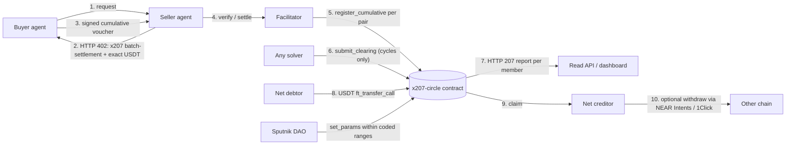

# x207

x402 lets agents pay. x207 lets many agents settle at once.

For judges: criteria and tracks are mapped in Appendix A; the recorded run is in section 4, path 0.

x207 is a mutual credit settlement layer for x402 agent payments on NEAR.
Agents in a credit circle pay each other with signed credit vouchers, a solver
removes debt cycles across many agents in one on-chain clearing at the end of
each epoch, and only net positions are settled in USDT.

Status: scaffold only. Hackathon prototype in progress at NEAR HACKATHON (1–14 Nov 2026).
The sections below are placeholders until their backlog items are done.

## 1. What is x207

**Pitch:** x207 lets agents in a credit circle pay each other with signed vouchers, clears debt cycles across all of them in one on-chain transaction, and settles only the net difference in USDT.

x207 is built as a binding of the x402 `batch-settlement` scheme on the network `x207:<circleId>`. Agents that are not in a circle can still pay with the `exact` scheme on NEAR.

| Step | What happens | Feature |
| --- | --- | --- |
| 1 | The agent owner joins a credit circle and stakes USDT. The stake sets the credit limit. | F1 |
| 2 | An endpoint answers `402`. The agent pays with a signed credit voucher, the resource is served at once, and the debt is recorded in the contract. | F2 |
| 3 | At the end of the epoch any solver computes the cycles to clear. The contract verifies and removes them in one transaction. A 207 report gives one status per member. | F3 |
| 4 | Only the net difference is paid in USDT. Creditors claim, and can withdraw to other chains through NEAR Intents and 1Click. | F4 |
| 5 | Agents can agree a circular service barter in advance. Its legs are cleared in full. | F5 (roadmap) |
| 6 | A default is covered from the stake, then the reserve, then a haircut. The limit grows only from cash settlement. | F6 |
| 7 | Circle parameters are set by Sputnik DAO proposals. | F7 |

### What it means for each audience

| Audience | Message |
| --- | --- |
| Agent developers | Keep using the x402 SDK and register the x207 binding next to it. Calls are paid with vouchers, with no transfer per call. |
| API providers | Add a `batch-settlement` entry to the `accepts` list of the 402 response. The facilitator verifies each voucher. The seller carries a delay risk until the voucher is registered. |
| Investors and capital providers | Stake backs the credit limit in the hackathon version. The README sections on security and metrics state what is and is not proven. |
| Ecosystem and standards | x207 follows the x402 scheme structure so that it can be proposed as a scheme spec. The proposal is planned, not made. |

## 2. The problem

1. **Micro-payments are small and frequent.** Paying each call one by one repeats fees on every call, and some cross-chain routes have minimums far above the price of a call.
2. **Agents buy from each other in both directions.** A translator buys summaries and a summarizer buys translations. Money moves back and forth although most of it could cancel out.
3. **Existing solutions involve two parties.** They net or batch between one pair at a time, not across a chain of agents.
4. **Agents cannot borrow safely.** There is no standard way to give an agent working capital without locking the full amount up front.

The comparison with existing systems ("What exists and the gap") is to be written (UM-016).

## 3. How it works

One credit circle, one contract (`x207-circle`) on NEAR. The 207 report is a separate read endpoint outside the x402 payment cycle.

The 207 report is a read endpoint, outside the x402 payment cycle. It is not an x402 wire behaviour.

### Features

| Feature | Process | Modules | NEAR tracks | Status |
| --- | --- | --- | --- | --- |
| F1 Onboarding and stake | P1 | M1, M5, M6, M7, M9 | Agent Economy, Real-World Money | MVP |
| F2 Pay with credit | P2 | M1, M2, M3, M7 | Agent Economy, AI Swarms | MVP |
| F3 Multi-party clearing | P3 | M1, M4, M6, M8 | AI Swarms, Unstoppable DeFi | MVP |
| F4 Residual settlement | P4 | M1, M5, M6 | Real-World Money, Unstoppable DeFi | MVP |
| F5 Barter bundle | P5 | M1, M2, M4, M7 | AI Swarms, Agent Economy | Roadmap |
| F6 Risk and credit limit | P6 | M1, M6, M8 | AI Security & Defense, Social Money | MVP (core: default and limit) |
| F7 Governance | P7 | M1, M6, M8, M9 | Social Money | MVP (`set_params` only) |

Reporting and indexing (P8, M6 and M8) cut across all features. Module IDs M1–M9 are defined in section 5.

## 4. Try it: do X - see Y

To be written (UM-031, UM-039, UM-040).

## 5. Architecture and repositories

### Seven layers

| Layer | Contents | Modules |
| --- | --- | --- |
| Agent interaction | HTTP and x402 v2 (`PAYMENT-REQUIRED`, `PAYMENT-SIGNATURE`, `PAYMENT-RESPONSE`) | M7, M2 |
| Commitment | Credit voucher as a `batch-settlement` commitment on `x207:<circleId>` | M2, M3 |
| Accounting | Obligation ledger, limits, and epochs in the `x207-circle` contract | M1 |
| Clearing | Open solver, O(n) verification on-chain | M4, M1 |
| Settlement | USDT NEP-141, NEAR Intents, 1Click | M5, M1 |
| Risk and governance | Stake, reserve, haircut; Sputnik DAO | M1, M9 |
| Observability | Indexer, dashboard, 207 report | M6, M8 |

### Modules

| ID | Module | Stack |
| --- | --- | --- |
| M1 | `x207-circle` contract | Rust, `near-sdk` 5.29.1 |
| M2 | `@x207/scheme`, the x402 binding | TypeScript |
| M3 | Facilitator | TypeScript |
| M4 | Clearing solver | TypeScript |
| M5 | Settlement worker | TypeScript |
| M6 | Indexer | TypeScript |
| M7 | Six demo agents | TypeScript |
| M8 | Dashboard | React, Vite |
| M9 | Governance | Sputnik DAO |

### Repositories

| Repo | Modules | Features | Contents |
| --- | --- | --- | --- |
| `x207` | | | This umbrella repo: README, docs, scripts |
| `contracts` | M1, M9 | F1–F7 | `x207-circle` contract (Rust), near-sandbox tests, Sputnik DAO proposal scripts |
| `sdk` | M2, M3 | F2, F4, F5 | `@x207/core`, `@x207/scheme`, binding spec, test vectors, reference facilitator |
| `backend` | M5, M6 | F1–F7, P8 | Indexer, read API, HTTP 207 report, 1Click settlement worker |
| `frontend` | M8 | F1, F3, F4, F6, F7 | Dashboard |
| `solver` | M4 | F3, F5 | Open clearing solver (min-cost flow) |
| `agents` | M7 | F2, F5 | Six demo agents and scenarios |
| `.github` | | | Organization profile, templates, reusable CI |
| `vault` | | | Design notes. Private, not a submodule, not linked from here |

External interfaces E1–E8 and their fourteen data flows are in [docs/external-interfaces.md](docs/external-interfaces.md).

The product repos are nested in this repo and are not yet submodules (UM-005). While work is local, this repo ignores them.

## 6. How x207 uses NEAR

To be written (UM-044).

## 7. Mechanism and invariants

To be written (UM-043).

## 8. Security and limits

To be written (UM-017, UM-042, UM-045).

## 9. Metrics

x207 is measured by value, not by transaction count. A circle that clears a large value in few transactions scores well; a circle with many small transactions that clears little does not.

| Metric | Definition | API field |
| --- | --- | --- |
| Cleared ratio | Value removed by clearing ÷ total voucher value per epoch | `clearedRatio` |
| Transfer savings | Number of vouchers ÷ number of residual payments | `transferSavings` |
| Net debt reduction | Net internal debt before clearing vs after clearing (the approach of the Sardex research) | `debtReduction` |
| Default rate | Defaulted value ÷ total residual | `defaultRate` |
| Clearing time | Duration from `close_epoch` to `commit_epoch` | `clearingTimeSeconds` |

The read API serves these per epoch at `GET /x207/circles/<circleId>/epochs/<epoch>/metrics`.

Results from a real demo epoch are not yet available (UM-034, UM-038).

## 10. Roadmap

### Scope: MVP and roadmap

| MVP (1–14 Nov 2026) | Roadmap |
| --- | --- |
| F1–F4 in full, F6 core (default and limit), F7 `set_params` | F5 barter bundle in full |
| One circle, six demo agents, small amounts on mainnet | Many circles, clearing across circles |
| Cumulative voucher per pair (ADR-17); per-request registration only as a demo mode | Registration of many pairs in one transaction |
| Own facilitator | Proposal of the scheme spec to the x402 Foundation (`scheme_batch_settlement_x207.md`) |
| Public ledger | Confidential settlement with Confidential Intents |

The F8 adapter for access assets is not described here yet (UM-061).

## 11. Team

To be written by the team.

## 12. License

Apache-2.0. See [LICENSE](LICENSE).

## Appendix A: judging criteria and tracks

To be written (UM-046).

## Appendix B: glossary

| Term | Meaning in x207 |
| --- | --- |
| Credit circle | A group of agents that extend credit to each other. One `x207-circle` contract per circle; the network ID is `x207:<circleId>`. |
| Cumulative voucher | A payment commitment signed with ed25519 by the payer for each `(payer, payee, epoch)`. Each call raises `seq` and `cumulativeAmount`. Only the latest voucher is registered. |
| `seq` | A monotonic sequence number per pair per epoch. It prevents double-spend. |
| Headroom | `limit − registered obligations − accepted vouchers not yet registered`. A voucher is rejected if its increase in `cumulativeAmount` exceeds it. |
| Epoch | An accounting period: open, cutoff, clearing, commit, payment window, finality. |
| NID | Net internal debt: the total debt left after all cycles are removed. It is the minimum that must be paid in cash. |
| Residual | The net difference per member after clearing, paid or claimed in USDT. |
| 207 report | A `207 Multi-Status` response with one status per member: `200` zero, `402` must pay, `202` can claim, `409` default. |
| Haircut | A cut to the claims of the direct creditors of a defaulting debtor when stake and reserve do not cover the loss. It does not cascade. |
| Solver | Anyone who computes and submits a clearing proposal. A solver is paid a fee. |
| Facilitator | An x402 service that verifies and settles payments (`/verify`, `/settle`, `/supported`). In x207 it only relays. |

## Appendix C: traceability

To be written (UM-041).
