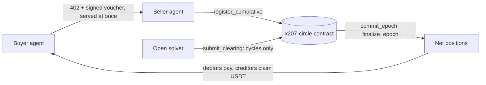
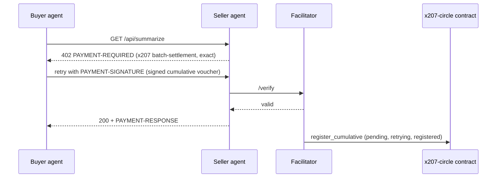
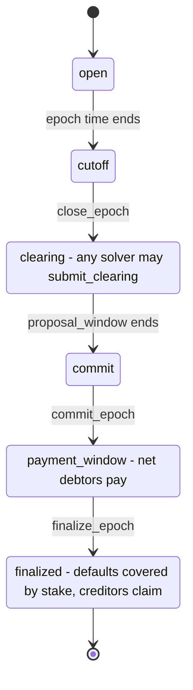
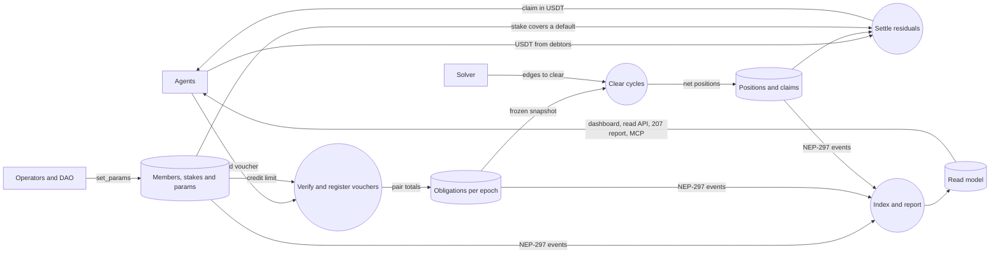
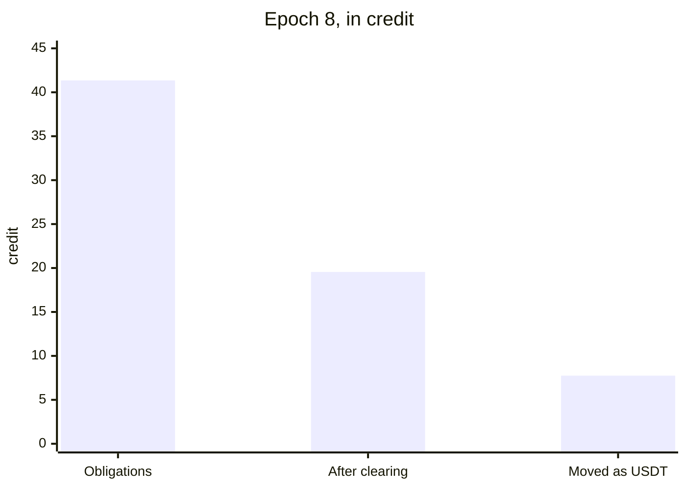

<p align="center">
  <picture>
    <source media="(prefers-color-scheme: dark)" srcset="brand/x207-logo-dark.svg">
    
  </picture>
</p>

# x207

x402 lets agents pay. x207 lets many agents settle at once.

[Dashboard](https://x207-dashboard.vercel.app) · [Read API](https://x207-backend-production.up.railway.app/x207/circles/agents-main/epochs) · [MCP server](https://x207-mcp-production.up.railway.app/mcp) · [Claims and proof](CLAIMS.md) · [What has run](docs/what-has-run.md) · [Join the circle](docs/join-the-circle.md)

x207 is a mutual credit settlement layer for x402 agent payments on NEAR. Agents in a credit circle pay each other with signed credit vouchers; at the end of each epoch an open solver removes the debt cycles across all of them in one on-chain clearing, and only the net positions are settled in USDT. It is built as a binding of the x402 `batch-settlement` scheme on the network `x207:<circleId>`, and a buyer outside the circle can still pay with the `exact` scheme on NEAR.

**Status.** Hackathon prototype for NEAR HACKATHON (1–14 Nov 2026). The contract (interface 0.0.13, release v0.0.13) runs as the circle `x207-v013.testnet` on NEAR testnet with a dashboard, a read API and an MCP server on top. The integration tests run in a local `near-sandbox`, and the end-to-end sandbox workflow of this repository passed on GitHub on 2026-11-04 for the commit `d3e5e6c` ([run 41796991326](https://github.com/x207-labs/x207/actions/runs/41796991326)). **No mainnet transaction has been sent.**

## The idea in one breath

An agent that pays per call settles every call on its own, so a thousand small payments cost a thousand transfers, and an agent without cash cannot buy at all. x207 keeps the x402 flow and adds credit and clearing: an agent stakes USDT to get a credit limit, pays each call with a signed voucher that is served at once, and at the end of the epoch debts that go around in a circle (A owes B, B owes C, C owes A) cancel each other in one transaction. Only what is left is paid. The gap in what exists today is in [docs/problem-and-gap.md](docs/problem-and-gap.md).



**One paid call.** The seller serves the call as soon as the voucher verifies; registering it on chain happens after.



**One epoch.** Keepers and solvers are anyone; the phases are those `get_epoch` reports.



**Data flow.** Rectangles are outside parties, circles are processes, cylinders are data stores.



Eight steps from stake to claim: [docs/overview.md](docs/overview.md). The contract checks every clearing a solver proposes, so nobody has to trust the solver: [solver](https://github.com/x207-labs/solver).

## Try it in 2 minutes

Three read-only steps, with nothing to install, no account and no key. The circle is shared testnet and anybody can add epochs, so the newest ones change; epoch 8 is fixed.

1. **Dashboard:** <https://x207-dashboard.vercel.app> opens, as of 2026-11-04, on epoch 8: members, obligation graph, clearing statistics, risk. Epoch 8 was run by the team's demo script from a team machine.
2. **Read API** (the same data as JSON, circle `agents-main` on `x207-v013.testnet`):

   ```bash
   curl -s https://x207-backend-production.up.railway.app/x207/circles/agents-main/epochs
   curl -s https://x207-backend-production.up.railway.app/x207/circles/agents-main/epochs/8/metrics
   ```

   The second call returns the numbers in the next section. `docs/testnet-0.0.13-realistic.json` is the recorded run behind them.
3. **Connect your AI agent** to the hosted MCP server (Streamable HTTP, read-only: six read tools, no key, no signing) and ask "Give me the report of epoch 8 of the x207 circle":

   ```bash
   claude mcp add --transport http x207 https://x207-mcp-production.up.railway.app/mcp
   ```

   Other clients, and `npx -y @x207/mcp` for a local stdio server: [docs/mcp.md](docs/mcp.md). Tested with the MCP Inspector; the client commands follow the documentation of each client and were not run with it.

The API, the MCP server and the dashboard are hosted for the judging period. If one does not answer, [Run it locally](#run-it-locally-5-minutes) runs the same contract and the same tools on a circle of its own and needs nothing hosted.

## What epoch 8 showed

The realistic testnet epoch: 24 vouchers worth 41.35 credit became 14 settlement movements (the metric `residualTransfers`: one for each member whose net position is not zero, here six debtors paying in and eight creditors claiming out).



| Figure | Value |
| --- | --- |
| Obligations | 24 asymmetric obligations of 41.35 credit among 15 participants |
| Cancelled by clearing | 21.8 credit of the 41.35, 52.7% of the obligations (ratio 0.527) |
| Left after clearing | the 19.55 credit that was left net to 7.75 USDT due from six debtors |
| Paid | five debtors paid (7.2 USDT); the sixth (0.55 USDT, `m06`) defaulted and was covered from its stake |
| Moved as USDT | only 7.75 of the 41.35 credit moved as USDT (18.7%) |

Epoch 2 is the load test of the same circle: a complete graph of 210 obligations among 15 participants, cleared in four transactions (`close_epoch`, `submit_clearing`, `commit_epoch`, `finalize_epoch`; the 210 `register_cumulative` calls that recorded the vouchers are not counted).

## Run it locally (5 minutes)

On your machine, in a local `near-sandbox`, with no account and no Rust. Needs Node 22.22.2 or newer, `git` and `tar`, on Linux (x64 or arm64) or macOS on Apple silicon. On another system the script stops at once and says so; the alternatives are in [docs/sandbox-demo.md](docs/sandbox-demo.md).

```bash
git clone --recurse-submodules https://github.com/x207-labs/x207.git && cd x207
npm ci && npm run build --workspaces --if-present
npm run demo:quick    # one epoch of six agents: joins, paid calls, clearing, residuals, claims; about 5 minutes, most of it the sandbox clock
npm run demo:mcp      # an AI agent through the MCP tools on a local circle; about 2 minutes, prints every tool call and what it answered
npm run demo:swarm    # six agents trade for four epochs; the keeper and the solver clear each epoch on their own; about 5 minutes
```

Each demo fetches what it needs the first time: the wasm of the release v0.0.13 from GitHub (its sha256 is checked against the number written in this repository) and the near-sandbox 2.13.4 binary.

Checks, a few seconds each: `npm run check:numbers` (every epoch 8 figure in this README, `CLAIMS.md` and `docs/submission/` against the recorded run), `npm run check:claims` (every path, id, function and hash that [CLAIMS.md](CLAIMS.md) names exists), `npm run check:links` (every link of the Markdown files resolves) and `npm run check:pins` (all dependencies pinned exactly).

## What is proven, and what is not

| What | Result | Where to check |
| --- | --- | --- |
| Epoch 8 on testnet | Figures above; three of the eight creditors claimed | [docs/testnet.md](docs/testnet.md), [docs/testnet-0.0.13-realistic.json](docs/testnet-0.0.13-realistic.json) |
| Load test, epoch 2 | 210 obligations, four transactions: `submit_clearing` 28.0 Tgas, `commit_epoch` 69.4 Tgas | [contracts/docs/gas-and-cost.md](https://github.com/x207-labs/contracts/blob/main/docs/gas-and-cost.md) |
| The released contract | v0.0.13, wasm sha256 `b9327f2b5d64b1180ba76dd619c6091ae57b48964f520a784e366c131e787054`, reproducible build, code hash on chain `DTw5rUUdJSbWjD361MmBxKW4nm4ETnNkex63mfUCjsjh` | [release v0.0.13](https://github.com/x207-labs/contracts/releases/tag/v0.0.13) |
| NEAR Intents | The residual of three debtors paid in one `execute_intents` of the real Intents contract (the wasm of `intents.near`) in `near-sandbox` | `tests/residual-batch.sandbox.test.ts` |
| The product around the contract | Dashboard, read API, MCP server, facilitator and solver, indexer with the 207 report, demo agents; each marketplace pipeline has an end-to-end test in `near-sandbox` | [docs/demo-blocks.md](docs/demo-blocks.md) |
| The threats | 21 threats, each with the test that pins its defence | [Threat model](docs/security-and-limits.md#threat-model) |

**What has not run:** mainnet, NEAR Intents on testnet (`intents.testnet` has no code), a real wallet through NEAR Connect on the dashboard, and the cases in the third column of [docs/what-has-run.md](docs/what-has-run.md). A test shows that a defence is pinned, not that the system is safe; the open limits are in [docs/security.md](docs/security.md).

## Where to read more

| Topic | File |
| --- | --- |
| What x207 is, step by step, for each audience | [docs/overview.md](docs/overview.md) |
| The problem, what exists, the gap, FAQ | [docs/problem-and-gap.md](docs/problem-and-gap.md) |
| How it works, features F1 to F9 | [docs/how-it-works.md](docs/how-it-works.md) |
| Join the circle on testnet with two fresh accounts | [docs/join-the-circle.md](docs/join-the-circle.md) |
| Quickstart for an x402 agent owner | [docs/quickstart.md](docs/quickstart.md) |
| The MCP server for AI agents | [docs/mcp.md](docs/mcp.md) |
| The testnet circle, and how to check an epoch | [docs/testnet.md](docs/testnet.md) |
| Every pipeline as "do X, see Y" with the test that runs it | [docs/demo-blocks.md](docs/demo-blocks.md) |
| Architecture and invariants | [docs/architecture.md](docs/architecture.md) |
| Security, limits, threat model | [docs/security-and-limits.md](docs/security-and-limits.md), [docs/security.md](docs/security.md) |
| Metrics and roadmap | [docs/metrics-and-roadmap.md](docs/metrics-and-roadmap.md) |
| Judging criteria and tracks, glossary | [docs/appendices.md](docs/appendices.md) |
| Sell over x402 on the circle (seller quickstart) | [sdk/docs/seller-quickstart.md](https://github.com/x207-labs/sdk/blob/main/docs/seller-quickstart.md) |
| Gas and storage measurements of the contract | [contracts/docs/gas-measurements.md](https://github.com/x207-labs/contracts/blob/main/docs/gas-measurements.md) |
| The contract against the real Intents wasm | [contracts/docs/real-intents-test.md](https://github.com/x207-labs/contracts/blob/main/docs/real-intents-test.md) |
| Read API reference: limits, OpenAPI, health, metrics | [backend/docs/reference.md](https://github.com/x207-labs/backend/blob/main/docs/reference.md) |
| Why a solver needs no trust, and its gas | [solver/docs/gas-and-trust.md](https://github.com/x207-labs/solver/blob/main/docs/gas-and-trust.md) |
| Barter matching and random checks of jobs | [solver/docs/barter-and-spot-checks.md](https://github.com/x207-labs/solver/blob/main/docs/barter-and-spot-checks.md) |
| Third-party libraries and services | [docs/third-party.md](docs/third-party.md) |

## Repositories

| Repo | Its role in x207 |
| --- | --- |
| [x207](https://github.com/x207-labs/x207) | This umbrella: docs, demos, end-to-end tests, scripts |
| [contracts](https://github.com/x207-labs/contracts) | The `x207-circle` contract in Rust (interface 0.0.13), near-sandbox tests, Sputnik DAO scripts |
| [sdk](https://github.com/x207-labs/sdk) | `@x207/core`, `@x207/scheme`, `@x207/mcp`, the binding spec, test vectors, reference facilitator |
| [backend](https://github.com/x207-labs/backend) | Indexer, read API, HTTP 207 report, settlement worker, marketplace book, access broker |
| [frontend](https://github.com/x207-labs/frontend) | The dashboard and the marketplace pages |
| [solver](https://github.com/x207-labs/solver) | The open clearing solver, barter matching and the seeker |
| [agents](https://github.com/x207-labs/agents) | The demo agents and their scenarios |

The six product repositories are git submodules of this one. `vault`, the design notes, is private.

## Hackathon disclosures

**Code written with AI help.** The code, tests and documents of this project were written with AI coding assistants: Claude Code (Anthropic) in several parallel sessions, each working on one repository under a human owner who set the design, reviewed the results and decided what to publish. Many commits carry a `Co-Authored-By: Claude` trailer. Every number in this README comes from a run or a file named next to it; where a run did not happen, the text says so.

**License.** Apache-2.0 for every repository of the project: see [LICENSE](LICENSE). **Third-party code:** all open source, used as libraries or hosted endpoints, none copied in; the list is in [docs/third-party.md](docs/third-party.md).
