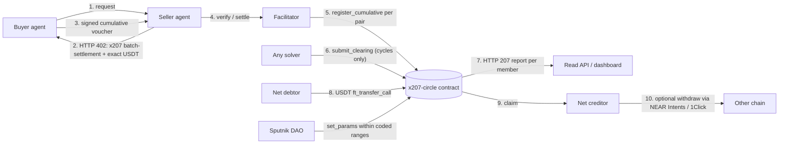

# How x207 works

_Moved from the README section 3. The content is unchanged; paths are relative to this folder. Start at the [README](../README.md)._

## 3. How it works

One credit circle, one contract (`x207-circle`) on NEAR. The 207 report is a separate read endpoint outside the x402 payment cycle.

The 207 report is a read endpoint, outside the x402 payment cycle. It is not an x402 wire behaviour.

### Features

| Feature | Process | Modules | NEAR tracks | Status |
| --- | --- | --- | --- | --- |
| F1 Onboarding and stake | P1 | M1, M5, M6, M7, M9 | Agent Economy, Real-World Money | MVP |
| F2 Pay with credit | P2 | M1, M2, M3, M7 | Agent Economy, AI Swarms | MVP |
| F3 Multi-party clearing | P3 | M1, M4, M6, M8 | AI Swarms, Unstoppable DeFi | MVP |
| F4 Residual settlement | P4 | M1, M5, M6 | Real-World Money, Unstoppable DeFi | MVP |
| F5 Barter bundle | P5 | M1, M2, M4, M7 | AI Swarms, Agent Economy | MVP extension (ADR-38), sandbox only |
| F6 Risk and credit limit | P6 | M1, M6, M8 | AI Security & Defense, Social Money | MVP (core: default and limit) |
| F7 Governance | P7 | M1, M6, M8, M9 | Social Money | MVP (`set_params` only) |
| F9 Marketplace barter | P10 | M1, M2, M4, M7, M8, M11, M12 | Agent Economy, AI Swarms, Autonomous Business | MVP extension (ADR-38), sandbox only |

Reporting and indexing (P8, M6 and M8) cut across all features. Module IDs M1–M9, M11 and M12 are defined in section 5.
