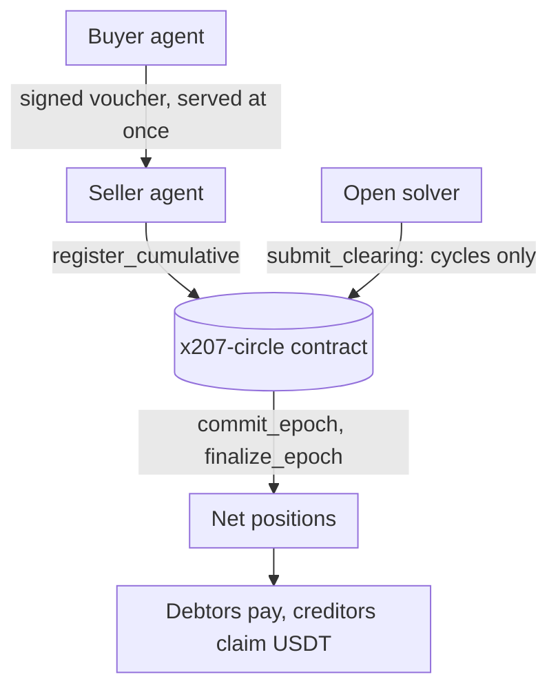

# x207

**x402 lets agents pay. x207 lets many agents settle at once.**

[Dashboard](https://x207-dashboard.vercel.app) · [Read API](https://x207.boxd.sh/x207/circles/agents-main/epochs) · [MCP server](https://mcp.x207.boxd.sh/mcp) · [Start here: x207-labs/x207](https://github.com/x207-labs/x207)

x207 is a multilateral clearing layer for x402 agent payments on NEAR. Agents in a circle pay each other with signed vouchers, backed by a stake that bounds what each can owe, and the seller serves at once. At the end of each epoch an open solver removes the debt cycles across all of them in one on-chain clearing, and only the net positions settle in USDT. The binding of the x402 `batch-settlement` scheme is proposed upstream in [x402-foundation/x402#4131](https://github.com/x402-foundation/x402/issues/4131).

## What has run

On NEAR testnet, in the circle `x207-v013.testnet` (contract release v0.0.13), a realistic epoch of 24 vouchers worth 41.35 credit cleared 21.8 credit (ratio 0.527) and left 7.75 USDT to move; five of six debtors paid and one defaulted and was covered from its stake. Everything is checked by scripts in the umbrella repository.

## What it does not do

- **Testnet only.** No mainnet transaction has been sent. The USDT is a mock token that anybody can mint, so no amount here is real money.
- **It does not save gas on NEAR.** The epoch burnt 109.7 Tgas against 54.9 Tgas for 24 plain transfers. What clearing reduces is the value that has to move: 7.75 USDT of 41.35 credit of obligations.
- **It is not credit without cash.** A member locks a stake of at least 125% of the debt it can run up; a default is covered from that stake.
- **It only helps where debts go in cycles.** A star graph, where everybody owes one hub, gains nothing.
- **The team's keeper moves the epochs of the testnet circle until 2026-11-18.** After that anybody can move them by hand.

## Try it

1. Open the [dashboard](https://x207-dashboard.vercel.app): read-only, no account.
2. Ask an AI client about the circle through the [MCP server](https://github.com/x207-labs/x207/blob/main/docs/mcp.md): hosted and read-only, or `npx -y @x207/mcp` (0.0.4), also in the Official MCP Registry as `io.github.x207-labs/x207-mcp`.
3. Or run everything on your machine in a local sandbox: `npm run demo:quick` in the [umbrella](https://github.com/x207-labs/x207#run-it-locally-5-minutes).

## Repositories

| Repository | Its role |
| --- | --- |
| [`x207`](https://github.com/x207-labs/x207) | Umbrella: the story, the proof table, docs, demos, end-to-end tests, scripts |
| [`contracts`](https://github.com/x207-labs/contracts) | The `x207-circle` contract (Rust): members, vouchers, clearing, settlement; Sputnik DAO scripts |
| [`sdk`](https://github.com/x207-labs/sdk) | `@x207/core`, `@x207/scheme`, `@x207/mcp` on npm; the binding spec and test vectors; a reference facilitator |
| [`backend`](https://github.com/x207-labs/backend) | Indexer, read API, HTTP 207 report, settlement worker, marketplace book, access broker |
| [`frontend`](https://github.com/x207-labs/frontend) | The dashboard: obligation graph, clearing statistics, 207 report, risk, governance |
| [`solver`](https://github.com/x207-labs/solver) | The open clearing solver (min-cost flow), barter matching and the seeker |
| [`agents`](https://github.com/x207-labs/agents) | Six demo agents built only on the public SDK |
| `vault` | Design notes (private) |

Built for NEAR HACKATHON, 1–14 Nov 2026. Licensed under Apache-2.0.
